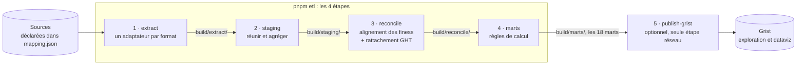

# datahub, l'ETL de la part des trajets via les plateformes

datahub calcule la part des trajets sanitaires réalisés via les plateformes : au
numérateur les trajets qu'elles déclarent, au dénominateur le référentiel national de
remboursement. Le résultat est ventilé par établissement ou GHT, par année, par type de
transport et par enveloppe, et sort en dix-huit marts CSV. Un pipeline de cinq étapes les
produit à partir des fichiers déclarés dans `mapping.json`, la dernière les publiant dans
Grist pour la dataviz. Le métier (ce que le calcul veut dire, les règles de rapprochement)
est dans [`docs/knowledge/domain/etl-part-plateformes.md`](docs/knowledge/domain/etl-part-plateformes.md),
les livrables et leurs limites d'interprétation dans [`spec/`](spec/), qui fait autorité.
Ce README ne traite que de l'exécution.

> **Code public, données et fournisseurs privés.** Le code de l'ETL est générique : il ne
> connaît que des rôles (`plateforme`, `referentiel-national`, `referentiel-ght`) et des
> formats de fichier, jamais l'identité d'un fournisseur ni la moindre donnée.
> L'association entre les fichiers réels, avec leurs fournisseurs, et ces formats et rôles
> vit dans `mapping.json`, qui n'est pas versionné. Voir
> [Confidentialité](#confidentialité).

## Vue d'ensemble



Les quatre premières étapes sont locales et déterministes ; la cinquième, optionnelle,
publie les marts dans [Grist](#publication-dataviz).

## Où lire le métier

| Document | Ce qu'il porte |
|---|---|
| [`docs/knowledge/domain/etl-part-plateformes.md`](docs/knowledge/domain/etl-part-plateformes.md) | Ce que le calcul veut dire, et les règles de rapprochement des sources. |
| [`spec/livrables.md`](spec/livrables.md) | Les dix-huit marts : grain, colonnes, ce que chacun sait et ne sait pas dire. |
| [`spec/points-attention-metier.md`](spec/points-attention-metier.md) | Les propriétés de la donnée et les règles de gestion à connaître avant de citer un chiffre. |

---

## Commandes

Une fois, après `pnpm install`, copier `mapping.example.json` vers `mapping.json`
et y renseigner les fichiers d'entrée (voir ci-dessous).

| Commande | Ce qu'elle fait |
|---|---|
| `pnpm etl` | enchaîne les quatre premières étapes et régénère `build/` |
| `pnpm extract`, `pnpm staging`, `pnpm reconcile`, `pnpm marts` | lance une étape seule, dans cet ordre |
| `pnpm publish-grist` | optionnel : publie les marts dans Grist (voir [Publication](README.md#publication-dataviz)) |
| `pnpm fetch-ght` | rafraîchit le référentiel GHT versionné dans `ref/ght/`, hors chaîne |
| `pnpm test` | les tests unitaires, avec vitest |
| `pnpm verifier` | lint, typecheck, knip et tests. La CI en passe les étapes une à une |

Node 24 exécute le TypeScript nativement, il n'y a aucun build. SheetJS lit les
`.xlsx`. Les quatre premières étapes n'ont aucun accès réseau : tous les référentiels
publics sont versionnés dans `ref/`. Seuls `pnpm publish-grist` et `pnpm fetch-ght`
parlent au réseau, et `fetch-ght` n'est pas nécessaire au fonctionnement.

**Les tests n'ont pas de mock**, et **aucune donnée réelle n'entre dans les
fixtures**.

## Configuration des entrées — `mapping.json`

`mapping.json`, qui n'est pas versionné et dont le gabarit est `mapping.example.json`,
déclare chaque fichier d'entrée : son emplacement, son rôle et son format. L'ETL se
comporte de manière générique quels que soient les fichiers fournis.

```json
[
  {
    "role": "referentiel-national",
    "format": "referentiel-remboursement-xlsx",
    "location": "data/reference-nationale.xlsx",
    "label": "reference-1"
  },
  {
    "role": "plateforme",
    "format": "plateforme-finess-tsv",
    "location": "data/plateforme-a.csv",
    "label": "plateforme-a",
    "plateforme": "Plateforme A",
    "options": { "colFinessJuridique": 1, "colFinessGeographique": 0 }
  }
]
```

| Champ | Requis | Rôle |
|---|---|---|
| `role` | oui | `referentiel-national` pour le dénominateur hors article 80, `plateforme` pour le numérateur, `referentiel-ght` pour le rattachement finess vers GHT en open data, cf. [Référentiels](#référentiels-ref) |
| `format` | oui | nomme un adaptateur enregistré dans `src/01-extract/adapteurs/registry.ts`, cf. le tableau des formats ci-dessous |
| `location` | oui | chemin du fichier, absolu ou relatif à la racine de l'app |
| `label` | oui | identifiant neutre et unique, qui nomme les artefacts de traçabilité |
| `plateforme` | non | nom affiché dans la colonne `plateforme` des marts. N'a de sens que pour le rôle `plateforme` et **n'existe nulle part dans le code versionné** : c'est ici, dans un fichier non versionné, que le nom d'un fournisseur est autorisé. Absent, la colonne retombe sur le `label` |
| `cibles` | non | les [cibles](#publier-pour-une-cible) où cette plateforme figure, par exemple `["partenaire-a"]`. N'a de sens que pour le rôle `plateforme`. Absent, la plateforme ne figure que dans le périmètre complet |
| `options` | non | paramètres propres au format, par exemple les index de colonnes finess pour le TSV. C'est ce qui permet à plusieurs fichiers de partager un adaptateur |

Une entrée invalide (rôle, format, location ou label manquant, format inconnu) fait
échouer l'ETL avec un message explicite.

| `format` | Ce qu'il lit |
|---|---|
| `referentiel-remboursement-xlsx` | le référentiel national de remboursement, xlsx à double en-tête : une bande de colonnes véhicule par période. Ne couvre que le hors article 80 |
| `plateforme-finess-tsv` | un CSV UTF-16 tabulé au grain établissement. Les colonnes finess variant d'un fichier à l'autre, elles sont passées en `options` : `colFinessJuridique`, `colFinessGeographique` |
| `plateforme-finess-xlsx` | un xlsx au grain établissement, en-têtes multi-niveaux et une colonne par année, portant l'article 80 en total et le hors article 80 en détail partiel, taxi, VSL et ambulance. Le reliquat, la différence entre le total et le détail, est imputé à `Autre` pour boucler le total annoncé |
| `plateforme-ght-xlsx` | un xlsx **hiérarchique** : une ligne fille, reconnue à son préfixe `« - »`, porte son finess juridique en fin de libellé ; une ligne parente porte un libellé libre. Un parent qui a des filles est ignoré, sauf pour son détail véhicule quand aucune de ses filles n'en porte. Cf. le [point 6](spec/points-attention-metier.md#6-plateforme-hiérarchique--une-couverture-au-finess-partielle) |
| `ght-fhir-datagouv` | les bundles FHIR du jeu open data `etablissements-de-sante-par-ght`, dont la `location` est le dossier `ref/ght/`. Sortie : une dimension finess juridique vers GHT, aucun trajet |

## Pipeline & artefacts

Toute la connaissance propre à une source est dans l'adaptateur de son format, déclaré
dans `src/01-extract/adapteurs/registry.ts`. Les étapes suivantes sont génériques et ne
raisonnent que sur les rôles.

| Étape | Responsabilité | Entrée → sortie |
|---|---|---|
| `extract`   | appliquer à chaque fichier l'**adaptateur de son format** → lignes normalisées (rôle + nomenclature canonique), puis **rétablir le zéro de tête** des finess tronqués | `mapping.json`, sources → `build/extract/` |
| `staging`   | **réunir** les sources et **agréger** au grain canonique | `build/extract/trajets/` → `build/staging/trajets.csv` |
| `reconcile` | poser les **clés** : dimension établissements ; **alignement des finess** des trajets sur le référentiel, qui fait autorité ; rattachement au GHT | `build/extract/`, `build/staging/` → `build/reconcile/` |
| `marts`     | appliquer les **règles de calcul** (part / volumes), à chaque grain | `build/reconcile/` → `build/marts/` |

| Artefact | Étape | Description |
|---|---|---|
| `build/extract/trajets/<label>.csv` | extract | Trajets d'une source, décodés et normalisés (schéma : `src/contrats.ts`). |
| `build/extract/etablissements.csv` | extract | Identité des établissements (émise par les référentiels), un par site. |
| `build/extract/ght.csv` | extract | Rattachement finess juridique → GHT, dérivé des bundles `ref/ght/`. |
| `build/staging/trajets.csv` | staging | Toutes les sources réunies et agrégées au grain canonique. |
| `build/reconcile/etablissements.csv` | reconcile | Libellé représentatif de chaque établissement, pour habiller les marts. |
| `build/reconcile/trajets.csv` | reconcile | Trajets aux **finess alignés sur le référentiel** et **rattachés au GHT**. Base commune des marts. |
| `build/marts/mart_*.csv` | marts | Les **18 [livrables](spec/livrables.md)**. |

## Publication (dataviz)

C'est une étape optionnelle, hors des 4 étapes de l'ETL, et la seule étape réseau, en
écriture. Elle pousse les marts dans Grist pour les explorer et bâtir la dataviz. Ce que
chaque table donne à lire, et à quel grain, est décrit dans
[`spec/livrables.md`](spec/livrables.md).

```bash
pnpm publish-grist            # tous les marts publiables
pnpm publish-grist ght_2025   # un seul (par son nom court)
```

La configuration passe par l'environnement. Un `.env` est lu automatiquement s'il existe,
sinon on prend les variables du shell.

| Variable | Rôle |
|---|---|
| `GRIST_DOC_URL` | Base API du doc **dédié dataviz** (≠ doc d'identification), ex. `https://…/api/docs/<docId>` |
| `GRIST_API_KEY` | Clé API Grist |
| `GRIST_DOC_URL_<NOM>` | Base API du doc d'une [cible](#publier-pour-une-cible), une variable par cible |

Chaque mart publiable déclare ses colonnes dans `marts()`
(`src/05-publish/publish.ts`) : ajouter un mart revient à ajouter une ligne. Pour chacun,
la publication garantit la table, en la créant avec ses colonnes si elle est absente et en
complétant les colonnes manquantes, puis remplace tout son contenu, en le vidant et en
réinsérant. La sémantique est celle d'un snapshot : idempotente, sans lignes périmées, et
relançable après chaque `pnpm marts`.

La publication ne touche pas à l'arborescence des pages : Grist crée une page à la racine
pour chaque table nouvelle, et elle y reste. Ranger la barre latérale, si le besoin s'en
fait sentir, se fait à la main dans Grist.

Le fichier et la table se déduisent du nom court : `hors_ght` lit `mart_hors_ght.csv` et
alimente `Mart_Hors_Ght`.

⚠️ Le mart contient de vrais établissements, cf. [Confidentialité](#confidentialité) : le
doc Grist cible doit rester privé.

⚠️ `publish-grist` n'a **aucune reprise sur erreur**. Comme chaque table est vidée avant
d'être réinsérée par lots, une coupure en cours de mart laisse la table vide ou partielle,
et la relance suivante ne le signale pas. Vérifier le compte de lignes après une
publication interrompue.

### Publier pour une cible

Une **cible** est un document Grist destinataire, restreint à certaines plateformes. Le
document interne reçoit le périmètre complet et se publie sans option. Une cible reçoit
les mêmes marts, recalculés sur ses seules plateformes.

Elle se déclare à deux endroits, tous deux non versionnés :

- dans `mapping.json`, chaque plateforme liste dans `cibles` les cibles où elle figure ;
- dans `.env`, `GRIST_DOC_URL_<NOM>` porte l'adresse du document. Le nom est celui de la
  cible, en majuscules : `partenaire-a` lit `GRIST_DOC_URL_PARTENAIRE_A`.

```bash
pnpm publish-grist --cible partenaire-a            # recalcule puis publie tous ses marts
pnpm publish-grist --cible partenaire-a ght_2024   # un seul
pnpm marts --cible partenaire-a                    # recalcule sans publier
```

Ce que la restriction garantit :

| Règle | Effet |
|---|---|
| Les trajets des autres plateformes sont retirés avant le calcul | aucun volume ni nom d'une autre plateforme, y compris dans les sommes |
| Seules les entités où ses plateformes déclarent des trajets sont listées | la cible ne voit pas le remboursement des établissements qu'elle n'équipe pas |
| Les marts s'écrivent dans `build/cibles/<nom>/marts/` | ceux du périmètre complet ne sont jamais écrasés |
| La publication recalcule toujours avant d'envoyer | le document ne reçoit ni un mart périmé, ni un mart du périmètre complet |

Une cible que nulle plateforme ne déclare fait échouer la commande : une faute de frappe
ne publie donc jamais le périmètre complet par erreur.

Une cible déclarée sur **toutes** les plateformes n'est pas restreinte : elle reçoit le
périmètre complet, tous les établissements connus compris, dans son propre document.

⚠️ Deux chiffres dépassent le périmètre d'une cible et y restent : le remboursement entier
d'un GHT dont elle n'équipe qu'une partie, dans `mart_ght`, et le total national, dans
`mart_taux_plateforme`.

## Référentiels (`ref/`)

`ref/` ne contient que des référentiels publics et non identifiants, versionnés pour la
reproductibilité : de l'open data figé et des mappings manuels relus par le porteur. Ils ne
portent que des noms d'établissements et de GHT publics, aucune donnée ni identité de
fournisseur.

| Fichier | Rôle | Jointure `reconcile` |
|---|---|---|
| `ght/*.json` | Référentiel **finess vers GHT**, open data data.gouv `etablissements-de-sante-par-ght` (ODbL), un bundle FHIR par GHT. `pnpm fetch-ght` les rafraîchit. | via l'adaptateur `ght-fhir-datagouv`, qui écrit `build/extract/ght.csv` |
| `plateforme-finess-mapping.csv` | Rend son **finess juridique** à un libellé libre qui désigne un établissement. Les libellés sont recopiés tels quels, fautes de la source comprises : ils sont la clé de jointure. Certaines entrées ne sont pas jointes aujourd'hui, la source les listant à zéro. | sur `libelle`, nettoyé de ses notes entre parenthèses, **avant** le mapping GHT |
| `plateforme-ght-mapping.csv` | Rattache à un GHT les libellés libres qui désignent un GHT, sans finess à trouver. C'est un repli : quand la source donne le détail au finess, l'entrée n'a plus lieu d'être. | sur `libelle`, nettoyé de la même façon |
| `finess-ght-manuel.csv` | Overrides **finess juridique vers GHT**, par-dessus l'open data, pour les entités hors référentiel : l'AP-HP, traitée comme un GHT, et des établissements structurellement hors GHT, rattachés au GHT de leur territoire. | sur `finess_juridique` |

Les règles de rapprochement sont dans la
[page de domaine](docs/knowledge/domain/etl-part-plateformes.md#rapprocher-les-sources-reconcile).
Leurs conséquences sur les chiffres sont au
[point 6](spec/points-attention-metier.md#6-plateforme-hiérarchique--une-couverture-au-finess-partielle)
et au [point 7](spec/points-attention-metier.md#7-établissements-hors-ght-rattachés-par-territoire).

## Confidentialité

**Le monorepo est public ; les données et l'identité des fournisseurs ne le sont
pas.**

Le code de l'ETL est générique. Il ne connaît que deux choses :

- des **rôles** : `plateforme`, `referentiel-national`, `referentiel-ght` ;
- des **formats de fichier**.

Jamais l'identité d'un fournisseur, jamais la moindre donnée. L'association entre
les fichiers réels et ces formats vit dans `mapping.json`, **non versionné**. Son
gabarit neutre est `mapping.example.json`.

| Statut | Fichiers |
|---|---|
| **Jamais versionnés** | `data/` (sources brutes), `build/` (tous les artefacts, dont des marts contenant de vrais établissements), `mapping.json`, `.env` |
| **Versionnés** | `src/` (code générique), `ref/` (open data figé + mappings manuels), `mapping.example.json` |

Un nom de fournisseur fuite par cinq chemins :

- un commentaire,
- un nom de variable,
- un fichier de test,
- **un message de commit**,
- **une issue ou une PR**, par son titre, son corps ou un commentaire. Elles
  sont publiques, comme le dépôt.

Relis le diff *et* le message avant de commiter, et le texte d'une issue avant
de l'ouvrir. Les libellés de véhicule et les
noms de colonnes des adaptateurs décrivent des **formats**, jamais des
fournisseurs. Garde-le ainsi en ajoutant un adaptateur.

La publication dans Grist (voir [Publication](README.md#publication-dataviz)) envoie de
vrais établissements : le doc cible doit rester privé, et sa clé
`GRIST_API_KEY` hors du dépôt, dans un `.env` non versionné. Comme `ref/` est
versionné, l'ETL tourne sans étape réseau.

## Dette connue

**Des modules déguisés en classes.** `Csv`, `Xlsx`, `Paths` et `Mapping` sont des
classes à membres uniquement statiques. Biome les signale par `noStaticOnlyClass`, une
règle du preset `recommended` de `biome.base.jsonc` : aucun fichier ne la configure.
C'est un avertissement, qui ne bloque ni `pnpm lint` ni la CI. Les convertir en
fonctions exportées touche plus de quatre-vingts appels. **À payer quand un de ces
modules sera rouvert.** Pas avant, et pas par un `off` dans la configuration.

**`noNonNullAssertion` est éteinte dans `src/`** (`biome.jsonc`), pour une raison précise. Le
tsconfig active `noUncheckedIndexedAccess`, qui rend `ligne[colonne]`
potentiellement `undefined`.

C'est la garantie forte, on la garde. Le `!` en est le prix sur une colonne qu'on
vient de lire dans l'en-tête. On éteint la règle faible pour tenir la forte.
