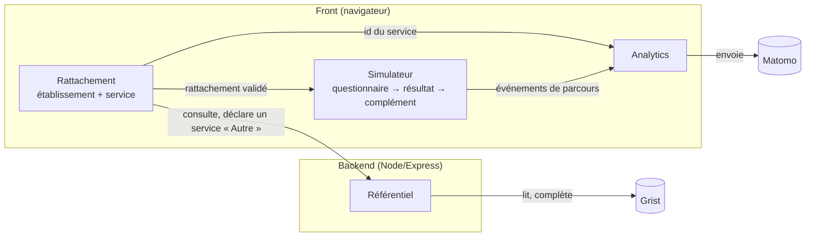

# Simulateur d'éligibilité aux transports sanitaires

Aide un prescripteur hospitalier à déterminer, par un questionnaire guidé, si le
transport d'un patient est pris en charge par l'Assurance Maladie, et ce qu'il doit faire
en conséquence. Le parcours débute par un rattachement obligatoire à un établissement et
à un service, sans identifier la personne.

> **L'app est entre deux modèles.** Le modèle d'éligibilité v9 et tout ce qui en
> dépendait ont été retirés, et la v10 s'intègre étape par étape. Le simulateur
> s'ouvre sur le **modèle de l'éditeur**, encore incomplet. Le modèle de
> démonstration reste à portée des developer tools. Voir
> [« Entre deux modèles »](#entre-deux-modèles).

## Fonctionnement



Aucune réponse du questionnaire ne quitte le navigateur. Le backend ne sert que le
front et le référentiel de rattachement.

## Commandes

| Commande | Ce qu'elle fait |
| --- | --- |
| `pnpm verifier` | **La vérification complète** : lint, typecheck, knip, tests, build et sa vérification de bundle. C'est la commande que lance la CI, telle quelle : ce qui passe ici passe là-bas. |
| `pnpm dev` | Le front et le backend de dev ensemble. C'est ce que lance `tsp dev simulateur`. |
| `pnpm dev:front` | Le front de dev, sur le port 5173, qui proxifie `/api` vers `:3000` |
| `pnpm dev:server` | Le backend de dev, sur le port 3000, en `--watch`, qui charge `.env` s'il est présent |
| `pnpm test` | Vitest. Le smoke Grist est ignoré sans `GRIST_API_KEY`. |
| `pnpm lint` | Biome : format, tri des imports et lint. `lint:fix` applique les corrections sûres. Le socle est commun aux apps du dépôt, dans `biome.base.jsonc` à la racine. |
| `pnpm knip` | Les exports, fichiers et dépendances que plus personne n'atteint |
| `pnpm typecheck` | `tsc -b` sur les quatre projets : front, node, serveur et tests |
| `pnpm build` | Typecheck puis build Vite dans `dist/`, suivi de `verifier-bundle`. `pdf-lib` et le catalogue de seeds doivent rester hors du chunk d'entrée, sans quoi chaque prescripteur télécharge ce qu'il ne verra jamais. |
| `pnpm start` | Le serveur de production (`node server/server.ts`, Node 24) |

Les règles d'écriture et les invariants ne sont pas de la prose, ils sont exécutables.
On les trouve dans `tests/architecture.test.ts`, pour les frontières, dans
`tests/taille-du-code.test.ts`, pour les limites de 30 et 300 lignes, et dans `tests/lisibilite.test.ts`, pour la forme des fichiers, les noms
et les extensions d'import. Lis leur message d'échec : chacun dit ce que sa règle
protège. Ce qu'on attend d'un contributeur est écrit dans [AGENTS.md](AGENTS.md).

De n'importe où dans le dépôt, `tsp dev simulateur` lance le front et le backend en
parallèle, et `tsp verifier` passe la vérification sur toutes les apps. Voir
[`apps/cli`](../cli/README.md).

## Configuration

Copier `.env.example` vers `.env`, qui est gitignoré. Les variables `VITE_*` sont lues au
build et bundlées dans le front ; les autres sont détenues par le serveur et ne sont
jamais exposées au front.

| Variable | Portée | Requis | Défaut / si absente | Usage |
| --- | --- | --- | --- | --- |
| `GRIST_API_KEY` | serveur | **prod** | référentiel **snapshot factice** (dev/CI) | Clé API Grist source du référentiel (établissements/services). Jamais exposée au front. |
| `GRIST_DOC_URL` | serveur | non | doc Grist du projet | Base API du doc Grist (`server/referentiel.ts`). |
| `VITE_MATOMO_ENABLED` | front | non | `false` (traceur no-op) | Active le tracking Matomo. Actif d'office en build de prod ; à mettre à `true` pour tester en local. |
| `VITE_MATOMO_URL` | front | non | instance mutualisée beta.gouv | URL de l'instance Matomo. |
| `VITE_MATOMO_SITE_ID` | front | non | `275` | Identifiant du site Matomo. |

La variable marquée **prod** n'a pas de valeur par défaut : son repli est un
référentiel inventé, ce qui n'a de sens que sur un poste de développement. En production — `NODE_ENV=production`, ce que pose Scalingo —
`server/configuration.ts` refuse donc de rendre une configuration incomplète : le serveur
s'arrête au démarrage, avant d'ouvrir son port, sur la liste de ce qui cloche.

```
[simulateur] Démarrage impossible — configuration invalide :
  - GRIST_API_KEY : sans valeur par défaut, elle doit être posée en production
```

La règle est portée par un schéma **zod** : un socle de variables à défaut, et une variante
de production où la clé Grist est exigée. Le schéma valide aussi la forme de ce qui est
posé — `PORT=quatre-mille` ou une `GRIST_DOC_URL` qui n'est pas une URL arrêtent le
démarrage de la même manière, plutôt que d'échouer plus tard et ailleurs. Une variable
posée mais vide (`GRIST_API_KEY=` dans un `.env` recopié) compte pour absente. Les autres
variables ont un défaut documenté ci-dessus : elles ne bloquent jamais le démarrage.
*Gardé par* [`tests/socle/serveur/configuration.test.ts`](tests/socle/serveur/configuration.test.ts).

## Structure (feature-first)

Il y a quatre racines de *runtime* : `core/`, le métier, qui se charge sous Node
comme dans le navigateur, `front/`, le front bundlé par Vite, `server/`, le
backend Node qui détient la clé Grist, et `shared/`, le contrat commun.
Chacune est organisée par feature. À côté, `cms/` porte le script que le CMS exécute
sur ses propres pages : il n'est ni bundlé ni servi par l'app.

`core/` et `front/` ont chacun un `socle/` et un `models/`. Un modèle a son
dossier des deux côtés, sous le même nom : son métier dans `core/`, son écran
dans `front/` (ADR [`metier-et-ecran`](docs/knowledge/adr/metier-et-ecran.md)).

```
shared/                  le contrat front ⇄ back, source unique des types partagés
server/                  le backend Node, barrière de sécurité : les secrets vivent ici
                         et ne sont jamais bundlés. Bootstrap, composition,
                         configuration lue une fois et refusée si elle manque en prod.
  rattachement/          LA feature backend : les routes `/api` et la source Grist du
                         référentiel, qu'elle lit et complète
core/                    le métier, sans React ni DOM : ce qu'un serveur ou un script
                         peut calculer
  models/                le métier de chaque modèle
    fake/                le modèle de démonstration : une page par capacité du
                         socle. Ses déclarations (questions, faits, cibles), son
                         questionnaire, sa préconisation et son catalogue de seeds
    eligibilite/         le modèle de l'éditeur, en cours d'intégration. À sa racine,
                         ce qui assemble : le questionnaire, le catalogue des
                         faits, la préconisation, l'évaluation des règles et le
                         catalogue de seeds
      rules/             le livrable de l'éditeur : le YAML, sa `VERSION`, le
                         catalogue des textes de R2, et `regles.json`, que
                         `pnpm regles` calcule du YAML
      declarations/      les questions, faits et cibles, dans les mots des règles
      concepts/          ce que plusieurs parties lisent d'un concept : la
                         permission, le séjour, l'aide du patient, le numéro d'une
                         option. Ni page ni fait
      p1/                l'autonomie et l'état de santé : les pages et les faits du
                         mode de transport
      p2/                l'éligibilité : une page et ses faits par thème (prestation,
                         contextes, trajet, transfert, permission, convocation,
                         retour pénitentiaire, branche). Chaque fait se déclare
                         dans un seul thème
      p3/                le complément du cerfa : le trajet, le soin, l'urgence, les
                         évènements et l'exonération
  socle/                 ce qui ne dépend d'aucune version. `model.ts` est le contrat
                         métier qu'un modèle remplit (`CoreModel`), `index.ts` ce
                         qu'il a le droit d'importer
    questionnaire-engine/  le moteur de questionnaire : ce qu'est une question, une
                         page, une partie et une adresse, les questions posées et
                         validées, l'état d'un questionnaire, l'invalidation des
                         réponses dépendantes, ce qui ne va pas dans une saisie,
                         une date répondue
    decision-engine/     le moteur de décision : le fait et la cible en objets
                         valeur, le catalogue des faits et leurs règles, puis des
                         faits aux cibles, par les règles publicodes qu'un modèle
                         lui donne. Un fait absent n'est pas envoyé, et laisse
                         inconnue la cible qui en dépend. Le seul
                         fichier qui importe publicodes, pris par le modèle hors de
                         `index.ts`
    seeds/               ce qu'est une seed, et ce qu'elle confirme ou dément
front/                   le front, bundlé par Vite
  main.tsx               le point d'entrée du navigateur : monte l'app, amorce le traceur
  models/                l'écran de chaque modèle, chacun chargé à la demande
    fake/                les deux résultats de la démonstration et son bon de commande
    eligibilite/         les deux résultats du modèle de l'éditeur
      r2/                le résultat : la trace, ses précisions, le catalogue chargé
                         à la demande, les boutons, et ce que les fiches partagent
        praticien/       les cinq issues sans fiche patient
        fiche-negative/  `ISSUE_NON_ELIGIBLE`
        fiche-positive/  la prescription, le S3141 et les deux accords préalables
      r3/                le résultat du complément : le document de chaque support
        rubriques/       ce que les cerfa partagent, sans lien à aucun d'eux (D-138),
                         dont le texte médical de la PMT et de la DAP
        s3141/           le S3141, assemblé de rubriques
  socle/                 ce qui ne dépend d'aucune version. `model.ts` est le contrat
                         d'écran qu'un modèle remplit (`Model`), qui porte son
                         métier sous `core`, `index.ts` ce qu'il a le droit d'importer
    app/                 le choix de l'écran affiché, la navigation entre les écrans,
                         le conteneur de page, le pied de page
    rattachement/        LA feature de l'écran de rattachement, miroir de server/rattachement/ :
                         le formulaire à révélation progressive, les deux clients de
                         l'API, le rattachement en mémoire de session (ADR-4)
    simulateur/          le parcours : questionnaire, résultat, verrou, complément
    questionnaire-engine/  le questionnaire à l'écran : la page ouverte et son
                         brouillon, les phrases de l'écran, l'avancement
                         automatique, le champ qui affiche une question, ce qui part
                         vers l'analytics
    ui/                  les champs de formulaire, bâtis sur le DSFR et sans rien
                         savoir du questionnaire : TextField, TextAreaField,
                         SelectField, RadioField, CheckboxField, NumberField,
                         DateField, AddressField
    developer-tools/      ce qui est réservé au service produit : son encadré, la
                         trace de debug du parcours et de ses résultats, son export, et le
                         déverrouillage, garde commune à l'écran des seeds et aux traces
    seeds/               l'écran des seeds. Elles se greffent sur le
                         simulateur, jamais l'inverse : c'est App.tsx qui compose.
    cerfa/               le socle de remplissage d'un PDF : un cerfa et son DTO,
                         l'écriture dans un AcroForm, le texte qui déborde,
                         l'aplatissement, les marques et textes dessinés, la
                         génération et le bouton de téléchargement. Aucun gabarit,
                         et rien du simulateur.
    cerfa-mapping.ts     la traduction des données du simulateur en DTO d'un cerfa
    analytics/           le vocabulaire mesuré, seul import du reste, son transport
                         vers Matomo, et le choix de l'utilisateur transmis par le CMS
cms/                     le script à coller dans Sites Conformes : l'opt-out du pied de
                         page, qui répond au traceur de l'iframe (voir « Intégrer dans
                         Sites Conformes »)
```

## Entre deux modèles

La v10 du modèle change trop de comportements pour être portée par-dessus la v9. L'app
a donc été vidée de ce qui dépendait de la v9, sur la branche `v10`.

| Retiré | Conservé |
| --- | --- |
| les règles publicodes, leur validation, la version du modèle au pied de page | l'interface DSFR |
| le questionnaire engendré par `@publicodes/forms` | l'écran de rattachement et son backend |
| les parcours prescripteur et secrétariat, leurs pages de résultat | la mesure d'audience Matomo, réduite aux événements de parcours |
| les tests métier et la recette du livrable | le comportement de navigation, sur un questionnaire factice |
| le contenu du catalogue de seeds | ce qu'est une seed, l'écran des seeds, les traces de debug |
| les trois CERFA : gabarits, tableaux de remplissage, téléchargement | le socle de remplissage d'un PDF |
| le mode test des règles (labo) | |

Le questionnaire n'est plus déduit d'un moteur de règles : il est **déclaré par
le modèle**. Une partie liste ses pages, une page ses questions, une question dit
quand elle se pose (`askedIf`) et de quelles réponses elle dépend (`dependsOn`).

Le modèle de l'éditeur s'intègre sur la v10.1.3, dans `core/models/eligibilite/`
et `front/models/eligibilite/`, une étape après l'autre. Ses règles sont livrées
en YAML : `pnpm regles` les écrit en JSON à côté, que le navigateur et Node
importent tels quels. Aucun analyseur YAML ne part dans le navigateur. Le noyau est là : les règles, la déclaration des faits et des
cibles, et l'oracle de l'éditeur rejoué en faits. Le questionnaire pose P1 :
ses réponses donnent les faits du mode de transport, à trois états. De P2, il
pose la prestation (Q2.1, avec ses sous-questions f, g et h) et le trajet : la
distance, l'avion ou le bateau, la série et l'urgence (Q2.3.1 à Q2.3.4).
Le résultat de R2 montre la page du praticien pour cinq issues, la fiche
patient négative pour `ISSUE_NON_ELIGIBLE` et la fiche patient positive pour
`ISSUE_PMT`, `ISSUE_S3141` et les deux demandes d'accord préalable : les dix
issues ont leur texte et leurs boutons. « Compléter la prescription »,
« Compléter la demande d’accord préalable » et « Compléter la demande
d’examen » ouvrent P3, qui pose le trajet (#144). Son résultat, R3, imprime et
télécharge le document du support, rempli : le S3141 (#158), la PMT (#160) et
la DAP (#161). R3 suit C03 (#223) : le stepper titré du document, à
« Étape 4 sur 4 » et « Préparation terminée. », le texte, la navigation, les
deux actions, puis l'aperçu du document.
L'avancement
est dans l'issue 50 du dépôt, les décisions dans
[`docs/knowledge/adr/journal-des-decisions-v10.md`](docs/knowledge/adr/journal-des-decisions-v10.md).

Le modèle de démonstration (`core/models/fake/` et `front/models/fake/`) déroule une commande de
boisson, sans rapport avec le transport sanitaire. Il est pérenne : chaque capacité du socle
y a sa page, et ses seeds ouvrent les pages à montrer. Le modèle de l'éditeur
s'ouvre par défaut (D-119) ; les developer tools permettent de passer à la
démonstration.

Les tests du socle tournent sur leur propre factice
(`tests/socle/fixtures/modele-factice/`), petit et figé : ils ne changent ni
quand l'éditeur livre une version, ni quand la démonstration gagne une page. Il
sert à tenir en vie, et sous test, ce que le parcours réel reprendra :

| Comportement | Ce qu'il fait | Où |
| --- | --- | --- |
| Avancement automatique | Une page faite de choix uniques avance seule 200 ms après la réponse, sans bouton « Suivant ». Au retour, le bouton reprend la main ; changer la réponse avance aussitôt. | `questionnaire-engine/auto-advance.ts` |
| Brouillon | Une saisie ne compte qu'une fois la page validée. « Précédent » abandonne le brouillon. | `questionnaire-engine/questionnaire.ts` |
| Invalidation | Une réponse changée efface les réponses qui en dépendent, et elles seules. | `core/socle/questionnaire-engine/page-commit.ts` |
| Verrou | Au résultat, « Précédent » rouvre le questionnaire. L'action principale verrouille : le complément est un second parcours, qui ne repose aucune question d'avant et n'a pas de « Précédent » sur sa première page. | `simulateur/Simulateur.tsx` |
| Stepper | Il compte des parties, jamais des pages. Sur une page de questions, le titre de la partie est le sien, en `h1`, et il annonce la partie suivante du même questionnaire ; la dernière n'annonce rien (D-166). Les résultats l'affichent aussi. | `questionnaire-engine/Stepper.tsx`, `questionnaire-engine/QuestionnaireForm.tsx` |
| Page du premier résultat | Le socle compose la page : le stepper avec son titre et ce qui suit (« Étape suivante : … » ou « Évaluation terminée. »), puis le `h1`, l'introduction et le corps que le modèle donne (D-124), puis une rangée de boutons sous un trait : « Précédent » et « Faire une nouvelle simulation » à gauche, « Compléter » poussé à droite, les trois empilés sous 768 px (D-168). « Compléter » verrouille ; le modèle le nomme selon la préconisation, ou le retire (libellé `null`), et il n'est posé que si la partie suivante a des pages ou un cerfa, et que le résultat chargé n'est pas `terminal`. Un résultat qui charge ses textes garde le stepper, compté avec l'étape prévisionnelle, sans ligne, et les deux boutons de gauche. Le titre d'un résultat avec feuille et complétion est vert (D-169). Toute fiche à remettre au patient est une feuille (`sheet`, D-125) : les boutons passent au-dessus d'elle, puis la liseuse la pose sur fond gris, sous une barre « Imprimer », et seule la feuille s'imprime : sur une A4 si elle y tient, sinon sur deux, la seconde ouverte au bloc de suivi, d'après une mesure de sa mise en page d'impression (D-178, D-179). « Télécharger » viendra avec #129. | `simulateur/FirstResultat.tsx`, `simulateur/sheet-pagination.ts` |
| Impression et téléchargement du cerfa | Sous le second résultat, « Imprimer » et « Télécharger » portent le même cerfa, généré une fois dans le navigateur dès que le résultat s'affiche (D-135). Pendant la génération, « Télécharger » dit « Préparation du PDF… » et les deux boutons sont désactivés (D-191). Un PDF prêt après qu'on a quitté le résultat ne sort pas (D-190). « Imprimer » ouvre le dialogue d'impression sur le PDF, chargé dans un cadre invisible, et non sur la page. Le cerfa porte la date du jour où le complément a été validé, qui ne change pas tant qu'il ne l'est pas à nouveau. Un échec s'affiche sous le résultat. Le PDF est aplati, sans aucun champ : il ne se corrige plus. Sous les deux boutons, l'aperçu de ce même PDF, hors impression de la page, ou ce que le modèle met à sa place (`cerfa.standIn`). Le titre du résultat est celui que le modèle donne à la préconisation : il titre le stepper, qui est le `h1` (D-182). | `cerfa/CerfaDocument.tsx`, `cerfa/CerfaPreview.tsx`, `cerfa/print-pdf.ts`, branchés par `simulateur/Resultats.tsx` |
| Texte trop long | Un texte n'est jamais coupé, et ne bloque jamais le cerfa. Trop long pour son cadre, il passe de 9 à 8 pt, puis perd son commentaire facultatif : un avertissement le dit au-dessus du bouton, avant tout téléchargement. S'il ne tient toujours pas, il déborde sous son cadre, par-dessus ce qui s'y trouve, et ne descend sous 8 pt, jusqu'à 6 pt, que pour rester sur la page. | `cerfa/fill-cerfa.ts`, `cerfa/overflow.ts` |
| Résultat sans suite | Quand la préconisation ne donne pas de libellé pour l'action qui verrouille, pas de partie suivante qui ait des pages ou un cerfa, ou que le résultat se dit `terminal`, le premier résultat est le dernier écran : pas de bouton pour verrouiller, et le stepper s'arrête sur lui. | `simulateur/FirstResultat.tsx` |

*Gardé par* `tests/socle/simulateur/`.

## Déployer

Scalingo construit et sert cette app, et déploie depuis `main`.

1. **Passer la vérification.** `pnpm verifier` doit être vert, comme en CI.
2. **Pousser sur `main`.** Scalingo part de là, sans action manuelle.
3. **Laisser construire depuis la racine du dépôt**, et non depuis
   `apps/simulateur-eligibilite/`. C'est ce qu'impose le workspace pnpm : le
   `pnpm-lock.yaml` et le `pnpm-workspace.yaml` vivent à la racine, et une construction
   lancée dans le sous-dossier n'y aurait accès à aucun des deux. Elle installerait des
   versions non verrouillées. Le réglage à tenir côté Scalingo est `PROJECT_DIR`, qui doit
   rester *vide*.
4. **Tenir la variable de production**, `GRIST_API_KEY`. Elle n'a pas de défaut, et le
   serveur refuse de démarrer sans elle (cf. [Configuration](#configuration)).
5. **Relire le pied de page en production.** Il annonce la version de l'app et le sha du
   commit livré.

Trois fichiers de la racine portent ce déploiement :

| Fichier | Ce qu'il donne à Scalingo |
| --- | --- |
| `package.json` | `packageManager` (la version de pnpm), `engines.node`, et deux scripts d'aiguillage : `build` et `start`, qui délèguent tous deux à cette app par `--filter` |
| `Procfile` | `web: pnpm --filter simulateur-eligibilite run start` |
| `pnpm-lock.yaml` | les versions exactes de toutes les apps |

Le build installe donc aussi les dépendances de `data-analyzer` et de `glossaire-notion`.
C'est le prix du lock unique, et il se compte en secondes.

## Intégrer dans Sites Conformes

Le simulateur est embarqué en iframe dans une page Sites Conformes, qui tient aussi
l'opt-out de la mesure d'audience dans son pied de page (voir
[analytics.md](docs/knowledge/adr/analytics.md), ADR-5). Tout se règle dans
l'administration du CMS :

1. **Embarquer l'app.** Dans la page, un bloc « Iframe » (syntaxe experte) dont l'URL
   est celle du simulateur. Laisser le champ « Paramètres » vide : un `sandbox` y
   casserait l'opt-out et l'API.
2. **Installer l'opt-out.** Dans Paramètres → Scripts personnalisés → « Scripts dans
   la section `<body>` », coller le contenu de
   [`cms/statistiques-simulateur.js`](cms/statistiques-simulateur.js) entre
   `<script type="module">` et `</script>`, après avoir remplacé
   `ORIGINE_SIMULATEUR` par l'origine réelle du simulateur (`https://domaine`, sans
   chemin ni barre finale).
3. **Informer.** La politique de confidentialité du site décrit la mesure par service
   et renvoie au bouton du pied de page (R-12 d'analytics.md).
4. **Recetter.** Le bouton « Désactiver la mesure d'audience du simulateur » apparaît
   à la fin du pied de page. Après un clic, plus aucune requête ne part vers
   `stats.beta.gouv.fr` depuis l'iframe, même après rechargement.

Le script vit dans les réglages du CMS, hors de tout déploiement : toute modification
du fichier se recolle à la main. Il ajoute son bouton dans la liste DSFR du pied de
page ; une montée de version de Sites Conformes qui la changerait le ferait
disparaître sans erreur, d'où l'étape de recette.
