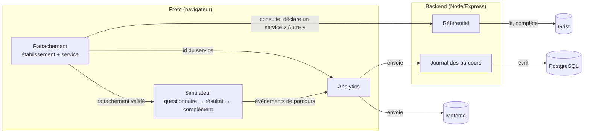

# Simulateur d'éligibilité aux transports sanitaires

Aide un prescripteur hospitalier à déterminer, par un questionnaire guidé, si le
transport d'un patient est pris en charge par l'Assurance Maladie, et ce qu'il doit faire
en conséquence. Le parcours débute par un rattachement obligatoire à un établissement et
à un service, sans identifier la personne.

Le simulateur s'ouvre sur le **modèle de l'éditeur** : le modèle d'éligibilité qu'il livre
(v10.2.2, voir `core/models/eligibilite/rules/VERSION`). Un **modèle de démonstration**
reste à portée des developer tools, en local seulement. Voir [« Les deux
modèles »](README.md#les-deux-modèles).

## Fonctionnement



Aucune réponse du questionnaire ne quitte le navigateur : ni Matomo ni le journal n'en
reçoivent (voir [la mesure d'audience](docs/knowledge/domain/mesure-d-audience.md)). Le
backend sert le front, le référentiel de rattachement et le journal des parcours.

Le front est en React 19, Vite et DSFR. Le questionnaire est **déclaré par le modèle**
(`core/socle/questionnaire-engine/`), et `front/socle/questionnaire/` l'affiche. Le
backend Node/Express (`server/`) sert le front et `/api/*`, sur Scalingo : ce n'est pas un
site statique.

## Commandes

| Commande | Ce qu'elle fait |
| --- | --- |
| `pnpm verifier` | **La vérification complète** : lint, typecheck, knip, tests, build et sa vérification de bundle. Sa CI en passe les étapes une à une. En local, on lance seulement les tests ciblés, `pnpm lint` et `pnpm typecheck`, puis la CI dit le reste. |
| `pnpm dev` | Le front et le backend de dev ensemble. |
| `pnpm dev:front` | Le front de dev, sur le port 5173, qui proxifie `/api` vers `:3000` |
| `pnpm dev:server` | Le backend de dev, sur le port 3000, en `--watch`, qui charge `.env` s'il est présent |
| `pnpm test` | Vitest. Les smoke Grist sont ignorés sans `GRIST_API_KEY` et `GRIST_DOC_URL` ; celui qui écrit dans Grist demande en plus `GRIST_ECRITURE_TEST=1`. |
| `pnpm test:navigateur` | Les parcours en navigateur réel (Playwright, Chromium et WebKit) : le front construit, embarqué en iframe dans une page d'une autre origine. Demande `pnpm exec playwright install chromium webkit` la première fois. La CI les passe dans son job `navigateur`. |
| `pnpm lint` | Biome : format, tri des imports et lint. `lint:fix` applique les corrections sûres, `format` formate. Le socle de la configuration est commun aux apps, dans `biome.base.jsonc` à la racine. |
| `pnpm knip` | Les exports, fichiers et dépendances que plus personne n'atteint |
| `pnpm typecheck` | `tsc -b` sur les six projets de `tooling/` : front, métier, node, serveur, tests et navigateur |
| `pnpm build` | Typecheck puis build Vite dans `dist/`, suivi de `verifier-bundle`. `pdf-lib` et le catalogue de seeds doivent rester hors du chunk d'entrée, sans quoi chaque prescripteur télécharge ce qu'il ne verra jamais. |
| `pnpm start` | Le serveur de production (`node server/server.ts`, Node 24) |
| `pnpm regles` | Recalcule le `regles.json` et le `regles.graphe.json` de chaque modèle d'après son `regles.publicodes`. À lancer après toute retouche des règles : un test les compare. |

De n'importe où dans le dépôt, `pnpm --filter simulateur-eligibilite dev` lance le front
et le backend en parallèle, et `pnpm verifier` passe la vérification sur toutes
les apps.

Les règles d'écriture et les invariants ne sont pas de la prose : ils sont exécutables, et
vivent dans les fichiers `tests/*.test.ts` à la racine de `tests/` (frontières des
racines, architecture, sens des dépendances, taille du code, lisibilité, miroir des
sources, index des modules du socle, lecture des valeurs). Lis leur message d'échec :
chacun dit ce que sa règle protège. Ce qu'on attend d'un contributeur est écrit dans
[`docs/knowledge/contributing/`](../../docs/knowledge/contributing/) et dans
[`regles-d-architecture.md`](docs/knowledge/contributing/regles-d-architecture.md).

## Configuration

Copier `.env.example` vers `.env`, qui est gitignoré. Les variables `VITE_*` sont lues au
build et bundlées dans le front ; les autres sont détenues par le serveur et ne sont
jamais exposées au front.

| Variable | Portée | Requis | Défaut / si absente | Usage |
| --- | --- | --- | --- | --- |
| `GRIST_API_KEY` | serveur | **prod** | référentiel **snapshot factice** (dev/CI) | Clé API Grist source du référentiel (établissements/services). Jamais exposée au front. |
| `GRIST_DOC_URL` | serveur | **prod** | référentiel **snapshot factice** (dev/CI) | Base API du doc Grist du référentiel, lu et complété avec la clé. |
| `SCALINGO_POSTGRESQL_URL` | serveur | non | aucun | URL de la base PostgreSQL du journal des parcours, posée par l'addon PostgreSQL de Scalingo. Sans elle, le serveur accepte les événements sans en garder aucun, et le signale au démarrage. Les tables se créent à la première écriture (voir [le journal](docs/knowledge/domain/journal-des-parcours.md)). |
| `JOURNAL_READ_TOKEN` | serveur | non | pas de lecture | Jeton du tableau de bord qui lit le journal, par `GET /api/journal/v1/events` et `Authorization: Bearer <jeton>`. Au moins 32 caractères (`openssl rand -hex 32`). Sans lui, la route n'existe pas. |
| `APP` | serveur | non | `local` | Nom de l'app Scalingo, posé par Scalingo. Écrit comme `environment` de chaque événement du journal. |
| `CONTAINER_VERSION` | serveur | non | commit `inconnu` | Commit déployé, posé par Scalingo sur le conteneur. Écrit, sur 7 caractères, sur le signe de vie horaire du journal. |
| `PORT` | serveur | non | `3000` | Le port du serveur. Scalingo le pose. |
| `VITE_MATOMO_ENABLED` | front | non | `false` (traceur no-op) | Active le tracking Matomo. Actif d'office en build de prod ; à mettre à `true` pour tester en local. |
| `VITE_MATOMO_URL` | front | non | instance mutualisée beta.gouv | URL de l'instance Matomo. |
| `VITE_MATOMO_SITE_ID` | front | non | `275` | Identifiant du site Matomo. |

Les variables marquées **prod** n'ont pas de valeur par défaut : leur repli est un
référentiel inventé, ce qui n'a de sens que sur un poste de développement. En production
(`NODE_ENV=production`, que pose Scalingo), `server/configuration.adapter.ts` refuse donc une
configuration incomplète : le serveur s'arrête au démarrage, avant d'ouvrir son port, sur
la liste de ce qui cloche. Une variable posée mais vide (`GRIST_API_KEY=` dans un `.env`
recopié) compte pour absente. Une forme invalide (`PORT=quatre-mille`, une
`GRIST_DOC_URL` qui n'est pas une URL) arrête le démarrage de la même manière. Les
autres variables ne le bloquent jamais.

*Gardé par* [`tests/socle/server/configuration.test.ts`](tests/socle/server/configuration.test.ts).

## Structure (feature-first)

Il y a quatre racines de *runtime* : `core/`, le métier, qui se charge sous Node comme
dans le navigateur, `front/`, le front bundlé par Vite, `server/`, le backend Node qui
détient la clé Grist, et `shared/`, le contrat commun. Chacune est organisée par feature :
un dossier est un module, une entité (un nom) ou une capacité (un verbe), et un fichier
porte une responsabilité, nommé de ce qu'il exporte. À côté, `tooling/` porte la
configuration TypeScript et les outils de développement.

`core/` et `front/` ont chacun un `socle/` et un `models/`. Un modèle a son dossier des
deux côtés, sous le même nom : son métier dans `core/`, son écran dans `front/`
(ARCH-002). Un module du socle, dossier direct de `core/socle/` ou de `front/socle/`, a
son `index.ts` : ce qu'il promet au reste du socle, et le seul de ses fichiers qu'on
importe de l'extérieur (ARCH-003).

**Le socle est celui des transports sanitaires.** L'outillage stable (publicodes, DSFR,
pdf-lib) et ce qui ne change pas avec le modèle (logos, mise en page, impression) y
vivent. Le modèle ne porte que ce que l'éditeur livre : règles, déclarations, textes.

**DSFR pour toute l'interface.** Un composant emprunte la forme de ses props au composant
appelé (`ComponentProps<typeof Checkbox>`) plutôt que de la recopier : une recopie dérive
d'une version à l'autre.

```
shared/                  le contrat front ⇄ back, source unique des types partagés
  analytics/             le contrat d'un événement du journal, et son schéma zod,
                         que seul le serveur importe
server/                  le backend Node, barrière de sécurité : les secrets vivent ici
                         et ne sont jamais bundlés
  container.ts           instancie les adaptateurs, les use cases et les contrôleurs
  rattachement/          les routes `/api` du référentiel et sa source Grist
  journal/               le journal des parcours en clean architecture : entité, use
                         cases, ports, adaptateurs (PostgreSQL, mémoire) et routes
core/                    le métier, sans React ni DOM : ce qu'un serveur ou un script
                         peut calculer
  models/
    fake/                le modèle de démonstration
    eligibilite/         le modèle de l'éditeur
      questions/         les questions, par partie (p1, p2, p3), un `.question.ts` par question
      faits/             un `.fait.ts` par fait, dans les mots des règles
      cibles/            les cibles, et leur évaluation par les règles publicodes
      rules/             le livrable de l'éditeur : le YAML, sa `VERSION`, le catalogue
                         des textes de R2, et les JSON que `pnpm regles` en calcule
      seeds-catalogue.ts les situations de référence du modèle
  socle/                 ce qui ne dépend d'aucun modèle
    questionnaire-engine/ ce qu'est une question, une page, une partie ; les réponses
                         validées, l'invalidation des réponses dépendantes
    decision-engine/     des faits aux cibles, par les règles publicodes d'un modèle
    simulation/          la simulation, l'agrégat du parcours
front/                   le front, bundlé par Vite
  main.tsx, container.ts le point d'entrée, et ce qui parle à l'extérieur
  models/                l'écran de chaque modèle, chargé à la demande
    eligibilite/r2/      le premier résultat
    eligibilite/r3/      le second résultat : les cerfa et leurs gabarits
  socle/
    app/                 le choix de l'écran, la navigation, le pied de page
    rattachement/        l'écran de rattachement, miroir de server/rattachement/
    simulateur/          le parcours : résultats, feuille du patient et son PDF
    questionnaire/       le questionnaire à l'écran
    cerfa/               le remplissage d'un PDF, son impression et son téléchargement
    analytics/           la mesure d'audience et le journal des parcours, et `cms.js`
    developer-tools/     ce qui ne s'ouvre qu'en local : trace de debug, choix du modèle
    seeds/               l'écran des seeds
    theme/               le thème, qui suit celui de la page qui embarque l'app
tests/, navigateur/      les tests rangés comme les sources, et les parcours en
                         navigateur réel
```

Le script `front/socle/analytics/cms.js` s'exécute sur les pages du CMS, pas dans l'app :
il n'importe rien et personne ne l'importe.

## Les deux modèles

Le questionnaire n'est pas déduit d'un moteur de règles : il est **déclaré par le
modèle**. Une partie liste ses pages, une page ses questions, une question dit quand elle
se pose (`appliesWhen`, `mattersWhile`) et de quelles réponses elle dépend (`dependsOn`).

- **Le modèle de l'éditeur** (`core/models/eligibilite/`, `front/models/eligibilite/`)
  s'ouvre par défaut. Ses règles sont livrées en YAML : `pnpm regles` les écrit en JSON à
  côté, que le navigateur et Node importent tels quels. Aucun analyseur YAML ne part dans
  le navigateur. Voir [le livrable de l'éditeur](docs/knowledge/domain/livrable-de-l-editeur.md).
- **Le modèle de démonstration** (`core/models/fake/`, `front/models/fake/`) déroule une
  commande de boisson, sans rapport avec le transport sanitaire. Chaque capacité du socle
  y a sa page, et ses seeds ouvrent les pages à montrer. Le socle ne sait pas qu'un modèle
  est « de démonstration ».
- **Les developer tools** permettent de passer de l'un à l'autre. Ils ne s'ouvrent
  qu'en local, sous le serveur de dev et sous les tests, quel que soit le service
  choisi : staging et production n'atteignent ni la démonstration ni les seeds. Seule la
  trace de debug s'y ouvre, pour la structure « Assurance Maladie »
  (`front/socle/developer-tools/unlock.service.ts`).
- **Les tests du socle** tournent sur leur propre modèle factice
  (`tests/socle/fixtures/modele-factice/`), petit et figé : ils ne changent ni quand
  l'éditeur livre une version, ni quand la démonstration gagne une page.

Le PDF de la fiche remise au patient est une image de la feuille : son texte ne se
sélectionne pas. Celui du cerfa est un vrai PDF, rempli puis aplati dans le navigateur.

Le comportement du parcours (avancement automatique, brouillon, verrou, stepper, résultats,
impression, téléchargement, texte trop long) est décrit par `tests/socle/simulateur/` et
`tests/socle/cerfa/`.

## Tests

**Sans mock.** Les tests d'interface passent Testing Library sur le vrai `<App />`, les
tests serveur font de vraies requêtes HTTP sur une app Express montée sur un référentiel
injecté, et ceux du PDF remplissent un vrai PDF, fabriqué par `pdf-lib`.

`tests/socle/` éprouve le socle sur un modèle qu'on lui injecte : le factice, dans
`tests/socle/fixtures/modele-factice/`. `tests/model/` vérifie chaque modèle :
`conformite.test.ts` contrôle ce que le socle suppose de n'importe quel modèle et rejoue
ses seeds, `tests/model/eligibilite/` rejoue l'oracle de l'éditeur, en faits, contre le
moteur.

**Quelques parcours tournent dans un vrai navigateur**, dans `navigateur/` : ils
vérifient ce que happy-dom ne peut pas dire (l'iframe, les messages avec la page, le PDF,
l'accessibilité vue par axe). Ils restent peu nombreux : la logique s'éprouve dans
`tests/`.

**Une capacité ajoutée au socle arrive avec trois choses** : ses tests, sur des pages
écrites dans le test (`tests/socle/questionnaire/afficher.tsx`), sa page dans le modèle de
démonstration, et une seed qui ouvre cette page.

**Une situation de référence va dans le `seeds-catalogue.ts` de son modèle, pas dans un
fichier de test.** C'est un catalogue unique de situations nommées, *avec leurs cibles
attendues*. Les réponses d'une seed se donnent par identifiant de question (`"Q1.2"`).
Complètes, elles ouvrent un résultat et `expected` annonce les seules cibles qui la
caractérisent. Incomplètes, elles s'arrêtent sur la première question sans réponse et
n'annoncent rien. Sur un écart, ne corrige pas l'attendu pour qu'il passe : lis la règle et
le contrat ([`livrable-de-l-editeur.md`](docs/knowledge/domain/livrable-de-l-editeur.md)).

## Déployer

Scalingo construit et sert cette app, et déploie depuis `main`.

1. **Attendre la CI verte.** Elle passe les étapes du `verifier` sur `staging` : c'est elle
   qui fait foi avant de pousser sur `main`.
2. **Pousser sur `main`.** Scalingo part de là, sans action manuelle.
3. **Laisser construire depuis la racine du dépôt**, et non depuis
   `apps/simulateur-eligibilite/` : le `pnpm-lock.yaml` et le `pnpm-workspace.yaml`
   vivent à la racine, et un sous-dossier installerait des versions non verrouillées. Le
   réglage à tenir côté Scalingo est `PROJECT_DIR`, qui doit rester *vide*.
4. **Brancher l'addon PostgreSQL.** Il pose `SCALINGO_POSTGRESQL_URL`, la base du journal
   des parcours ; les tables se créent à la première écriture.
5. **Tenir les variables de production**, `GRIST_API_KEY` et `GRIST_DOC_URL`. Elles n'ont
   pas de défaut, et le serveur refuse de démarrer sans elles (voir
   [Configuration](#configuration)).
6. **Surveiller la collecte.** Le workflow `.github/workflows/signe-de-vie.yml` demande
   chaque heure à la production si le journal porte son signe de vie
   (`GET /api/journal/v1/alive`), et échoue sinon : GitHub prévient par courriel (voir
   [le journal](docs/knowledge/domain/journal-des-parcours.md)).
7. **Relire le pied de page en production.** Il annonce la version de l'app et le sha du
   commit livré.

Trois fichiers de la racine portent ce déploiement :

| Fichier | Ce qu'il donne à Scalingo |
| --- | --- |
| `package.json` | `packageManager` (la version de pnpm), `engines.node`, et deux scripts d'aiguillage : `build` et `start`, qui délèguent tous deux par `--filter` à l'app nommée par `DEPLOY_APP`, cette app si la variable est absente |
| `Procfile` | `web: pnpm --filter "${DEPLOY_APP:-simulateur-eligibilite}" run start` |
| `pnpm-lock.yaml` | les versions exactes de toutes les apps |

## Intégrer dans Sites Conformes

Le simulateur est embarqué en iframe dans une page Sites Conformes, qui tient aussi
l'opt-out de la mesure d'audience dans son pied de page (voir
[l'ADR sur l'opt-out](docs/knowledge/adr/0011-le-cms-tient-l-opt-out-et-le-transmet-a-l-iframe.md)),
dont l'iframe suit le thème, clair ou sombre, et qui remonte au haut de l'iframe à chaque
nouvelle page. Tout se règle dans l'administration du CMS :

1. **Embarquer l'app.** Dans la page, un bloc « Iframe » (syntaxe experte) dont l'URL est
   celle du simulateur. Laisser le champ « Paramètres » vide : un `sandbox` y casserait
   l'opt-out et l'API.
2. **Installer le script.** Dans Paramètres → Scripts personnalisés → « Scripts dans la
   section `<body>` », coller le contenu de
   [`front/socle/analytics/cms.js`](front/socle/analytics/cms.js) entre
   `<script type="module">` et `</script>`, après avoir remplacé `ORIGINE_SIMULATEUR` par
   l'origine réelle du simulateur (`https://domaine`, sans chemin ni barre finale). Il
   porte l'opt-out, transmet le thème de la page et remonte la page au haut de l'iframe
   quand le simulateur le demande : Safari ne laisse pas l'iframe le faire elle-même.
3. **Informer.** La politique de confidentialité du site décrit la mesure par service et
   renvoie au bouton du pied de page (R-12 de
   [l'ADR sur la mesure sans bandeau](docs/knowledge/adr/0003-la-mesure-d-audience-se-fait-sans-bandeau-de-consentement.md)).
4. **Recetter.** Le bouton « Désactiver la mesure d'audience du simulateur » apparaît à la
   fin du pied de page. Après un clic, plus aucune requête ne part vers
   `stats.beta.gouv.fr` depuis l'iframe, même après rechargement. L'iframe a le thème de la
   page, et le suit quand on le change dans « Paramètres d'affichage ». Sous Safari, la page
   défilée jusqu'au bas de l'iframe remonte à son haut à la question suivante.

Le script vit dans les réglages du CMS, hors de tout déploiement : toute modification du
fichier se recolle à la main. Il ajoute son bouton dans la liste DSFR du pied de page :
une montée de version de Sites Conformes qui la changerait le ferait disparaître sans
erreur, d'où l'étape de recette.
