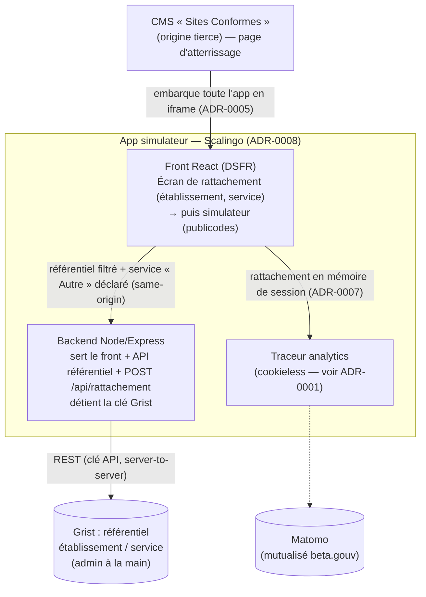

# ADR-0004 - Rattachement intégré en écran de rattachement (~~app dédiée~~)

> Statut : **décidé** · 2026-07-03 · Anciennement ADR-1 de `identification.md`

**Décision (révisée 2026-07-08).** Le rattachement est un **écran de rattachement** au sein de
l'app simulateur : tant que l'établissement et le service ne sont pas validés, le
formulaire n'est pas rendu. ~~Créer une SPA statique `apps/identification` dédiée.~~

**Pourquoi.** Une app séparée imposait un passage de contexte inter-app par fragment
d'URL et une navigation top-level hors iframe. Surtout, elle n'empêchait pas d'atteindre
le simulateur sans identification, son URL étant publique. Un écran de rattachement dans l'app rend
l'étape obligatoire pour de bon, et simplifie l'intégration : un seul iframe, un seul
déployable. Le rattachement reste isolé du moteur (ADR-0009) et derrière l'interface
`Referentiel`, donc une migration FINESS reste possible sans toucher le simulateur.

**Conséquences.** Il n'y a plus de passage de contexte inter-app : la sélection est
gardée en mémoire (voir ADR-0007). L'écran de rattachement et le formulaire du simulateur cohabitent dans la
même app, avec des steppers distincts.

## Architecture

Composants :

| Composant | Nature | Statut |
|---|---|---|
| `apps/simulateur-eligibilite` | **App unique** : front React (rattachement + simulateur) + backend Node/Express, sur **Scalingo** | modifié (fusion, puis rattachement) |
| API référentiel + déclaration du rattachement | Endpoints du backend détenant la clé Grist | modifié (plus de prescripteurs ni de pseudonymisation) |
| Grist | Base managée, admin à la main | config |
| ~~`apps/identification`~~ | ~~app séparée~~ | **supprimé (fusionné)** |

## Mises à jour

> **Mise à jour 2026-07-08, fusion des apps.** L'identification et le simulateur ont un
> temps été conçus comme **deux apps séparées** : une SPA d'identification en iframe, une
> redirection top-level vers le simulateur statique, et le contexte passé en fragment
> `#ctx`. Ils sont désormais **une seule app**, où l'identification est un **écran de rattachement**
> en amont du simulateur. Cela **réverse** l'ADR-0004 (app dédiée), l'ADR-0007 (contexte en
> fragment d'URL) et l'invariant « simulateur 100 % statique » de l'ADR-0008. Deux raisons :
> l'intégration Sites Conformes est plus simple avec **un seul iframe**, sans navigation
> top-level, et le passage de contexte devient trivial une fois l'**état en mémoire**,
> sans fragment. Les sections ci-dessous ont été mises à jour. Les décisions restées
> valables sont conservées : identification déclarative, PII hors bundle, moteur
> publicodes intouché.

> **Mise à jour 2026-11-09, developer tools en local (#373, D-279).** Le service
> n° 4 ne déverrouille plus rien. Les developer tools s'ouvrent en local, quel que
> soit le service, et jamais sur un build de production. L'écran de rattachement
> n'a plus de sortie vers les seeds : toute sélection qui suffit ouvre le
> simulateur, et les seeds s'ouvrent depuis lui.

> **Mise à jour 2026-11-12, trace de debug pour « Assurance Maladie » (#407,
> D-280).** Choisir la structure « Assurance Maladie » ouvre la trace de debug
> sur tous les environnements. L'écran de rattachement remonte la structure
> choisie au simulateur. Les seeds et le choix du modèle restent en local.
