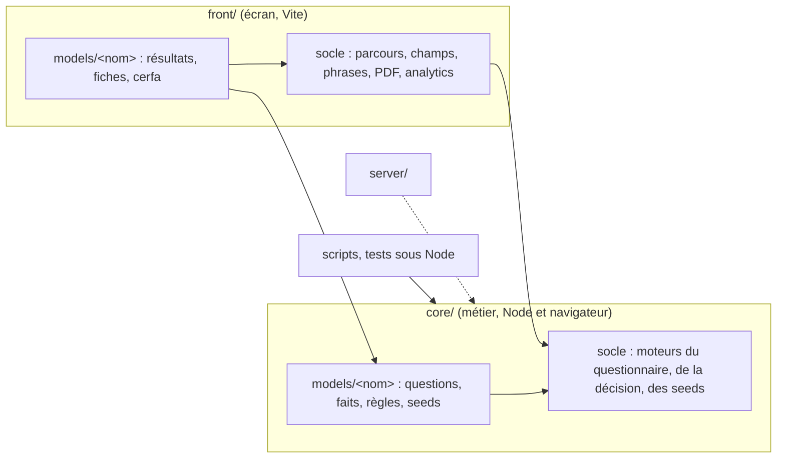

# ADR-0012 - Le métier dans une racine à part, `core/` (~~dans `front/`~~)

> Statut : **décidé** · 2026-10-23 · Anciennement ADR-1 de `metier-et-ecran.md`
>
> Décidé par l'agent qui a mené le chantier, sur délégation, le 2026-10-22 :
> à relire (issues 202 à 207).

**Contexte.** Le métier vivait dans `front/socle/` (les moteurs) et
`front/models/` (les modèles). Le nom `domain/` a été écarté par Simon : `core/`
dit mieux ce qui reste quand on retire l'écran.

**Décision.** `core/` est une quatrième racine de runtime, à côté de `front/`,
`server/` et `shared/`. Elle porte les moteurs (questionnaire, décision, seeds)
et le métier de chaque modèle. Elle n'importe ni React, ni le DOM, ni le front,
ni le serveur. Ses imports portent l'extension `.ts`, comme tout ce que Node
atteint. Elle a son propre projet TypeScript, sans les types du DOM.

**Conséquences.** Le front et le serveur importent `core/`, jamais l'inverse. Un
test de frontières le garde. Ce qui touche à l'affichage reste dans `front/` :
le parcours à l'écran, son brouillon, les champs, les phrases.

## Ce qui a mené là

Jusqu'à la v10.1.3, tout le simulateur vit dans `front/`. Le moteur de
questionnaire, le moteur de décision et les modèles y côtoient React, le DSFR
et Vite. Rien ne l'interdit, mais rien ne le sépare non plus : un moteur qui
écrit une phrase d'écran, un modèle qui mêle ses faits et ses fiches, des règles
que seul Vite sait lire.

Trois besoins en font un coût :

- **calculer sans navigateur.** Un serveur ou un script doit pouvoir rejouer une
  préconisation, sur les seules réponses, pour une API ou une recette ;
- **lire le métier d'un coup d'œil.** Ce que l'éditeur livre (questions, faits,
  règles) doit se lire sans traverser des composants ;
- **tester le métier sans écran.** Une seed se rejoue sur la préconisation, pas
  sur un rendu.

Objectif : une racine du métier, `core/`, qui se charge sous Node comme dans le
navigateur, et un écran, `front/`, qui l'affiche.

## Architecture

## Ce qui va où

Une seule question tranche : **un serveur qui calcule une préconisation en
a-t-il besoin ?**

| Pièce | Oui : `core/` | Non : `front/` |
|---|---|---|
| une question, ses options, ses conditions | ✓ | |
| un libellé livré par l'éditeur | ✓ | |
| une phrase écrite par l'app (« (facultatif) ») | | ✓ |
| un fait, une règle, une cible | ✓ | |
| une seed et ses attendus | ✓ | |
| le brouillon d'une page, la navigation | | ✓ |
| un résultat, une fiche, un cerfa | | ✓ |

## Risques

| Id | Risque | Mesure |
|---|---|---|
| R-3 | Le serveur n'importe pas encore le métier : la frontière n'est éprouvée que par un test | le test sous Node rejoue toutes les seeds à attendus |
| R-5 | Une constante déclarée sous la déclaration qui la lit casse le chargement du module | le test sous Node et chaque test du modèle chargent le module ; l'erreur nomme la constante |
| R-7 | Le banc d'équivalence couvre 4 688 états, pas tous | les seeds et les tests du modèle passent ; la relecture vérifie les chaînes thème par thème |
| R-9 | Le banc d'équivalence ne couvre pas la trace de R2 | les tests de la trace et des précisions passent tels quels ; deux tests disent le séjour réel |

## Mises à jour

> **Mise à jour 2026-10-23, deux fusions de staging.** Staging avait pris
> sept numéros du journal le 2026-10-22, puis sept autres pour le texte médical
> de R3. Les décisions de ce chantier, D-134 à D-149 dans les messages de
> commit, sont D-148 à D-163 au journal. La première fusion porte aussi R3 et
> QUAL-017 sur `core/` : les noms d'absence choisis sont au journal, D-164.
