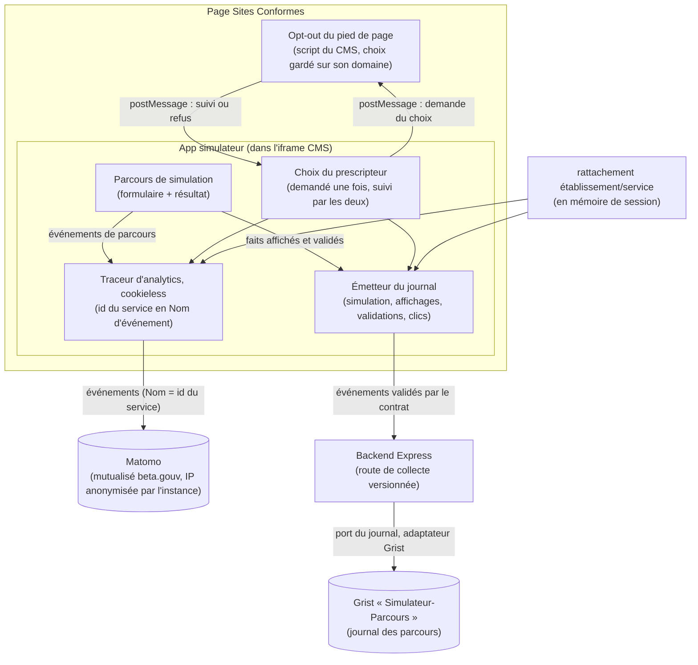

# ADR-0042 - Journal des parcours écrit par le backend (~~dans Grist~~)

> Statut : **décidé** · 2026-11-12 · Anciennement ADR-6 de `analytics.md`

**Contexte.** Le dashboard analytics sera livré après le simulateur. Il devra
recalculer ses 62 blocs depuis des événements unitaires, conservés, dédoublonnés et
reliés entre eux : une simulation de P0 à sa fin, un bouton affiché à son clic, un
document à son résultat. Matomo ne sait pas le porter (ADR-0001). Le plan de marquage
v10.1.7 et le contrat `analytics/` du paquet de l'éditeur décrivent ces événements.
Le responsable du traitement a donné son accord à cette collecte.

**Décision.** Le navigateur envoie chaque événement à une route de collecte
versionnée de notre backend Express. Le backend :

- valide l'événement contre une liste fermée de champs : notre contrat, écrit
  d'après ANA-1015 (`REFERENTIEL/03` du paquet de l'éditeur) pour le socle, et un
  contrat versionné à part pour nos compléments (`service_id`, exposition des boutons
  documentaires, mesures typographiques). ~~Le contrat du paquet pour le socle.~~ ;
- y ajoute ce que le navigateur ne peut pas prouver : la date de réception, la
  version du schéma, l'environnement ;
- le conserve dans le journal (ADR-0043) : un renvoi identique du même `event_id` est
  ignoré, le même `event_id` avec un autre contenu est mis à part comme collision ;
  ~~l'écrit dans le document Grist « Simulateur-Parcours », en ajout ou mise à jour sur
  l'`event_id`~~ ;
- n'accuse réception qu'une fois l'écriture faite.

Chaque événement porte l'id de l'établissement et celui du service du rattachement,
et leurs noms (ADR-0053). Jusqu'au 2026-11-16, seul `simulation_started` les portait.
Le contrat v0.1 du plan de marquage (16 événements, `p0_viewed`, `cta_exposed`…)
n'est pas suivi : il est historique.

Le contrat vit dans `shared/analytics/`, en TypeScript : le navigateur n'en prend que
les types, le backend valide avec. ANA-1015 le dit lui-même : les fichiers
`analytics/` du paquet sont ses dérivés. Le validateur et le réducteur
(`contrat-analytics.mjs`) n'entrent pas dans le code : ses exemples doivent passer
notre validateur, et son réducteur sert d'oracle dans les tests. Si le texte et le
code du paquet divergent, le texte fait foi.

Le navigateur envoie chaque événement seul, dans un `fetch` en `keepalive`, qui
survit à la fermeture de l'onglet. Sur une erreur réseau ou une réponse 5xx, il
réessaie après 0,5, 1, 2 puis 4 secondes, et abandonne. Un refus du contrat (4xx)
n'est pas réessayé. Il n'y a ni file ni stockage dans le navigateur.

Le journal ne s'exporte pas. Le dashboard le lira par une API du backend, construite
avec lui.

**Pourquoi.** Un journal tenu par le backend se dédoublonne, se date et se filtre en
un seul endroit, que le navigateur ne peut pas contourner. Un contrat à nous suit nos
règles de code et se teste sur les exemples de l'éditeur à chaque livraison. Le
réessai sans file couvre une coupure brève pour presque rien : une perte plus longue
est un cas à la marge, et elle se voit sans rien construire, par un trou dans les
`sequence` d'une simulation. Une file sur le disque survivrait à l'onglet, mais elle
écrirait sur le poste du prescripteur, ce que l'ADR-0003 écarte. ~~**Pourquoi Grist.**
L'équipe y tient déjà le référentiel, le backend sait déjà y écrire (le rattachement
« Autre »), et l'app n'a aucune base de données à exploiter. Le journal se lit et
s'exporte sans outil de plus.~~ (voir ADR-0043)

**Conséquences.**

- Le backend devient un point de passage de la collecte : s'il ne répond pas
  pendant les quelques secondes du réessai, l'événement est perdu. La perte se lit
  dans la couverture, par les trous de `sequence`. ~~Le navigateur garde un nombre
  borné d'événements à renvoyer.~~
- Si l'onglet se ferme entre deux essais, l'événement est perdu aussi : `keepalive`
  ne protège que la requête en cours.
- Chaque événement fait une écriture : pas de lot à constituer, mais un débit à
  surveiller (R-13).
- Aucune adresse IP ni aucun en-tête du navigateur n'est écrit dans le journal.
- Un rechargement de la page crée une nouvelle simulation : l'app ne garde rien
  d'un rechargement à l'autre. La reprise viendra avec #392 si les rechargements
  le justifient (R-14, ADR-0049).

## Architecture

| Composant | Rôle | Statut |
|---|---|---|
| Traceur Matomo | mesure d'audience | inchangé |
| Émetteur du journal | crée la simulation, émet les faits réellement affichés, validés ou demandés | ajouté (2026-11-12) |
| Route de collecte | valide, date la réception, dédoublonne, écrit par le port du journal | ajouté (2026-11-12) |
| Grist « Simulateur-Parcours » | conserve le journal, premier adaptateur du port (ADR-0043) | ajouté (2026-11-12) |

~~Un composant de gestion du consentement autorisait l'initialisation du traceur.~~
Retiré le 2026-09-29 (ADR-0003).

Depuis la fusion, tout le parcours, rattachement et simulation, tourne dans
l'iframe du CMS. C'est un contexte tiers, où les cookies sont bloqués. Le traceur
est donc cookieless (`_paq.push(["disableCookies"])`) : les événements partent sans
cookie, ce qui convient à une mesure d'audience sans bandeau. L'API JavaScript de
Matomo n'a pas de commande pour anonymiser l'IP : c'est un réglage de l'instance.

## Risques

| Réf | Risque / à valider | Portée |
|---|---|---|
| **R-13** | **Volume du journal dans Grist** : une simulation donne des dizaines d'événements. Les limites de taille d'un document et le débit de l'API Grist sont à mesurer avant la communication de l'app, et un archivage à prévoir s'ils approchent. | exploitation |
| **R-15** | **Durée de conservation** du journal : à fixer avec l'équipe responsable des données. | conformité, plus tard |
| **R-16** | **Droits de la clé d'API** sur « Simulateur-Parcours » : lecture, écriture et création de table vérifiées le 2026-11-12 avec la clé de staging. La clé de production reste à vérifier avant la livraison. | exploitation, **à vérifier avant la release** |

## Mises à jour

> **Mise à jour 2026-11-17, le contrat v10.2.2 entier (#497).** Cela
> **révise** le premier point de la décision. La collecte valide le schéma de
> l'éditeur entier : ses champs fermés et ses 26 règles croisées (`allOf`),
> dans `shared/analytics/contract-rule.vo.ts`, sous leur numéro. Nos
> compléments sortent : `schema_version` passe à 4. Un onglet ouvert avant le
> déploiement, qui envoie une autre `version` (la 10.2.1 de ses règles), son
> `commit_sha` ou ses `portions`, est refusé en 400 comme tout envoi hors
> contrat, sans tolérance ni réécriture : une seule forme reçue. Le serveur
> écrit la raison d'un refus dans ses traces, sans rien du contenu reçu : la
> version si elle est bien formée, le nom des champs en cause, le numéro de la
> règle enfreinte. Le journal de test valide chaque événement de même. Les
> contrôles qui suivent toute une simulation (séquence strictement croissante,
> révision connue) restent au dashboard.

> **Mise à jour 2026-11-17, la fermeture d'une simulation (#497).**
> « Faire une nouvelle simulation » ferme la simulation en cours au journal :
> `simulation_closed`, `closure_reason = new_simulation`, sous le numéro qui
> suit son dernier événement. Plus rien ne part ensuite sous elle. La nouvelle
> simulation repart à 1. L'inactivité et la fin explicite attendent #390.

> **Mise à jour 2026-11-12, journal des parcours (#380, #381).** Le simulateur collecte
> désormais chaque parcours, rattaché à son établissement et à son service, pour le
> dashboard analytics à venir. Le navigateur envoie les événements à notre backend,
> qui les écrit dans le document Grist « Simulateur-Parcours » (ADR-0042). Aucun contenu
> de champ libre n'en fait partie. Le responsable du traitement a donné son accord
> à cette collecte. Cela **révise** l’objectif d’alors (« aucun backend applicatif ne collecte les
> événements ») et l'invariant, et **étend** l'opt-out (ADR-0011) au journal. Matomo
> reste en place pour la mesure d'audience (ADR-0001). Le même jour, au cadrage de #382 :
> le journal suit la clean architecture, Grist n'en est que le premier adaptateur (ADR-0043) ;
> notre contrat s'écrit d'après ANA-1015, le code du paquet ne sert qu'aux tests ; le
> navigateur envoie chaque événement seul et réessaie quelques secondes, sans file ;
> le journal ne s'exporte pas, le dashboard le lira par une API à venir.
