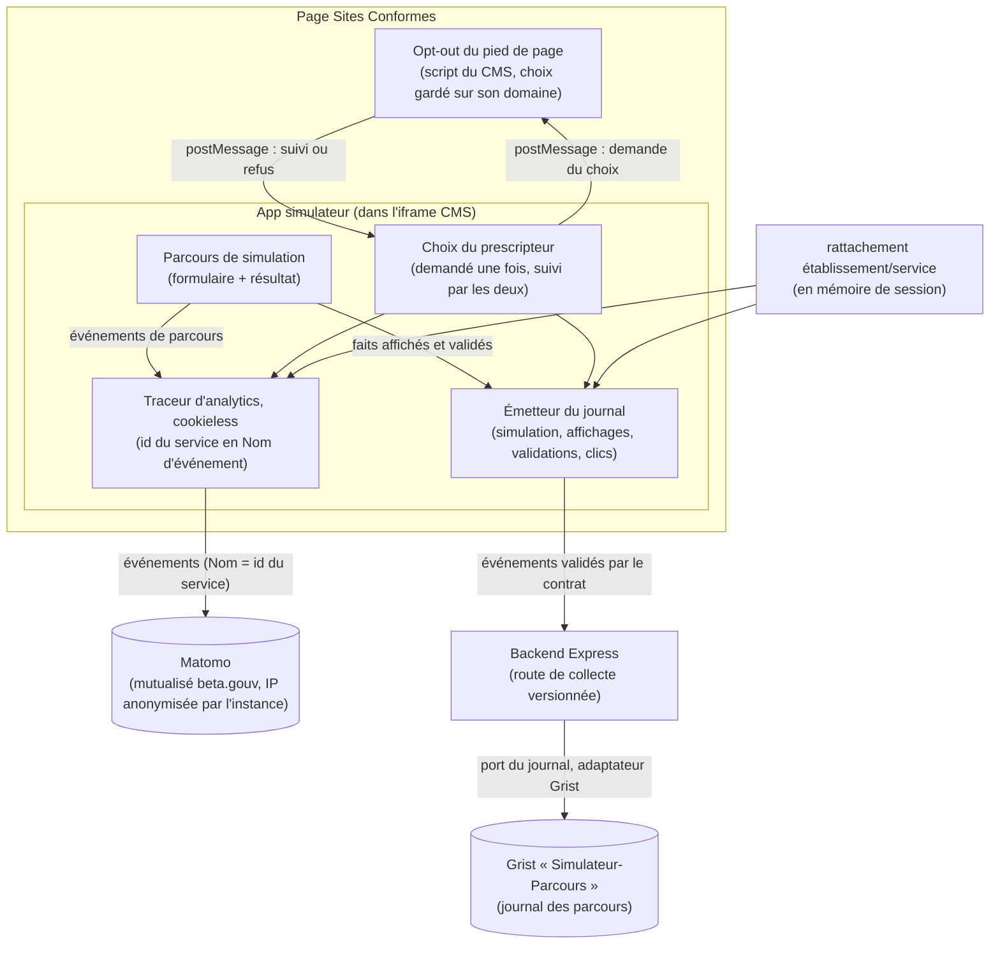

# Architecture : Analytics de parcours

> Statut : **décidé (release officielle)** · Dernière mise à jour : 2026-11-13
>
> Suivi analytique du parcours dans le simulateur d'éligibilité.
> Repose sur le rattachement établissement/service fourni par l'écran de rattachement :
> voir [identification.md](./identification.md).
>
> **Mise à jour 2026-11-13, les arbitrages de l'éditeur sur les véhicules et les
> motifs (#443).** `portions` ne porte plus `TERRESTRE` : la portée M-COMMUN
> parle des « éventuelles » parties terrestres, et aucune réponse ne prouve leur
> présence ou leur absence. Le champ manque, ce qui se lit « inconnu », en
> attendant que l'éditeur dise quelle réponse les établit. Le serveur reçoit
> encore `TERRESTRE` d'un onglet resté sur une version d'avant, et l'écarte.
> Une liste de motifs vide dit qu'aucun motif n'est affiché, et son absence
> qu'on ne sait pas. Voir l'ADR-9.
>
> **Mise à jour 2026-11-13, la couverture de la collecte (#384).** Chaque heure,
> le serveur écrit dans le journal un signe de vie, `alive`. Une heure sans lui
> ressortira « indisponible » au dashboard, pas « zéro ». Les référentiels ne
> sont pas stockés : ceux d'une version se tirent de son code, et leur lecture
> vient avec le dashboard (#440). Voir l'ADR-15.
>
> **Mise à jour 2026-11-13, les versions de l'app (#416).** Chaque événement dit
> quelle app l'a produit : `version` est la version des règles, lue dans
> `rules/VERSION`, et non plus une constante figée à 10.1.7. `app_version` et
> `commit_sha` s'y ajoutent. Le serveur refuse un événement sans elles. Voir
> l'ADR-14.
>
> **Mise à jour 2026-11-13, les rechargements de page (#434).** La première
> simulation d'une page dit comment la page s'est chargée : ouverte, rechargée,
> ou rouverte par l'historique. Dans l'iframe, c'est le script du CMS qui le
> donne. La mesure dira si la reprise après rechargement (#392) vaut d'être
> faite. Voir l'ADR-13.
>
> **Mise à jour 2026-11-13, la taille des champs du document R3 (#389).** Le journal
> reçoit, pour chaque version du document R3, la taille réellement imprimée de
> chaque champ rempli, sous la clé du champ dans le DTO, jamais son texte. Une
> mesure incomplète le dit. Voir l'ADR-12. Cela **étend** l'ADR-10 : la taille
> imprimée fait partie de l'empreinte d'une version.
>
> **Mise à jour 2026-11-13, les boutons exposés et leurs clics (#388).** Le journal
> reçoit l'exposition et le clic d'« Imprimer » et de « Télécharger », sur la fiche
> patient de R2 et sur le document R3, et de « Donner mon avis ». R2 et R3 ouvrent
> désormais un affichage, et la fiche une version, `f1`, `f2`… Voir l'ADR-11. Cela
> **étend** l'ADR-8 aux écrans de résultat.
>
> **Mise à jour 2026-11-13, le document R3 et ses versions (#387).** Le journal reçoit
> chaque version du document R3 affichée, `d1`, `d2`…, avec la révision du R2 dont
> elle vient, et chaque échec de sa génération. Une version tombe avec son R2, et
> une modification de P3 la remplace. Voir l'ADR-10.

> **Mise à jour 2026-11-13, le premier résultat et ses révisions (#386).** Le journal
> reçoit chaque R2 affiché, avec sa révision, ses codes, ses motifs et les portions
> du trajet qu'il restitue, et l'invalidation d'une révision qu'une modification de
> P1 ou de P2 rend caduque. Voir l'ADR-9. Cela **étend** l'ADR-8 : trois compléments
> de champ.
>
> **Mise à jour 2026-11-13, les questions et les jalons affichés (#385).** Le journal
> reçoit ce que le prescripteur voit et fait de chaque question : son affichage, sa
> première saisie, sa validation, et l'invalidation d'une validation qu'une
> correction rend caduque. Il reçoit aussi l'entrée et la fin de P1, P2 et P3, et le
> marquage de la première et de la dernière page de chaque phase. Voir l'ADR-8. Cela
> **étend** l'ADR-6 : deux compléments de champ et un type d'événement de plus.
>
> **Mise à jour 2026-11-13, des hooks sans règles (#383, #414).** Les hooks de l'écran
> (`.hook.ts`) ne font plus que traduire un événement de l'écran en un appel de use
> case. Ce qui compte ou part descend dans les entités : `QuestionnaireRun` tait le
> début d'un questionnaire qui reprend et l'abandon d'un questionnaire fini, `Journey`
> ne garde rien d'une seed. Un use case par action, qui n'en appelle pas d'autre. Les
> contextes React deviennent un fichier d'assemblage sans suffixe. Cela **précise**
> l'ADR-7 ; #414 étendra la règle au reste de l'écran.
>
> **Mise à jour 2026-11-12, la mesure d'audience en clean architecture (#383).** Matomo
> suit le même découpage que le journal (ADR-7) : une entité, un use case, un port et
> son adaptateur, un contexte React. Le choix du prescripteur devient un port partagé,
> demandé une fois au CMS pour Matomo et pour le journal. Plus aucun état global :
> le conteneur instancie Matomo quand il est activé, et sinon une mesure qui ne garde rien. Cela **étend**
> l'ADR-7 à la mesure d'audience et **déplace** le référentiel de l'ADR-4.
>
> **Mise à jour 2026-11-12, journal des parcours (#380, #381).** Le simulateur collecte
> désormais chaque parcours, rattaché à son établissement et à son service, pour le
> dashboard analytics à venir. Le navigateur envoie les événements à notre backend,
> qui les écrit dans le document Grist « Simulateur-Parcours » (ADR-6). Aucun contenu
> de champ libre n'en fait partie. Le responsable du traitement a donné son accord
> à cette collecte. Cela **révise** le §1 (« aucun backend applicatif ne collecte les
> événements ») et l'invariant, et **étend** l'opt-out (ADR-5) au journal. Matomo
> reste en place pour la mesure d'audience (ADR-1). Le même jour, au cadrage de #382 :
> le journal suit la clean architecture, Grist n'en est que le premier adaptateur (ADR-7) ;
> notre contrat s'écrit d'après ANA-1015, le code du paquet ne sert qu'aux tests ; le
> navigateur envoie chaque événement seul et réessaie quelques secondes, sans file ;
> le journal ne s'exporte pas, le dashboard le lira par une API à venir.
>
> **Mise à jour 2026-10-29, indicateur de parcours ALD.** À chaque arrivée sur le
> premier résultat, un parcours ALD envoie son verdict, avec le nombre de questions
> posées de P1 à P2 (§4). Le modèle déclare ce qui compte, le socle compte et envoie
> (D-228 à D-231 du journal de la v10).
>
> **Mise à jour 2026-10-06, vidage avant la v10.** Les événements de résultat et de
> téléchargement de CERFA sont retirés avec le modèle v9 qui les définissait, et les
> noms d'action perdent leur préfixe d'outil (`prescripteur:`, `secretariat:`) : il
> n'y a plus qu'un parcours. Il reste les quatre événements de parcours (§4). Les
> séries Matomo antérieures portent les anciens noms et ne se raccordent pas aux
> nouvelles. Les événements de résultat reviendront avec la v10.
>
> **Mise à jour 2026-09-30, opt-out dans le pied de page du CMS.** L'exemption CNIL
> demande d'informer le prescripteur et de le laisser s'opposer à la mesure. L'opt-out
> vit dans le pied de page de Sites Conformes, hors de notre iframe, et le choix est
> transmis au simulateur par `postMessage` (ADR-5). Le traceur attend ce choix avant
> de mesurer, et ne suit plus les liens sortants. Le texte d'information reste à
> publier sur le CMS (R-12).
>
> **Mise à jour 2026-09-29, mesure par service, sans bandeau.** Le Nom d'événement
> porte désormais l'id Grist du service, en clair, et non plus le `prescripteurRef`
> pseudonymisé, retiré avec l'identification individuelle. Cela **révise** l'ADR-2 (découpage par service) et
> l'ADR-3 (plus de drapeau de consentement), et **lève** la réserve RGPD R-4 : la mesure
> redevient une mesure d'audience agrégée, dans l'exemption de consentement CNIL. Le
> risque R-7 devient sans objet. Deux points restent à tenir : l'anonymisation de l'IP,
> qui se règle sur l'instance Matomo et non dans le code (R-10), et les très petits
> services, où un id de service peut désigner une ou deux personnes (R-11).

## 1. Contexte & objectifs

On veut suivre le parcours de simulation :

- qui démarre le formulaire ;
- qui l'achève ;
- qui l'abandonne, et à quelle étape ;
- le nombre de résultats éligibles et non éligibles par service ;
- la part des parcours ALD qui arrivent au résultat en six pages et six questions
  au plus (#148) ;
- depuis le 2026-11-12, tout ce que les 62 blocs du dashboard analytics demandent :
  ce qui a été réellement affiché (P0, questions, R2, R3, boutons), ce qui a été
  validé ou demandé, et comment le parcours finit. Le dashboard sera livré après le
  simulateur et recalculera l'historique depuis ce journal (#380).
  ~~par prescripteur~~ (jusqu'au 2026-09-29).

Le découpage par service s'appuie sur l'id du service dans le référentiel Grist,
fourni par l'étape de rattachement et gardé en mémoire de session (cf.
[identification.md, ADR-4](./identification.md)). La mesure d'audience part
directement du navigateur vers Matomo. Le journal des parcours passe par notre
backend, qui le conserve, dans Grist pour commencer (ADR-6, ADR-7). ~~Aucun backend applicatif ne collecte les
événements.~~ (jusqu'au 2026-11-12)

**Invariant** : aucune donnée patient, aucune PII, aucun contenu de champ libre et
aucune valeur de réponse ne part, ni vers Matomo ni vers le journal. Transitent les
ids de l'établissement et du service du référentiel, des identifiants techniques
opaques (simulation, événement, exposition, révision), les codes des questions
affichées et l'état de leur validation, et les codes de résultat (issue, motifs,
mode, support, financeur). Le service libre saisi sous « Autre » n'en fait pas
partie. ~~Seuls transitent l'id d'un service du référentiel et des compteurs
d'événements.~~ (jusqu'au 2026-11-12)

## 2. Décisions (ADR)

### ADR-1 - Matomo mutualisé hébergé par beta.gouv.fr

**Décision.** Utiliser l'instance Matomo mutualisée que beta.gouv.fr héberge pour
les produits publics, un service fourni par la communauté beta.gouv et la DINUM,
plutôt qu'une instance auto-hébergée, un backend de collecte maison ou un outil
tiers non souverain.

**Pourquoi.** Matomo couvre le suivi d'événements, les funnels et la segmentation
sans qu'on ait à construire de stockage ni de reporting. L'instance beta.gouv est
hébergée en France et gérée par l'infra publique, ce qui répond à la souveraineté
et à la conformité attendues d'un service public, cohérent avec le DSFR, et ne nous
laisse aucune opération à assurer.

**Conséquences.** Il faut demander la création d'un site dans le Matomo beta.gouv
et récupérer le `siteId` et l'URL du tracker. Les fonctionnalités disponibles
(Funnels, Custom Dimensions) et les quotas dépendent de la configuration de cette
instance mutualisée, qui reste à confirmer (voir R-8). Les réglages de
confidentialité de l'instance, dont l'anonymisation de l'IP, ne sont pas entre nos
mains (voir R-10).

Depuis le 2026-11-12, Matomo ne porte plus que la mesure d'audience. Il ne garde ni
identifiant d'événement dédoublonné, ni séquence, ni lien entre un bouton affiché et
son clic : le journal des parcours qu'attend le dashboard passe par notre backend
(ADR-6).

### ADR-2 - Découpage par service via propriété d'événement (~~par prescripteur~~)

**Décision (révisée 2026-09-29).** L'id Grist du service est porté en propriété
d'événement Matomo : chaque `trackEvent` l'a pour Nom, avec `simulateur` en catégorie
et le type d'événement en action. Un service saisi sous « Autre » donne l'id de
l'entrée « Autre » de son établissement, une structure (libéral, Assurance Maladie,
autre) donne l'id de son service sous l'établissement fourre-tout, un établissement
saisi à l'écran ne donne aucun Nom, et le rattachement dégradé, quand le référentiel
ne répond pas, donne `autre` (voir [identification.md, ADR-4 et §4](./identification.md)). Le reporting utilise le
rapport Événements, en Catégorie puis Action puis Nom, et la segmentation
`eventName == <id du service>`. ~~Le Nom portait le `prescripteurRef`, un
`HMAC-SHA256` calculé côté backend sur l'identité d'un prescripteur nommé.~~

**Pourquoi.** L'instance mutualisée beta.gouv n'expose pas les custom dimensions,
le plugin ou les droits n'étant pas disponibles (R-8). Les propriétés d'événement
donnent le découpage entre éligibles et non éligibles par service, sans
configuration admin ni backend de croisement. L'établissement n'est pas transmis : il
se déduit du service via le référentiel. Le service suffit au pilotage du produit, et
ne désigne pas une personne. Il part en clair : sans personne à masquer, un
pseudonyme n'apportait plus rien (voir [identification.md, ADR-4](./identification.md)).

**Conséquences.** Le nom d'un service se lit dans Grist à partir de son id, sans
secret. Qui a accès au Matomo mutualisé peut, avec le référentiel, savoir quels
établissements utilisent l'outil. Si les custom
dimensions deviennent disponibles, on pourra les ajouter sans changer le transport
actuel. Les données collectées avant le 2026-09-29 portent encore un
`prescripteurRef` en Nom et ne se raccordent pas aux nouvelles ; leur purge relève de
la gouvernance des données, hors de ce document.

### ADR-3 - Mesure sans bandeau de consentement (~~initialisation derrière un flag de consentement~~)

**Décision (révisée 2026-09-29).** Le traceur s'initialise sans demander de
consentement : il est actif en build de production, ou en local sur demande, et
rien d'autre ne le conditionne. ~~L'initialisation du tracking est conditionnée par
un composant de gestion du consentement, donné par défaut et sans bandeau en phase
expérimentale.~~ Le drapeau de consentement, jamais branché, est retiré du code. S'il
fallait un jour un bandeau, on le rajouterait à ce moment-là.

**Pourquoi.** La recommandation CNIL exempte de consentement la mesure d'audience
qui reste agrégée, sans suivi individuel ni recoupement entre sites. Le suivi par
prescripteur sortait de ce cadre : il était quasi nominatif. Le suivi par service y
revient, pourvu que les conditions techniques tiennent :

| Condition d'exemption | Comment elle tient |
|---|---|
| Pas de traceur persistant sur le terminal | Traceur cookieless (`disableCookies`), rien en `localStorage` |
| Finalité de mesure d'audience seule | Événements de parcours et compteurs, aucune réponse détaillée |
| Pas de suivi individuel | Nom d'événement = service, jamais une personne (voir R-11) |
| Pas de recoupement avec d'autres traitements | Instance Matomo dédiée aux produits beta.gouv, aucun export croisé |
| Adresse IP anonymisée | Réglage de l'instance Matomo, à vérifier (R-10) |
| Information et droit d'opposition | Opt-out dans le pied de page du CMS (ADR-5) ; texte d'information à publier (R-12) |

**Conséquences.** Plus de bandeau, et la couverture de la mesure est complète. La
réserve R-4 est levée, à la condition R-10 près. ~~Tant que le sujet RGPD n'est pas
tranché, la collecte individuelle sans bandeau est une réserve de conformité
explicite.~~

### ADR-4 - Référentiel figé des noms d'évènement, jamais composés

**Décision.** Le nom de chaque évènement Matomo est une valeur fixe d'un
référentiel unique (`front/socle/analytics/audience-event.entity.ts`, `EventName`), jamais
composé à la volée par concaténation de chaîne. Ce module n'interprète aucune
donnée métier — ni l'outil, ni le statut d'un résultat, ni le formulaire d'un
CERFA : c'est l'appelant qui choisit l'entrée à émettre, via
`trackEvenement(nom)`. Un nom qui n'est pas une valeur exacte du référentiel
ne compile pas.

**Pourquoi.** Composer un nom à l'exécution (`${outil}:${action}`,
`resultat:${statut}`) rend le vocabulaire ingrepable — aucun symbole ne
correspond au nom réellement envoyé à Matomo — et ne protège d'aucune valeur
incohérente. `cible_cas_final` et `cible_resultat_medical`, deux cibles
publicodes dont la valeur est une phrase d'affichage (jusqu'à 152 caractères
pour l'une d'elles, VSL/TPMR), aggravaient le problème : les utiliser telles
quelles comme nom d'évènement aurait rendu les rapports Matomo dépendants du
phrasé exact du modèle, livré par l'éditeur et sujet à reformulation sans
changement de sens.

**Conséquences.** `outil` (`prescripteur`/`secretariat`) et, pour un résultat,
un **slug court** font désormais partie du nom lui-même — voir §4 pour la
liste complète. Le slug est traduit depuis la phrase publicodes par
l'appelant, pas par le référentiel (`SLUG_CAS_FINAL` dans `Secretariat.tsx`,
`SLUG_RESULTAT_MEDICAL` dans `Prescripteur.tsx`) ; une phrase absente de la
table (montée de version du modèle) retombe sur le slug `indetermine` plutôt
que de faire échouer le parcours pour un souci d'analytics. Les CERFA suivent
le même principe : `formulaire` (typé `Formulaire`, réutilisé par
`DocumentCerfa.fichier`) fait partie du nom, un par document produit.

### ADR-5 - Opt-out tenu par le CMS, transmis à l'iframe par `postMessage`

**Décision (2026-09-30).** L'opt-out est un bouton du pied de page de Sites Conformes,
ajouté par un script que le CMS exécute sur toutes ses pages. Ce script garde le
choix sur le domaine du CMS et le transmet au simulateur par `postMessage` : quand
l'iframe le demande au démarrage, puis à chaque changement. Le traceur n'émet rien et
ne charge pas matomo.js tant que le choix n'est pas connu. Sur refus, il ne charge
rien ; sur un refus en cours de session, il cesse d'émettre. Sans réponse de la page
parente dans un court délai (app ouverte hors du CMS, script absent), la mesure suit
son cours. Le script du CMS est versionné dans ce dépôt et testé comme le reste.

**Pourquoi.** L'opt-out se place dans le pied de page du CMS pour l'UX : c'est là que
le prescripteur cherche ce réglage, et le simulateur n'a pas de pied de page propre
dans l'iframe. Or le navigateur isole le stockage de chaque origine, et range à part
celui d'une iframe tierce : aucun des opt-out natifs de Matomo (cookie posé par la
page du CMS, cookie tiers sur le domaine de Matomo) n'atteint notre traceur. Seul un
message entre les deux fenêtres franchit cette frontière. Le code de Sites Conformes
le permet : ses réglages « Scripts personnalisés » injectent un script sur chaque
page, sa CSP se limite à `frame-ancestors`, et son bloc iframe n'impose pas de
`sandbox` (voir [identification.md](./identification.md), R-1). Seule la page
parente est écoutée, sans vérifier son origine : le message ne porte aucune donnée
et ne fait qu'arrêter ou reprendre notre propre mesure.

**Conséquences.** La page vue part avec un décalage d'au plus une seconde, le temps de
la réponse. Le suivi automatique des liens sortants est retiré : il aurait continué
après un refus en cours de session, `optUserOut` reposant sur un cookie que le
traceur n'écrit pas. Le bouton est inséré dans la liste du pied de page DSFR : si
Sites Conformes change cette structure, il disparaît sans erreur, et la recette doit
le vérifier après chaque montée de version du CMS. Le script vit dans les réglages du
CMS, hors de tout déploiement : sa mise à jour se fait à la main, depuis le fichier du
dépôt. Le refus est mémorisé dans le stockage du CMS, ce que l'exemption autorise pour
retenir une opposition.

Depuis le 2026-11-12, le même choix vaut pour le journal des parcours (ADR-6) : sur
refus, le navigateur n'envoie rien au backend, et cesse d'envoyer sur un refus en
cours de session.

Depuis le 2026-11-13, le même script donne aussi au simulateur le chargement de la
page du CMS (ADR-13).

### ADR-6 - Journal des parcours écrit par le backend (~~dans Grist~~)

**Contexte.** Le dashboard analytics sera livré après le simulateur. Il devra
recalculer ses 62 blocs depuis des événements unitaires, conservés, dédoublonnés et
reliés entre eux : une simulation de P0 à sa fin, un bouton affiché à son clic, un
document à son résultat. Matomo ne sait pas le porter (ADR-1). Le plan de marquage
v10.1.7 et le contrat `analytics/` du paquet de l'éditeur décrivent ces événements.
Le responsable du traitement a donné son accord à cette collecte.

**Décision.** Le navigateur envoie chaque événement à une route de collecte
versionnée de notre backend Express. Le backend :

- valide l'événement contre une liste fermée de champs : notre contrat, écrit
  d'après ANA-1015 (`REFERENTIEL/03` du paquet de l'éditeur) pour le socle, et un
  contrat versionné à part pour nos compléments (`service_id`, exposition des boutons
  documentaires, mesures typographiques). ~~Le contrat du paquet pour le socle.~~ ;
- y ajoute ce que le navigateur ne peut pas prouver : la date de réception, la
  version du schéma, l'environnement ;
- le conserve dans le journal (ADR-7) : un renvoi identique du même `event_id` est
  ignoré, le même `event_id` avec un autre contenu est mis à part comme collision ;
  ~~l'écrit dans le document Grist « Simulateur-Parcours », en ajout ou mise à jour sur
  l'`event_id`~~ ;
- n'accuse réception qu'une fois l'écriture faite.

Chaque événement porte l'id de l'établissement et celui du service du rattachement.
Le contrat v0.1 du plan de marquage (16 événements, `p0_viewed`, `cta_exposed`…)
n'est pas suivi : il est historique.

Le contrat vit dans `shared/analytics/`, en TypeScript : le navigateur n'en prend que
les types, le backend valide avec. ANA-1015 le dit lui-même : les fichiers
`analytics/` du paquet sont ses dérivés. Le validateur et le réducteur
(`contrat-analytics.mjs`) n'entrent pas dans le code : ses exemples doivent passer
notre validateur, et son réducteur sert d'oracle dans les tests. Si le texte et le
code du paquet divergent, le texte fait foi.

Le navigateur envoie chaque événement seul, dans un `fetch` en `keepalive`, qui
survit à la fermeture de l'onglet. Sur une erreur réseau ou une réponse 5xx, il
réessaie après 0,5, 1, 2 puis 4 secondes, et abandonne. Un refus du contrat (4xx)
n'est pas réessayé. Il n'y a ni file ni stockage dans le navigateur.

Le journal ne s'exporte pas. Le dashboard le lira par une API du backend, construite
avec lui.

**Pourquoi.** Un journal tenu par le backend se dédoublonne, se date et se filtre en
un seul endroit, que le navigateur ne peut pas contourner. Un contrat à nous suit nos
règles de code et se teste sur les exemples de l'éditeur à chaque livraison. Le
réessai sans file couvre une coupure brève pour presque rien : une perte plus longue
est un cas à la marge, et elle se voit sans rien construire, par un trou dans les
`sequence` d'une simulation. Une file sur le disque survivrait à l'onglet, mais elle
écrirait sur le poste du prescripteur, ce que l'ADR-3 écarte. ~~**Pourquoi Grist.**
L'équipe y tient déjà le référentiel, le backend sait déjà y écrire (le rattachement
« Autre »), et l'app n'a aucune base de données à exploiter. Le journal se lit et
s'exporte sans outil de plus.~~ (voir ADR-7)

**Conséquences.**

- Le backend devient un point de passage de la collecte : s'il ne répond pas
  pendant les quelques secondes du réessai, l'événement est perdu. La perte se lit
  dans la couverture, par les trous de `sequence`. ~~Le navigateur garde un nombre
  borné d'événements à renvoyer.~~
- Si l'onglet se ferme entre deux essais, l'événement est perdu aussi : `keepalive`
  ne protège que la requête en cours.
- Chaque événement fait une écriture : pas de lot à constituer, mais un débit à
  surveiller (R-13).
- Aucune adresse IP ni aucun en-tête du navigateur n'est écrit dans le journal.
- Un rechargement de la page crée une nouvelle simulation : l'app ne garde rien
  d'un rechargement à l'autre. La reprise viendra avec #392 si les rechargements
  le justifient (R-14, ADR-13).

### ADR-7 - Le journal en clean architecture, Grist en premier adaptateur

**Contexte.** Grist sert à démarrer : l'équipe y tient déjà le référentiel, le
backend sait déjà y écrire, et l'app n'a pas de base de données. Mais il n'est pas
fait pour stocker des événements en masse, et il ne tiendra probablement pas dans
la durée.

**Décision.** Le journal suit la clean architecture, côté serveur
(`server/journal/`) comme côté écran (`front/socle/analytics/`). Depuis le
2026-11-12, la mesure d'audience aussi, dans le même dossier de l'écran. Chaque
fichier dit son rôle par son suffixe, et chaque rôle s'écrit en classe ou en
interface :

| Suffixe | Rôle | Serveur | Écran |
|---|---|---|---|
| `.entity.ts` | une notion et ses règles, sans dépendance | `JournalEntry` : l'événement daté à sa réception, qui sait s'il en répète un autre, ou le signe de vie de l'heure | `Journey` : la simulation, qui numérote et date ses événements, ne garde que sa première intention, et rien d'une seed ; elle entre dans chaque phase et la termine une fois, et sait quelles validations une correction fait tomber (ADR-8) ; `PageView` : un affichage de page, qui expose chaque question une fois et porte ses jalons ; `QuestionnaireRun` : un passage dans le questionnaire, qui tait le début d'une reprise, l'abandon après la fin, et tout le questionnaire du cerfa ; `AudienceEvent` : un événement Matomo, son nom pris dans `EventName`, et l'id du service, jamais le service libre |
| `.usecase.ts` | une action, qui ne parle qu'aux entités et aux ports | `CollectAnEvent` : garde un nouvel événement, ignore un renvoi, met une collision à part ; `ReportAlive` : écrit le signe de vie de l'heure (ADR-15) | `StartASimulation` : ouvre un parcours et le signale sur P0 ; `SelectAnIntent` : signale le premier choix validé en P0 ; `OpenAPage`, `RevealQuestions`, `AnswerAQuestion` : une page ouverte, les questions qu'une saisie révèle, une saisie ; `StartAQuestionnaire`, `PassAStep`, `CorrectAnAnswer`, `CompleteAQuestionnaire`, `LeaveAQuestionnaire` : le début, une étape, une correction, la fin et l'abandon d'un questionnaire, `PassAStep` et `CompleteAQuestionnaire` parlant à Matomo et au journal ; `ReachAnAldResult` : le verdict ALD sur le premier résultat. Un use case n'en appelle pas un autre |
| `.port.ts` | l'interface qu'un use case ou un adaptateur attend de l'extérieur | `Journal` : retrouver, ajouter, mettre à part | `Journal` : garder un événement ; `Audience` : compter un événement ; `ConsentSource` : suivre le choix du prescripteur |
| `.adapter.ts` | une classe qui implémente un port | `GristJournal` ; `DiscardingJournal`, qui ne garde rien, sans doc Grist ; `MemoryJournal`, pour les tests | `ServerJournal` : envoi, réessais ; `MatomoAudience` : file `_paq`, amorçage, chargement de matomo.js ; `DiscardingAudience`, qui ne mesure rien, quand Matomo n'est pas activé ; `CmsConsent` : le choix demandé au CMS (ADR-5), que les deux premiers suivent |
| `.controller.ts` | une entrée HTTP, qui valide la requête et appelle un use case | `JournalController` : la route de collecte | |
| `.hook.ts` | l'adaptateur primaire de l'écran : du React, et un appel de use case par événement, sans règle métier (#414) | | `journey.hook.ts` : `useRecordTheJourney` ; `questionnaire.hook.ts` : `useQuestionnaireTracking` ; `ald-pathway.hook.ts` : `useAldResultReached` |

Les adaptateurs parlent HTTP par deux clients préconfigurés (`.client.ts`), qui
portent l'adresse, l'authentification, le JSON et les erreurs :
`server/grist/grist-api.client.ts` (`GristApiClient`, serveur → Grist) et
`front/socle/server-api/server-api.client.ts` (`ServerApiClient`, écran → serveur).
Le référentiel et le rattachement passent aussi par eux. L'adaptateur Grist, seul à
connaître le document « Simulateur-Parcours », range chaque événement en colonnes
communes (`event_id`, `simulation_id`, `sequence`, type, dates, environnement,
version du schéma, `is_test`) et le reste en JSON dans une colonne `payload`, et les
collisions dans une table à part.

Chaque côté a un conteneur, `container.ts` à sa racine, qui instancie une fois ses
classes et les exporte. `server/container.ts` choisit les adaptateurs d'après la
configuration (`adaptersFor`), puis assemble use case et contrôleur
(`createContainer`), que `server.ts` donne à `app.ts`. `front/container.ts`
instancie le client du serveur, le choix du prescripteur, Matomo s'il est activé (sinon une mesure qui ne garde rien), le
journal, leurs use cases, le référentiel et la déclaration du rattachement, que
`main.tsx` donne à l'app. Les use cases forment un seul ensemble
(`analyticsUseCases`, ADR-8), qu'`App` pose dans un contexte React
(`use-cases-in-the-tree.ts`), où les hooks les lisent : aucune variable globale ne
les porte. Le simulateur y pose aussi le parcours de sa simulation, où le
questionnaire signale ses pages. Le rattachement se lit en session dans les hooks, pas dans le simulateur,
qui ignore qui prescrit. Le simulateur signale le parcours de sa simulation par
`useRecordTheJourney`, qui l'ouvre sur P0 et y signale l'intention que le modèle
déclare (`Model.intent`) ; le questionnaire signale ses pages, ses saisies et ses
validations par `useQuestionnaireTracking`, et le simulateur envoie le verdict ALD qu'il calcule
(`aldPathwayOf`) par `useAldResultReached`. Les deux conteneurs
exportent une fonction appelée une fois au démarrage, pas des instances, car rien
ne doit s'exécuter au chargement d'un module (QUAL-004). Les fichiers qui
assemblent (`container.ts`, `server.ts`, `app.ts`, `main.tsx`, les `index.ts`,
`use-cases-in-the-tree.ts`)
n'ont pas de suffixe.

**Pourquoi.** Changer de stockage ne doit toucher qu'un adaptateur. Si l'adaptateur
décidait seul qu'un renvoi est un doublon, la règle partirait avec lui. Le suffixe
dit au lecteur, avant d'ouvrir le fichier, de quel côté de la frontière il est.
Colonnes communes plus JSON : le journal sert au rejeu, pas à la lecture à l'œil, et
la table ne bouge pas quand le contrat gagne un champ.

**Conséquences.** Les use cases se testent entièrement sur l'adaptateur en mémoire.
L'adaptateur Grist n'a que des tests d'aller-retour. Une nouvelle variable de
configuration, `JOURNAL_GRIST_DOC_URL`, donne l'adresse du document
« Simulateur-Parcours ». Elle n'a pas de défaut : la collecte n'écrit dans Grist
que là où on la pose, en production. Ailleurs, staging compris, le serveur prend
`DiscardingJournal`, qui accepte les événements sans en garder aucun : la mémoire du
serveur ne grossit pas avec le trafic. Le test
d'architecture vérifie que les entités, use cases et ports n'importent qu'entre eux
et depuis `shared/`, et que seul `grist-journal.adapter.ts` importe `server/grist/`.
Le rattachement n'est pas encore découpé ainsi : il le sera sur ce modèle.

### ADR-8 - Les questions, les affichages et les jalons de phase

**Contexte.** Les funnels par question du dashboard (P07 à P09) demandent, par
phase, la première et la dernière question applicables vues, l'arrêt avant
validation, et des validations qui restent justes après une correction (#385). Le
contrat de l'éditeur donne `question_exposed`, `question_interacted`,
`question_validated`, `phase_entered` et `phase_completed`, avec `question_id`,
`page_id` et `exposure_id`. Il ne dit ni quelle page ferme une phase, ni quel
affichage de page porte une exposition, ni qu'une validation ne vaut plus.

**Décision.**

1. **Jalons.** La première et la dernière page d'une phase se marquent à
   l'affichage. `Simulation` dit, pour la page ouverte, si elle est la première ou
   la dernière de sa partie parmi les pages qui se posent avec les réponses
   validées. Chaque `question_exposed` de la page en porte le complément
   `milestones` (`first`, `last`, ou les deux). Les phases sont les parties du
   modèle dont l'id est une phase du contrat (`P1`, `P2`, `P3`) : aucune étiquette
   de funnel sur les questions, la partie les range déjà. Si une réponse sur la
   page marquée « dernière » ouvre une page de plus, c'est la dernière exposition
   de la phase qui compte.
2. **`page_id`.** C'est l'id de la page du modèle, sans traduction. Les deux pages
   que le contrat nomme portent son nom : `P2/contextes-situations` (Q2.2.1) et
   `P2/contextes-soins` (Q2.2.1.b). L'urgence est `Q2.3.4` à ses deux places.
3. **Affichages.** Un affichage de page naît quand le simulateur ouvre une page :
   un bouton, un lien de correction ou le bouton Retour du navigateur, jamais un
   rendu. Il porte le complément `page_view_id`. Une question y est exposée une
   fois, à son apparition, sous `exposure_id = page_view_id:question_id`. Une
   sous-question qu'un brouillon révèle est exposée dans le même affichage. Une
   saisie émet `question_interacted` quand elle change de question, et une page
   validée émet `question_validated` pour chaque question affichée.
4. **Invalidation.** Après chaque validation, les questions validées qui ne le
   sont plus (`Simulation.validated`) émettent le type complémentaire
   `question_invalidated`, avec l'`exposure_id` de la validation qu'il annule.
5. **Matomo et journal.** Un geste de l'écran est un use case, qui reçoit la
   mesure d'audience et le journal : « Suivant » fait avancer `QuestionnaireRun`
   vers Matomo et le parcours vers le journal.
6. **Phases.** `phase_entered` part au premier affichage d'une page de la phase,
   `phase_completed` à la première validation qui la quitte. Une fois chacun par
   simulation : un retour n'en émet plus. L'entrée en P3 portera la `revision` du
   R2 qui l'ouvre avec #386.

**Pourquoi.** Le simulateur sait déjà quelles pages se posent : marquer à
l'affichage évite au dashboard de recalculer le parcours. Une exposition tirée de
son affichage n'a rien à mémoriser, et un rendu redonne le même id. Seul le moteur
sait quelle validation une correction fait tomber : le dashboard ne peut pas la
déduire. Un use case par geste garde le hook sans règle (#414).

**Conséquences.** Le contrat de nos compléments passe en version 2 :
`page_view_id`, `milestones` et `question_invalidated`. Le second questionnaire,
celui du cerfa, ne mesure toujours rien dans Matomo, mais il alimente le journal.
Aucune réponse ne part : seulement des identifiants de question et de page.

### ADR-9 - Le premier résultat et ses révisions

**Contexte.** Le dashboard compte l'accès au premier résultat sur le premier R2
d'une simulation, et la répartition des issues sur le dernier R2 encore valide
(#386). Le contrat de l'éditeur donne `result_displayed`, avec `revision`,
`can_complete`, `issue`, `mode`, `reason_codes` et `support`, et
`result_invalidated`. Il dit qu'une modification de P1 ou de P2 invalide le R2,
que ces codes ne viennent que des sorties calculées, et qu'un champ absent vaut
« inconnu ». Il ne dit ni qui fournit les codes, ni quelle modification compte,
ni quand un R2 est affiché.

**Décision.**

1. **Les codes.** Le modèle déclare ce que le R2 donne au journal
   (`Model.resultCodes`), en une valeur calculée sur ses cibles : l'issue, le
   mode, les codes de raison, le support et le financeur. Le socle l'évalue à
   l'affichage et l'envoie, sans connaître les cibles. Comme pour l'indicateur
   ALD, ce qu'elle lit ne fait poser aucune question : la mesure suit le
   parcours.
2. **La révision.** `Journey` numérote les révisions du premier résultat, `r1`,
   `r2`… Un R2 réaffiché sans modification garde sa révision, et une révision
   tombée ne revient pas, même si les réponses redeviennent celles d'avant.
3. **L'invalidation.** Une révision tombe à la validation d'une page de P1 ou de
   P2 dont les réponses validées changent (`ValidatedAnswers.sameAs`) :
   `result_invalidated` part aussitôt, avec la révision. Revalider sans rien
   changer, ou reculer, ne fait rien tomber. Le complément ne touche pas au R2.
4. **L'affichage.** `result_displayed` part quand le contenu du R2 est chargé,
   une fois par révision. `can_complete` vaut ce que le socle affiche : le
   bouton qui verrouille, ou rien.
5. **Les états.** Un code part s'il a une valeur. Une cible sans valeur laisse
   le champ absent, ce que le contrat lit « inconnu ». Le dashboard sépare le
   sans objet du manquant par l'issue. `reason_codes` part dès que les règles
   l'ont calculé : une liste vide dit qu'elles n'ont donné aucun code, et son
   absence qu'il leur manquait un fait.
6. **Les compléments.** `financeur`, la cible du même nom. `motifs`, les
   identifiants des motifs du catalogue que le R2 affiche, choisis par le même
   calcul que leur texte (`FirstResult.motifs`). `portions`, les portions du
   trajet que le R2 restitue : `LIGNE_REGULIERE`, ou aucune
   (`FirstResult.portions`). ~~`TERRESTRE`~~ ne part plus (#443) : la
   présence d'une partie terrestre est inconnue, faute de réponse qui la
   prouve. Une liste vide part : rien n'est affiché. Sans liste, on ne sait
   pas, et le champ ne part pas.
7. **Le complément.** `phase_entered` de P3 porte la révision du R2 qui l'ouvre.

**Pourquoi.** Le socle reste aveugle au métier, comme pour l'intention.
Seul le moteur sait qu'une validation change les réponses : l'écran ne compare
rien. Envoyer au chargement est le seul moment où `can_complete` est connu et où
le prescripteur a vu le résultat. Les motifs et les portions viennent du calcul
qui les affiche : le journal et l'écran ne peuvent pas diverger. Une valeur
inventée pour le sans objet serait une sortie que le modèle ne calcule pas.

**Conséquences.** Le contrat de nos compléments reste en version 2, qui n'est pas
encore livrée : `financeur`, `motifs` et `portions` s'y ajoutent. Le modèle de
test ne déclare pas de codes : son R2 n'envoie que `revision` et `can_complete`.
L'éditeur a tranché la liste des motifs visibles et la classification des
modes (#443) : la collecte garde les identifiants source. Le catalogue cache le
pourquoi de l'étranger : ce R2 envoie une liste de motifs vide. S'il le
montrait, ses points, sans identifiant au catalogue, ne donneraient pas de
liste.

### ADR-10 - Le document R3 et ses versions

**Contexte.** Le dashboard compte une simulation menée jusqu'au bout quand le
document R3 affiché appartient au R2 encore valide (#387). Le contrat de
l'éditeur donne `document_displayed`, avec `document_id` et `revision`, et
`document_generation_failed`. Il dit qu'une modification de P1 ou de P2 invalide
le R2 et ses documents, et qu'une modification documentaire remplace
`document_id`. Il ne dit ni d'où vient cet identifiant, ni quand un document est
affiché, ni ce qu'un échec porte.

**Décision.**

1. **La version.** Un document est une version : `d1`, `d2`… dans une
   simulation. Son contenu, le nom du fichier daté et le DTO du cerfa, et la
   révision du R2 dont il vient, en font l'empreinte. Une empreinte nouvelle
   ouvre la version suivante ; la même empreinte, au retour sur R3 sans
   changement, garde la version et ne repart pas.
2. **L'affichage.** `document_displayed` part quand le PDF est prêt et affiché,
   une fois par version, avec `document_id`, `revision`, et le `support` et le
   `mode` de la révision courante quand ils ont une valeur.
3. **L'invalidation.** Aucun événement de plus : un document tombe avec son R2
   (`result_invalidated`), et une modification de P3 le remplace par la version
   suivante.
4. **L'échec.** `document_generation_failed` part à chaque tentative ratée, la
   première et chaque nouvel essai, avec la révision et le support, sans cause.
   Un échec n'ouvre aucune version.
5. **Sans révision.** Rien ne part d'un document sans R2 courant.

**Pourquoi.** Le journal ne survit pas à l'onglet (R-14) : une version n'a pas à
se retrouver d'une session à l'autre, un compteur suffit. L'empreinte suit ce que
le PDF montre : le prescripteur qui revient sur R3 sans rien changer voit le même
document. Le reducer de l'éditeur ne lit que la révision d'un document : un
événement d'invalidation de plus ne changerait aucun compte. La cause d'un échec
viendrait des réponses, que le journal ne prend pas.

**Conséquences.** La ligne de #387 sur « l'invalidation d'un artefact » se lit
comme ci-dessus : remplacé, ou tombé avec son R2. Un R3 d'une révision ne complète
pas la suivante, puisque sa révision ne vaut plus la révision courante.

### ADR-11 - Les boutons exposés, et leurs clics

**Contexte.** Le dashboard calcule, par simulation et par affichage, le taux de
clic de cinq boutons (#388) : « Imprimer » et « Télécharger » sur la fiche patient
de R2, les mêmes sur le document R3, et « Donner mon avis » en R2 ou en R3. Le
contrat de l'éditeur donne `feedback_exposed` et `feedback_clicked` pour l'avis.
Pour le document, il donne `document_print_requested`,
`document_download_requested` et `document_download_succeeded`. Il n'a rien pour
exposer les boutons du document, ni pour la fiche. R2 et R3 n'ouvraient aucun
affichage (ADR-8), et la fiche n'avait pas d'identité.

**Décision.**

1. **L'affichage.** Chaque montage de R2 ou de R3 ouvre un affichage, numéroté
   comme ceux des pages (`page_view_id`), sans question ni phase. Revenir sur le
   même R2 en ouvre un nouveau, avec la même révision.
2. **La fiche.** Une fiche patient est une version : `f1`, `f2`… dans une
   simulation, une par révision qui en montre une. Le complément `sheet_id` la
   porte.
3. **L'exposition.** Un bouton est exposé quand il est posé et utilisable, une
   fois par affichage et par version d'objet, sous
   `exposure_id = page_view_id:bouton:objet`. Pour la fiche, c'est au chargement
   du R2. Pour le document, c'est quand sa version est prête, avec
   `document_displayed`. Un bouton grisé n'est pas exposé. La position dans la
   fenêtre ne compte pas.
4. **Les types.** Les boutons de la fiche et du document sont exposés par le
   complément `action_exposed`, avec `action` (`print` ou `download`) et
   `sheet_id` ou `document_id`. La fiche a trois compléments :
   `sheet_print_requested`, `sheet_download_requested` et
   `sheet_download_succeeded`. Le document et l'avis gardent les types de
   l'éditeur. Chaque exposition et chaque clic portent `screen`,
   `page_view_id`, `exposure_id` et `revision`. L'avis porte aussi
   `document_id` en R3.
5. **Le clic.** Chaque clic envoie sa demande, avec l'exposition du bouton
   cliqué : le dashboard compte un clic par exposition. Un clic qui relance une
   génération ratée du document n'a pas de version, et n'envoie rien.
6. **La réussite.** `…_download_succeeded` part quand le PDF est remis au
   navigateur, avec l'exposition de sa demande. Une préparation ratée, ou une
   page quittée avant la fin, n'envoie rien de plus.

**Pourquoi.** Le `page_view_id` garde un seul sens, « cette page, cette fois ».
Une exposition tenue par le bouton rattache son clic à l'affichage où il est
né, jamais à un autre. Toute modification qui changerait la fiche fait tomber la
révision : une empreinte n'ajouterait rien. Mettre la fiche dans `document_id`
fausserait le funnel R3 de l'éditeur. Un bouton offert est une mesure stable,
qui ne dépend ni de l'écran ni du défilement. Le code ne voit pas plus loin
que le fichier remis : il ne certifie pas un enregistrement.

**Conséquences.** Le contrat de nos compléments reste en version 2, qui n'est pas
encore livrée : `sheet_id`, `action` et quatre types s'y ajoutent. Le reducer de
l'éditeur lit ses types tels quels. Un taux « vu dans la fenêtre » serait un
autre fait, à décider s'il est demandé.

### ADR-12 - La taille des champs du document R3

**Contexte.** Le dashboard suit la plus petite taille imprimée d'un document R3,
la taille de chacun de ses champs, et leur évolution (K10 à K12, #389). Le
contrat de l'éditeur a les colonnes `field_group` et `font_size_pt`, mais aucun
événement de mesure. Son plan de marquage nomme `document_typography_measured`,
avec un identifiant de version, un état de la mesure, le nombre de champs
remplis, les champs mesurés et ceux qui ne le sont pas. Le cerfa rapetisse un
texte qui ne tient pas dans son cadre, jusqu'au plancher de 6 pt, ou le dessine
dessous : la taille de départ ne dit pas ce qui s'imprime.

**Décision.**

1. **Un événement par version.** `document_typography_measured` part avec
   `document_displayed`, une fois par version, avec `screen` (`R3`),
   `document_id`, `revision` et `support`. Il se relie aux impressions de la
   même version par `document_id`.
2. **Le champ.** Un champ rempli est une entrée de texte du DTO du cerfa qui a
   une valeur : un texte, une date, ou un texte dessiné hors des champs. Les
   cases n'en sont pas. `field_id` est sa clé dans le DTO (`depart_structure`),
   et `support` dit de quel cerfa. Un commentaire s'imprime dans le champ de son
   texte : il se mesure sous la clé de ce texte.
3. **La taille.** `font_size_pt` est la taille où le texte s'imprime, après le
   calcul qui le fait tenir : dans son champ, ou dessiné dessous. Un texte porté
   par plusieurs volets garde sa plus petite taille.
4. **La couverture.** `status` vaut `complete` quand chaque champ rempli a sa
   taille, et `partial` sinon. `unmeasured_field_ids` nomme les champs sans
   taille, qui ne figurent pas dans `fields`. Pas de nombre de champs remplis :
   il se lit dans les deux listes.
5. **L'empreinte.** La taille imprimée fait partie de l'empreinte d'une version
   (ADR-10) : un rendu qui change, à DTO égal, ouvre la version suivante.

**Pourquoi.** La mesure appartient à la version, pas à l'impression : deux
impressions de la même version donnent un seul document et ses champs. La clé du
DTO est stable d'une version du modèle à l'autre, et c'est un nom écrit par le
code : le journal le borne à une forme d'identifiant, et refuse un texte saisi.
La plus petite taille est celle que le lecteur subit. Un champ sans taille fausserait
la classe du document : la mesure se dit incomplète plutôt que de la placer.

**Conséquences.** Le contrat de nos compléments reste en version 2 : `fields`,
`unmeasured_field_ids` et un type s'y ajoutent, et `status` reprend la colonne de
l'éditeur. Les noms du plan de marquage se lisent ainsi : `artifact_version_id`
est `document_id`, `measurement_status` est `status`. Aucun texte, aucune
longueur de texte ne part.

### ADR-13 - Les rechargements de page

**Contexte.** Un rechargement crée une nouvelle simulation, et l'ancienne reste
sans fin (R-14). La reprise (#392) garderait l'état du parcours dans le
navigateur : plusieurs jours de travail, des textes médicaux et l'adresse du
patient dans le stockage de session, et une révision des ADR-3 et ADR-4. Rien ne
dit encore que les prescripteurs rechargent. Le navigateur donne le type de
chargement d'une page (`PerformanceNavigationTiming.type`) : `navigate`,
`reload` ou `back_forward`. Mais dans l'iframe du CMS, vérifié sous Chrome, un
rechargement de la page du CMS laisse l'iframe se dire `navigate`.

**Décision.**

1. **Mesurer avant de reprendre.** #392 attend les chiffres. Si les
   rechargements sont rares, elle ne se fait pas.
2. **Le complément.** `simulation_started` porte `navigation` : `navigate`,
   `reload` ou `back_forward`. Un type inconnu, ou pas de réponse, et le
   complément manque.
3. **La première simulation seulement.** « Faire une nouvelle simulation » ne
   recharge pas la page : les simulations suivantes de la page ne portent pas
   `navigation`.
4. **Le CMS le donne.** Le simulateur demande
   `chargement-simulateur:demande` à la page qui l'embarque, au démarrage. Le
   script du CMS répond `chargement-simulateur:type`, avec le type de sa propre
   page. Hors iframe, le simulateur lit le sien.

**Pourquoi.** Une mesure coûte quelques lignes, la reprise plusieurs jours et des
données de santé dans le navigateur. Le type du navigateur est le seul signal
fiable d'un rechargement : sans stockage, une simulation ne sait rien de la
précédente. Seule la page du CMS voit le sien, d'où la question au script qui
répond déjà au simulateur (ADR-5). La demande part avec le conteneur, bien avant
que le rattachement ouvre la simulation : la réponse est là, sans délai à
attendre. Seule la page parente est écoutée, sans vérifier son origine : le
message ne porte qu'un type que le contrat borne.

**Conséquences.** Le contrat de nos compléments reste en version 2 :
`navigation` s'y ajoute. Le script du CMS est à recoller dans Sites Conformes ;
d'ici là, dans l'iframe, `navigation` manque. La part des `reload` parmi les
premières simulations se lit dans le journal. Un rechargement par le navigateur
d'un onglet resté ouvert (mise en veille, mémoire) compte aussi en `reload`.

### ADR-14 - Les versions de l'app sur chaque événement

**Contexte.** Le dashboard compare des simulations faites sur des règles, et des
builds, différents (#380). Le champ `version` d'ANA-1015 valait une constante,
`10.1.7`, restée telle depuis l'intégration de la v10.1.8. La version de l'app et
le commit déployé ne s'affichaient qu'au pied de page. Les exemples et le contrat
de l'éditeur (`analytics/` du paquet v10.1.8) mettent dans `version` la version
du modèle, `10.1.8`, et son dashboard range les simulations par elle.

**Décision.**

1. **Trois champs, sur chaque événement.** Le parcours les ajoute à tous ceux
   qu'il numérote, comme `simulation_id` :

   | Champ | Ce qu'il dit | D'où il vient | Format |
   |---|---|---|---|
   | `version` | la version des règles | `core/models/eligibilite/rules/VERSION`, que l'intégration d'une livraison écrit | `10.1.8` |
   | `app_version` | la version de l'app | `package.json`, lu au build (`VERSION_APP`) | `0.8.0` |
   | `commit_sha` | le commit déployé | `SOURCE_VERSION` de Scalingo, ou `git`, au build (`SHA_COMMIT`) | 7 caractères hexadécimaux, ou `inconnu` |

2. **La version des règles vient du modèle.** Le contrat `Model` du socle front
   la déclare. Le modèle de l'éditeur la lit dans `rules/VERSION` par un import
   `?raw` : une montée du modèle la change sans retouche du code.
3. **Le serveur les exige.** Un événement sans l'un des trois, ou d'un autre
   format, est refusé.
4. **La version de notre contrat reste à part.** C'est `schema_version`, que le
   serveur écrit (ADR-6).

**Pourquoi.** On colle au contrat de l'éditeur : son dashboard filtre par
`version`. Une seule source pour chaque version : rien à monter à la main, donc
rien à oublier. Le build écrit `inconnu` quand il ne trouve pas le commit, et le
pied de page l'affiche : le serveur l'accepte, pour qu'un tel build ne perde pas
tous ses événements, et l'inconnu se lit dans le journal.

**Conséquences.** Le contrat de nos compléments reste en version 2, qui n'est pas
encore en production : `app_version` et `commit_sha` s'y ajoutent. Les événements
de staging antérieurs n'ont pas ces champs, et portent `10.1.7`. Le modèle de
démonstration et celui des tests déclarent leur propre version.

### ADR-15 - La couverture de la collecte, et les référentiels tirés du code

**Contexte.** Le dashboard (#440) doit distinguer un zéro d'une collecte absente,
et montrer à zéro ce qui pouvait arriver sans être arrivé : une question jamais
affichée, une version sans simulation. Le journal ne dit que ce qui est arrivé.
Le plan de marquage demande des référentiels versionnés et une couverture : le
début fiable de la collecte, ses interruptions. Une coupure (serveur arrêté,
Grist en panne) ne laisse aucune trace dans le journal.

**Décision.**

1. **Un signe de vie par heure.** Le serveur écrit dans le journal, au démarrage
   puis à chaque heure pleine, un événement `alive` qui porte `app_version` et
   `commit_sha`. Il passe par le même port que les événements des navigateurs.
   Une heure sans `alive` est une heure sans collecte. Son identifiant tient
   l'heure et la version (`alive:2026-11-13T14:0.8.0:f30aafe`) : deux serveurs
   de la même version n'écrivent qu'une ligne par heure, et une version qui
   démarre en cours d'heure a la sienne.
2. **Les versions du serveur.** `app_version` vient du `package.json`, lu au
   démarrage ; `commit_sha` de `CONTAINER_VERSION`, que Scalingo pose sur le
   conteneur, sur 7 caractères, ou `inconnu`.
3. **Aucun référentiel stocké.** Les questions, jalons, issues, motifs, modes,
   documents et champs d'une version se tirent de son code, relu à son tag
   `simulateur-eligibilite@<app_version>` ou au `commit_sha` de ses événements
   (ADR-14). Les établissements et services sont dans le référentiel Grist, et
   chaque événement porte les deux.
4. **Les calculs viennent avec le dashboard** (#440) : les zéros, le regroupement
   des services, les versions listées, les périodes indisponibles.

**Pourquoi.** La couverture se prouve là où l'événement s'écrit : si le journal
n'écrit plus, le signe de vie manque aussi, sans rien de plus à construire. Le
code d'une version ne se perd pas : le stocker à côté ne ferait que le recopier.
Une lecture écrite avant le dashboard devinerait sa forme, et personne ne
l'appellerait d'ici là.

**Conséquences.** Le journal porte deux sortes d'entrées : les événements de
parcours et `alive`, qui n'a ni simulation ni séquence. Environ 8 800 lignes de
plus par an dans Grist (R-13). Un échec d'écriture du signe de vie se lit dans les
journaux du serveur, sans l'arrêter. Hors production, le journal jette tout,
`alive` compris. Les périodes de validité des établissements et la règle de
population référencée restent à trancher (#440).

## 3. Architecture cible



| Composant | Rôle | Statut |
|---|---|---|
| Traceur Matomo | mesure d'audience | inchangé |
| Émetteur du journal | crée la simulation, émet les faits réellement affichés, validés ou demandés | ajouté (2026-11-12) |
| Route de collecte | valide, date la réception, dédoublonne, écrit par le port du journal | ajouté (2026-11-12) |
| Grist « Simulateur-Parcours » | conserve le journal, premier adaptateur du port (ADR-7) | ajouté (2026-11-12) |

~~Un composant de gestion du consentement autorisait l'initialisation du traceur.~~
Retiré le 2026-09-29 (ADR-3).

Depuis la fusion, tout le parcours, rattachement et simulation, tourne dans
l'iframe du CMS. C'est un contexte tiers, où les cookies sont bloqués. Le traceur
est donc cookieless (`_paq.push(["disableCookies"])`) : les événements partent sans
cookie, ce qui convient à une mesure d'audience sans bandeau. L'API JavaScript de
Matomo n'a pas de commande pour anonymiser l'IP : c'est un réglage de l'instance.

## 4. Spécification des événements

Événements `trackEvent` émis par le traceur, en catégorie `simulateur`, portant l'id
Grist du service en Nom, ou `autre` pour un rattachement dégradé. ~~Ce nom était absent
si le parcours avait démarré sans rattachement pseudonymisé (API indisponible).~~ Le nom d'action est une valeur fixe du référentiel
`EventName` (`front/socle/analytics/audience-event.entity.ts`, ADR-4) — jamais composé à
l'exécution.

**Parcours** (~~un jeu par outil, `prescripteur:…` / `secretariat:…`~~, un seul
jeu depuis le 2026-10-06) :

| Action | Valeur | Moment du parcours |
|---|---|---|
| `simulation_start` | — | ouverture du simulateur, début du formulaire |
| `simulation_step` | `stepIndex` | passage à la page suivante |
| `simulation_complete` | — | affichage de la page de résultat |
| `simulation_abandon` | `lastStep` | départ (onglet quitté) sans avoir atteint le résultat |

Le complément posé après le verrou du résultat n'émet rien.

**Parcours ALD** (#148, D-228 à D-231 du journal de la v10). Un seul de ces
événements part à chaque arrivée sur le premier résultat, juste après
`simulation_complete`, si le parcours est un parcours ALD. Sa valeur est le nombre
de questions posées de P1 à P2 ; un groupe de cases compte une question.

| Action | Valeur | Verdict |
|---|---|---|
| `parcours_ald_dans_la_cible` | questions | au plus six pages et six questions |
| `parcours_ald_trop_de_pages` | questions | plus de six pages |
| `parcours_ald_trop_de_questions` | questions | six pages au plus, plus de six questions |
| `parcours_ald_caisse` | questions | issue caisse, sans conclusion sur le droit |

Le verdict part à chaque passage par le résultat : le taux compte des passages, pas
des simulations (D-230). Le modèle déclare le parcours compté, l'issue caisse, les
parties et la limite (`aldIndicator`) ; le socle compte et envoie.

Rien d'autre ne part (D-255) : la raison d'un dépassement est le nom du verdict,
la durée se lit entre `simulation_start` et `simulation_complete`, et les types
de soins, qui sont des réponses, ne partent pas.

~~**Résultat** (`secretariat:resultat:<slug>`), un slug par valeur de
`cible_cas_final`.~~ Retiré le 2026-10-06 avec le modèle v9.

~~**Résultat** (`prescripteur:resultat:<slug>`), un slug par valeur de
`cible_resultat_medical`.~~ Retiré le 2026-10-06 avec le modèle v9.

~~**CERFA** (`secretariat:cerfa_telecharge:<formulaire>`), un par document.~~
Retiré le 2026-10-06 avec le téléchargement des trois CERFA.

- **Interdits** : les réponses détaillées du formulaire, toute PII, toute donnée
  patient.
- **Reporting** : le rapport Événements (Catégorie, Action, Nom) et la segmentation
  `eventName == <id du service>` donnent les éligibles et non éligibles par service,
  ainsi que le taux d'abandon par étape.

## 5. RGPD & consentement

- **Depuis le 2026-09-29** : la mesure est agrégée par service, cookieless, sans
  réponse détaillée. Elle entre dans l'exemption de consentement CNIL et se passe de
  bandeau (ADR-3), sous deux réserves : l'IP doit être anonymisée par l'instance
  Matomo (R-10), et les très petits services restent un cas limite (R-11).
- **Depuis le 2026-09-30** : le prescripteur peut s'opposer à la mesure depuis le pied
  de page du CMS (ADR-5). Reste à l'en informer dans la politique de confidentialité
  (R-12).
- ~~Le suivi par prescripteur est quasi nominatif, donc hors de l'exemption de
  consentement CNIL. En conformité stricte, il demande un bandeau.~~
- ~~Choix du porteur en phase expérimentale : démarrer sans bandeau, avec suivi
  individuel, et instruire le sujet en parallèle.~~
- ~~Repli conforme si le bandeau devient nécessaire : une mesure d'audience anonyme
  et agrégée, sans `prescripteurRef`.~~ C'est ce repli, par service, qui est devenu la
  règle.

## 6. Découpage en incréments (analytics)

1. **Matomo funnel.** ✅ **Fait** (`front/socle/analytics/`, site 275,
   `https://stats.beta.gouv.fr/`). Le traceur est instrumenté dans le simulateur,
   avec le référentiel d'événements de l'ADR-4. Il est amorcé au boot en cookieless
   (`disableCookies`), et lit le service en session à l'émission de chaque
   événement, ce service étant renseigné après le rattachement. Il est gardé par
   un gating dev/prod : actif en build de prod, ou en local avec
   `VITE_MATOMO_ENABLED=true`, et sans effet sinon. Reste à configurer les Funnels
   côté Matomo si nécessaire.
2. **Mesure par service, sans bandeau.** ✅ **Fait (2026-09-29)**. Le Nom d'événement
   porte l'id Grist du service, en clair, le drapeau de consentement est retiré. *Reste : vérifier
   l'anonymisation de l'IP sur l'instance (R-10).*
3. **Opt-out dans le pied de page du CMS.** ✅ **Fait côté simulateur (2026-09-30)** :
   le traceur attend le choix du CMS (ADR-5), et le script du CMS est versionné et
   testé. *Reste : coller le script dans Sites Conformes avec l'origine réelle du
   simulateur, publier le texte d'information (R-12).*

4. **Journal des parcours.** En cours (#380) : la route de collecte et l'écriture dans
   Grist (#382), la simulation et son intention (#383), les questions et les jalons
   (#385, ADR-8), le premier résultat et ses révisions (#386, ADR-9), le document R3
   et ses versions (#387, ADR-10), les boutons exposés et leurs clics (#388,
   ADR-11), la taille des champs du document R3 (#389, ADR-12), les rechargements
   de page (#434, ADR-13), les versions de l'app (#416, ADR-14), la couverture de
   la collecte (#384, ADR-15), puis la fin de parcours, dans sa tâche.

Prérequis : l'écran de rattachement fournit le service (cf.
[identification.md](./identification.md), incréments 1–2 et 6).

## 7. Risques & validations en attente

| Réf | Risque / à valider | Portée |
|---|---|---|
| ~~**R-4**~~ | ~~**RGPD** : le suivi par prescripteur sans bandeau n'est pas conforme CNIL en l'état.~~ **Levé (2026-09-29)** : le suivi porte sur le service, dans l'exemption (ADR-3), sous réserve de R-10. | résolu |
| ~~**R-7**~~ | ~~Couverture partielle du KPI par prescripteur si un bandeau devient nécessaire.~~ **Sans objet (2026-09-29)** : plus de bandeau, plus de KPI par prescripteur. | résolu |
| **R-8** | Instance mutualisée beta.gouv : les custom dimensions sont indisponibles, ce que l'ADR-2 contourne en passant par une propriété d'événement. Restent à confirmer la disponibilité des Funnels et les quotas. | partiellement tranché |
| **R-10** | **Anonymisation de l'IP** : l'exemption CNIL l'exige, et elle se règle sur l'instance Matomo (Administration → Confidentialité), pas dans le code. À confirmer auprès des admins de stats.beta.gouv.fr pour le site 275. | conformité, **à vérifier avant la release** |
| **R-11** | **Très petits services** : dans un service d'une ou deux personnes, l'id du service désigne de fait des individus. Réserve mineure, acceptée sans traitement dans le code. | conformité |
| **R-12** | **Information des prescripteurs** : l'exemption exige de dire ce qui est mesuré et comment s'y opposer. Le texte, dans la politique de confidentialité du CMS, doit décrire la mesure par service et renvoyer à l'opt-out du pied de page. | conformité, **à publier avant la release** |
| **R-13** | **Volume du journal dans Grist** : une simulation donne des dizaines d'événements. Les limites de taille d'un document et le débit de l'API Grist sont à mesurer avant la communication de l'app, et un archivage à prévoir s'ils approchent. | exploitation |
| **R-14** | **Reprise après rechargement** : garder le même `simulation_id` après un rechargement demande un stockage dans le navigateur, que l'ADR-3 écarte. D'ici #392 (priorité basse), un rechargement crée une nouvelle simulation et l'ancienne reste sans fin. La première simulation d'une page dit si elle a été rechargée (ADR-13) : #392 attend ces chiffres. | décidé, plus tard |
| **R-15** | **Durée de conservation** du journal : à fixer avec l'équipe responsable des données. | conformité, plus tard |
| **R-16** | **Droits de la clé d'API** sur « Simulateur-Parcours » : lecture, écriture et création de table vérifiées le 2026-11-12 avec la clé de staging. La clé de production reste à vérifier avant la livraison. | exploitation, **à vérifier avant la release** |

## 8. Vérification

```bash
pnpm --filter simulateur-eligibilite exec vitest run tests/socle/analytics
```
