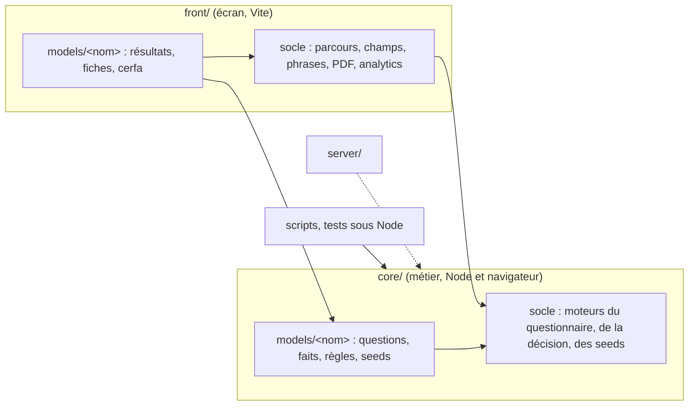

# Architecture : le métier et l'écran

> Statut : **décidé (phase expérimentale)** · Dernière mise à jour : 2026-10-22
>
> Où vit le métier du simulateur, et comment l'écran s'y branche. Les décisions
> ont été prises seul par l'agent qui a mené le chantier, sur délégation de
> Simon, le 2026-10-22 : elles sont à relire (issues 202 à 207 du dépôt).

## 1. Contexte & objectifs

Jusqu'à la v10.1.3, tout le simulateur vit dans `front/`. Le moteur de
questionnaire, le moteur de décision et les modèles y côtoient React, le DSFR
et Vite. Rien ne l'interdit, mais rien ne le sépare non plus : un moteur qui
écrit une phrase d'écran, un modèle qui mêle ses faits et ses fiches, des règles
que seul Vite sait lire.

Trois besoins le rendent coûteux :

- **calculer sans navigateur.** Un serveur ou un script doit pouvoir rejouer une
  préconisation, sur les seules réponses, pour une API ou une recette ;
- **lire le métier d'un coup d'œil.** Ce que l'éditeur livre (questions, faits,
  règles) doit se lire sans traverser des composants ;
- **tester le métier sans écran.** Une seed se rejoue sur la préconisation, pas
  sur un rendu.

Objectif : une racine du métier, `core/`, qui se charge sous Node comme dans le
navigateur, et un écran, `front/`, qui l'affiche.

## 2. Décisions (ADR)

### ADR-1 - Le métier dans une racine à part, `core/` (~~dans `front/`~~)

**Contexte.** Le métier vivait dans `front/socle/` (les moteurs) et
`front/models/` (les modèles). Le nom `domain/` a été écarté par Simon : `core/`
dit mieux ce qui reste quand on retire l'écran.

**Décision.** `core/` est une quatrième racine de runtime, à côté de `front/`,
`server/` et `shared/`. Elle porte les moteurs (questionnaire, décision, seeds)
et le métier de chaque modèle. Elle n'importe ni React, ni le DOM, ni le front,
ni le serveur. Ses imports portent l'extension `.ts`, comme tout ce que Node
atteint. Elle a son propre projet TypeScript, sans les types du DOM.

**Conséquences.** Le front et le serveur importent `core/`, jamais l'inverse. Un
test de frontières le garde. Ce qui touche à l'affichage reste dans `front/` :
le parcours à l'écran, son brouillon, les champs, les phrases.

### ADR-2 - Les règles en JSON versionné (~~YAML converti par Vite~~)

**Contexte.** D-71 faisait convertir le YAML de l'éditeur par Vite, à la
compilation, pour qu'aucun analyseur YAML ne parte dans le navigateur. Node ne
passe pas par Vite : le métier n'y aurait pas trouvé ses règles.

Trois options :

| Option | Pour | Contre |
|---|---|---|
| un analyseur YAML dans `core/` | rien à générer | l'analyseur part dans le bundle, ce que D-71 refuse |
| un chargeur Node pour le YAML | rien à générer | un réglage de plus pour Node, les tests et le serveur |
| un JSON calculé du YAML, versionné | Node et le navigateur l'importent tels quels | un fichier généré à tenir à jour |

**Décision.** La troisième. `pnpm regles` écrit `regles.json` à côté du YAML
livré, et le JSON est versionné. Un test vérifie qu'il dit les mêmes règles que
le YAML. Le JSON est marqué comme généré pour GitHub.

**Conséquences.** Le YAML reste la pièce livrée, recopiée telle quelle. Une
livraison demande une commande de plus, que les skills d'intégration disent, et
que le test rappelle si on l'oublie. D-71 tient pour le reste : aucun analyseur
YAML dans le navigateur.

### ADR-3 - Le moteur dit la nature d'un problème, l'écran en écrit la phrase

**Contexte.** Le moteur de questionnaire écrivait ses messages d'erreur
(« Cette réponse est attendue. », « Indiquez un code postal de 5 chiffres. »)
et le « (facultatif) » des libellés. Une API ne veut pas de ces phrases, et un autre
écran voudrait les siennes.

**Décision.** Le moteur donne la nature d'un problème (une réponse manquante,
un nombre hors bornes, un champ d'adresse mal formé). L'écran en écrit la
phrase. Les phrases que l'éditeur livre (un blocage, une incompatibilité, une
incohérence) restent dans le moteur, telles quelles : elles font partie du
métier, et une API doit pouvoir les donner.

**Conséquences.** Les phrases de l'écran vivent en un seul endroit du front.
Une nature nouvelle oblige l'écran à lui donner sa phrase : TypeScript le
réclame.

### ADR-4 - Deux contrats : le métier d'un modèle, et son écran (~~un seul `Model`~~)

**Contexte.** Le contrat `Model` mêlait le questionnaire, la préconisation, les
seeds, les deux résultats et le cerfa. D-09 nommait le premier résultat
`transportAndEligibility`, du nom de la première partie du parcours.

**Décision.** `CoreModel`, dans `core/`, porte le métier : les parties d'avant
le verrou (`questionnaire`), celle d'après (`complement`), la préconisation et
les seeds. `Model`, dans `front/`, le porte sous `core`, et y ajoute les deux
résultats, `result` et `cerfa`. Le premier résultat ne s'appelle plus
`transportAndEligibility` : ce nom disait une partie du parcours, pas un
résultat. **Ceci remplace D-09** (D-135 du
[journal](./journal-des-decisions-v10.md)). Aucune fonction ne fabrique un `CoreModel` : un
type annoncé suffit, puisque rien n'est à effacer.

**Conséquences.** Le serveur ou un script prend le seul `CoreModel`. Le socle de
l'écran lit le métier sous `model.core`.

### ADR-5 - Un modèle a deux dossiers du même nom

**Contexte.** Il fallait ranger le métier d'un modèle dans `core/` sans perdre
le lien avec son écran.

**Décision.** Un modèle a un dossier dans `core/models/` et un dans
`front/models/`, sous le même nom. Le métier (déclarations, parties du
questionnaire, faits, règles, seeds) va dans `core/`. L'écran (résultats,
fiches, cerfa, illustrations) va dans `front/`. `front/models/` dit quels
modèles existent : un modèle sans écran ne s'ouvre pas. Le socle a deux points
d'entrée, un par racine : un modèle importe le socle du métier par l'un, celui
de l'écran par l'autre. Les règles d'architecture raisonnent par nom de modèle,
à travers les deux dossiers : aucun modèle n'importe l'autre, d'un côté comme
de l'autre.

**Conséquences.** Une partie du parcours qui pose des questions vit dans
`core/` (P1, P2, P3). Un résultat vit dans `front/` (R2, R3). Le type des
textes de R2 que l'éditeur livre va dans `core/` : c'est une déclaration de
son livrable. Le formatage d'une adresse pour l'affichage reste dans `front/`.

### ADR-6 - Un test charge le métier sous Node

**Contexte.** Les frontières de `core/` se vérifient par ses imports. Rien ne
prouvait encore qu'il se charge vraiment hors de Vite : un import sans
extension, un JSON sans attribut d'import passent le typecheck et cassent sous
Node.

**Décision.** Un test lance Node sur le métier de chaque modèle, sans Vite. Il
rejoue les seeds qui annoncent des attendus, et compte celles que la
préconisation dément.

**Conséquences.** Une régression de chargement tombe dans `pnpm verifier`, pas
au premier script qui en aurait besoin.

### ADR-7 - Le moteur lit le questionnaire en objets (~~fonctions libres~~)

**Contexte.** Le moteur exposait des fonctions libres sur `(pages, answers,
cibles)` : les pages posées, les questions d'une page, les validées, la
complétude, la validation d'une page. Chacune refaisait la lecture complète,
gardes et faits compris, et l'écran d'une page la faisait cinq fois. Les
rappels avaient deux formes : le modèle les écrivait sur un objet, le moteur
les appelait avec trois arguments, et un adaptateur traduisait d'après une
liste de noms tenue à la main.

**Décision.** Deux objets. `Questionnaire` porte les pages, dans l'ordre.
`questionnaire.readWith(answers, cibles)` donne une `Reading`, calculée une
fois à sa construction : pages et questions posées, questions validées,
complétude, page où l'on rouvre, page suivante. Une lecture ne change pas :
valider une page (`commit`) donne de nouvelles réponses, qu'on relit. Tous
les rappels reçoivent le même contexte, `{ answers, validated, cibles,
faits }`, où les faits ne se calculent qu'à la lecture. L'adaptateur
disparaît. Le hook de l'écran ne garde que l'état (page ouverte, brouillon) et
demande le reste à la lecture.

**Conséquences.** Une page fait deux lectures : les réponses validées, qui
disent les pages, et les mêmes avec le brouillon, qui disent ce que la page
pose. La trace de debug garde la forme brute des validées
(`ValidatedAnswers.toJSON`).

### ADR-8 - La question posée ne porte que des données

**Contexte.** La lecture recopiait la question déclarée avec ses valeurs du
moment, fonctions comprises. Rien ne distinguait une question déclarée d'une
question posée, et une API n'aurait pas pu sérialiser ce que l'écran reçoit.
Juger une réponse passait par des fonctions libres réparties dans trois
fichiers.

**Décision.** Une question posée est un objet par sorte (`AskedSingleChoice`,
`AskedNumber`, `AskedAddress`…), distingué par `kind`. Ses champs ne sont que
des données : libellé, rappel, options, bornes, mode d'adresse, incohérences
du moment. Ses méthodes, sur le prototype, disent ce qu'elle garde d'une
réponse (`kept`), si la réponse suffit (`isAnsweredBy`) et ce qui n'y va pas
(`problemsWith`). `askedQuestion` la relit depuis son JSON, à l'identique ;
un test le vérifie sur toutes les questions posées par les seeds.

| Option | Pour | Contre |
|---|---|---|
| des données, et des fonctions libres pour les juger | rien à changer | ce que fait une question se lit dans plusieurs fichiers |
| un objet qui garde ses fonctions | rien à recopier | ne passe pas en JSON |
| un objet par sorte, données en champs, règles en méthodes | passe en JSON ; une sorte porte ses règles | une classe par sorte à tenir |

Les déclarations restent des objets littéraux jusqu'au constructeur de #204 :
`askedIn(question, contexte)` est donc une fonction du moteur, et non encore
une méthode de la question déclarée.

**Conséquences.** L'écran ne reçoit plus que des questions posées. Le
récapitulatif de R3 relit P3 par le questionnaire, et le contexte d'une
question ne sort plus du socle (`contextOf`).

## 3. Architecture cible



| Composant | Racine | Rôle | Statut |
|---|---|---|---|
| Moteur de questionnaire | `core/` | questions posées, validées, problèmes d'une saisie, réponses effacées | déplacé |
| `Questionnaire` et `Reading` | `core/` | des réponses lues une fois : pages, questions posées, validées, page suivante | nouveau |
| Question posée (`AskedQuestion`) | `core/` | la question du moment, en données ; ce qu'elle garde d'une réponse et ce qui n'y va pas | nouveau |
| Questionnaire à l'écran | `front/` | page ouverte, brouillon, navigation, phrases, champs | modifié |
| Moteur de décision | `core/` | des faits aux cibles, seul à importer publicodes | déplacé |
| Seeds | `core/` | ce qu'est une seed, ce qu'elle confirme ou dément | déplacé |
| Écran des seeds | `front/` | la liste, le rejeu à l'écran | inchangé |
| Contrat du métier (`CoreModel`) | `core/` | questionnaire, complément, préconisation, seeds | nouveau |
| Contrat de l'écran (`Model`) | `front/` | le métier sous `core`, les deux résultats | modifié |
| Métier d'un modèle | `core/models/` | déclarations, parties, faits, règles, seeds | déplacé |
| Écran d'un modèle | `front/models/` | résultats, fiches, cerfa | modifié |

## 4. Ce qui va où

Une seule question tranche : **un serveur qui calcule une préconisation en
a-t-il besoin ?**

| Pièce | Oui : `core/` | Non : `front/` |
|---|---|---|
| une question, ses options, ses conditions | ✓ | |
| un libellé livré par l'éditeur | ✓ | |
| une phrase écrite par l'app (« (facultatif) ») | | ✓ |
| un fait, une règle, une cible | ✓ | |
| une seed et ses attendus | ✓ | |
| le brouillon d'une page, la navigation | | ✓ |
| un résultat, une fiche, un cerfa | | ✓ |

## 5. Découpage en incréments

| Incrément | Issue | Statut |
|---|---|---|
| Sortir le métier du front | 202 | ✅ |
| Moteur objet | 203 | ✅ |
| Constructeur de questions | 204 | à venir |
| Faits : une déclaration par fait | 205 | à venir |
| Cibles : un objet valeur par cible | 206 | à venir |
| Concepts du modèle | 207 | à venir |

## 6. Risques & validations en attente

| Id | Risque | Mesure |
|---|---|---|
| R-1 | Les décisions de ce document ont été prises sans Simon | relecture de la PR, issue par issue |
| R-2 | Le JSON des règles oublié après une livraison | un test compare le JSON au YAML ; les skills d'intégration disent la commande |
| R-3 | Le serveur n'importe pas encore le métier : la frontière n'est éprouvée que par un test | le test sous Node rejoue toutes les seeds à attendus |
| R-4 | Une question posée gagne une fonction, et ne passe plus en JSON | le test de conformité relit chaque question posée par les seeds |

## Vérification

```bash
cd apps/simulateur-eligibilite
pnpm vitest run tests/frontieres-des-racines.test.ts tests/architecture.test.ts
pnpm vitest run tests/model/metier-sous-node.test.ts tests/model/regles-a-jour.test.ts
pnpm vitest run tests/model/conformite.test.ts tests/socle/questionnaire-engine
```
