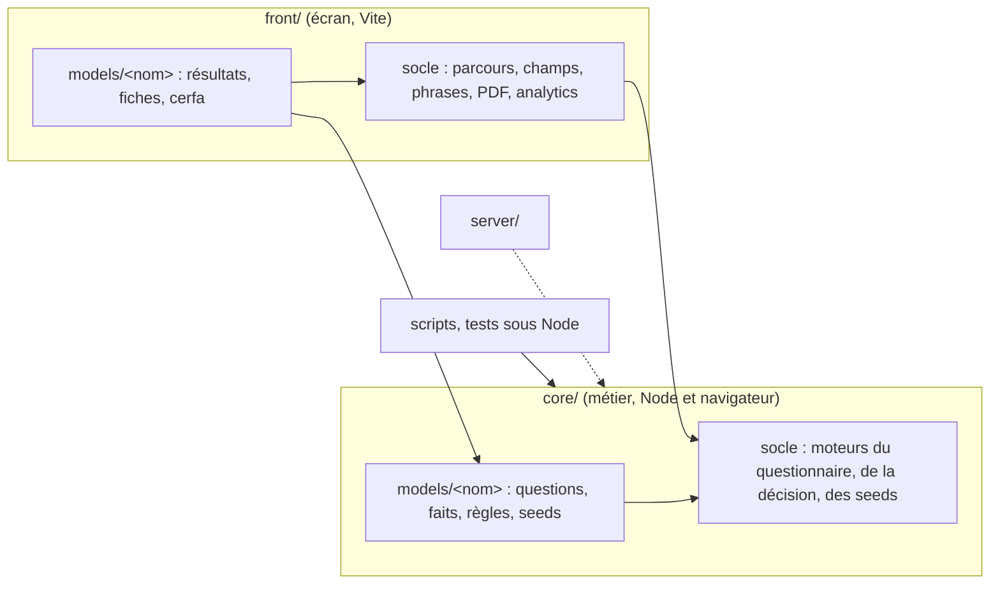

# Architecture : le métier et l'écran

> Statut : **décidé (phase expérimentale)** · Dernière mise à jour : 2026-10-28
>
> Où vit le métier du simulateur, et comment l'écran s'y branche. Les décisions
> ont été prises seul par l'agent qui a mené le chantier, sur délégation de
> Simon, le 2026-10-22 : elles sont à relire (issues 202 à 207 du dépôt).
>
> **Mise à jour 2026-10-23, deux fusions de staging.** Staging avait pris
> sept numéros du journal le 2026-10-22, puis sept autres pour le texte médical
> de R3. Les décisions de ce chantier, D-134 à D-149 dans les messages de
> commit, sont D-148 à D-163 au journal. La première fusion porte aussi R3 et
> QUAL-017 sur `core/` : les noms d'absence choisis sont au journal, D-164.
>
> **Mise à jour 2026-10-23, un fichier par fait (#218).** L'ADR-12 est révisé :
> une déclaration ne vit plus dans le thème de la question qui pose son fait,
> mais dans son propre fichier, sous `faits/`. Une page ne garde que ses
> questions et ses gardes. L'ADR-18 est précisé : un concept peut répondre par
> un `Fait`, que la déclaration reprend, sans déclarer de fait du catalogue.
> Décision de Simon, au journal D-165.
>
> **Mise à jour 2026-10-27, les faits en valeurs (#245).** Un fait est une
> valeur nommée, faite de règles sur des conditions (ADR-22). L'ADR-12 et
> l'ADR-13 perdent `retient`, l'ADR-18 les concepts que seuls les faits
> lisaient. Décisions de Simon, au journal D-202 à D-207.
>
> **Mise à jour 2026-10-28, la fin des concepts (#247).** L'ADR-18 et l'ADR-20
> sont renversés : `concepts/` disparaît, avec `AnswersReader` et
> `numeroDeLOption`. Une lecture de réponse s'écrit là où elle sert, même deux
> fois. Une donnée de l'éditeur se partage en donnée, dans `declarations/`
> (`RETIREE_SI_Q21`). Aucun fichier n'est commun aux pages et aux faits.
> Décisions de Simon, au journal D-208 à D-210.
>
> **Mise à jour 2026-10-28, les gardes écrites (#248).** L'ADR-23 écrit les
> décisions de #243 et #244, prises le 2026-10-27 : une garde est une
> condition, `answer()` se lit selon l'endroit, `appliesWhen` dit le sens et
> `mattersWhile` l'utilité, et la complétude n'a qu'une exception,
> `assuming`. L'ADR-16 est précisé. Décisions de Simon, au journal D-211 à
> D-215.

## 1. Contexte & objectifs

Jusqu'à la v10.1.3, tout le simulateur vit dans `front/`. Le moteur de
questionnaire, le moteur de décision et les modèles y côtoient React, le DSFR
et Vite. Rien ne l'interdit, mais rien ne le sépare non plus : un moteur qui
écrit une phrase d'écran, un modèle qui mêle ses faits et ses fiches, des règles
que seul Vite sait lire.

Trois besoins en font un coût :

- **calculer sans navigateur.** Un serveur ou un script doit pouvoir rejouer une
  préconisation, sur les seules réponses, pour une API ou une recette ;
- **lire le métier d'un coup d'œil.** Ce que l'éditeur livre (questions, faits,
  règles) doit se lire sans traverser des composants ;
- **tester le métier sans écran.** Une seed se rejoue sur la préconisation, pas
  sur un rendu.

Objectif : une racine du métier, `core/`, qui se charge sous Node comme dans le
navigateur, et un écran, `front/`, qui l'affiche.

## 2. Décisions (ADR)

### ADR-1 - Le métier dans une racine à part, `core/` (~~dans `front/`~~)

**Contexte.** Le métier vivait dans `front/socle/` (les moteurs) et
`front/models/` (les modèles). Le nom `domain/` a été écarté par Simon : `core/`
dit mieux ce qui reste quand on retire l'écran.

**Décision.** `core/` est une quatrième racine de runtime, à côté de `front/`,
`server/` et `shared/`. Elle porte les moteurs (questionnaire, décision, seeds)
et le métier de chaque modèle. Elle n'importe ni React, ni le DOM, ni le front,
ni le serveur. Ses imports portent l'extension `.ts`, comme tout ce que Node
atteint. Elle a son propre projet TypeScript, sans les types du DOM.

**Conséquences.** Le front et le serveur importent `core/`, jamais l'inverse. Un
test de frontières le garde. Ce qui touche à l'affichage reste dans `front/` :
le parcours à l'écran, son brouillon, les champs, les phrases.

### ADR-2 - Les règles en JSON versionné (~~YAML converti par Vite~~)

**Contexte.** D-71 faisait convertir le YAML de l'éditeur par Vite, à la
compilation, pour qu'aucun analyseur YAML ne parte dans le navigateur. Node ne
passe pas par Vite : le métier n'y aurait pas trouvé ses règles.

Trois options :

| Option | Pour | Contre |
|---|---|---|
| un analyseur YAML dans `core/` | rien à générer | l'analyseur part dans le bundle, ce que D-71 refuse |
| un chargeur Node pour le YAML | rien à générer | un réglage de plus pour Node, les tests et le serveur |
| un JSON calculé du YAML, versionné | Node et le navigateur l'importent tels quels | un fichier généré à tenir à jour |

**Décision.** La troisième. `pnpm regles` écrit `regles.json` à côté du YAML
livré, et le JSON est versionné. Un test vérifie qu'il dit les mêmes règles que
le YAML. Le JSON est marqué comme généré pour GitHub.

**Conséquences.** Le YAML reste la pièce livrée, recopiée telle quelle. Une
livraison demande une commande de plus, que les skills d'intégration disent, et
que le test rappelle si on l'oublie. D-71 tient pour le reste : aucun analyseur
YAML dans le navigateur.

### ADR-3 - Le moteur dit la nature d'un problème, l'écran en écrit la phrase

**Contexte.** Le moteur de questionnaire écrivait ses messages d'erreur
(« Cette réponse est attendue. », « Indiquez un code postal de 5 chiffres. »)
et le « (facultatif) » des libellés. Une API ne veut pas de ces phrases, et un autre
écran voudrait les siennes.

**Décision.** Le moteur donne la nature d'un problème (une réponse manquante,
un nombre hors bornes, un champ d'adresse mal formé). L'écran en écrit la
phrase. Les phrases que l'éditeur livre (un blocage, une incompatibilité, une
incohérence) restent dans le moteur, telles quelles : elles font partie du
métier, et une API doit pouvoir les donner.

**Conséquences.** Les phrases de l'écran vivent en un seul endroit du front.
Une nature nouvelle oblige l'écran à lui donner sa phrase : TypeScript le
réclame.

### ADR-4 - Deux contrats : le métier d'un modèle, et son écran (~~un seul `Model`~~)

**Contexte.** Le contrat `Model` mêlait le questionnaire, la préconisation, les
seeds, les deux résultats et le cerfa. D-09 nommait le premier résultat
`transportAndEligibility`, du nom de la première partie du parcours.

**Décision.** `CoreModel`, dans `core/`, porte le métier : les parties d'avant
le verrou (`questionnaire`), celle d'après (`complement`), la préconisation et
les seeds. `Model`, dans `front/`, le porte sous `core`, et y ajoute les deux
résultats, `result` et `cerfa`. Le premier résultat ne s'appelle plus
`transportAndEligibility` : ce nom disait une partie du parcours, pas un
résultat. **Ceci remplace D-09** (D-149 du
[journal](./journal-des-decisions-v10.md)). Aucune fonction ne fabrique un `CoreModel` : un
type annoncé suffit, puisque rien n'est à effacer.

**Conséquences.** Le serveur ou un script prend le seul `CoreModel`. Le socle de
l'écran lit le métier sous `model.core`.

### ADR-5 - Un modèle a deux dossiers du même nom

**Contexte.** Il fallait ranger le métier d'un modèle dans `core/` sans perdre
le lien avec son écran.

**Décision.** Un modèle a un dossier dans `core/models/` et un dans
`front/models/`, sous le même nom. Le métier (déclarations, parties du
questionnaire, faits, règles, seeds) va dans `core/`. L'écran (résultats,
fiches, cerfa, illustrations) va dans `front/`. `front/models/` dit quels
modèles existent : un modèle sans écran ne s'ouvre pas. Le socle a deux points
d'entrée, un par racine : un modèle importe le socle du métier par l'un, celui
de l'écran par l'autre. Les règles d'architecture raisonnent par nom de modèle,
à travers les deux dossiers : aucun modèle n'importe l'autre, d'un côté comme
de l'autre.

**Conséquences.** Une partie du parcours qui pose des questions vit dans
`core/` (P1, P2, P3). Un résultat vit dans `front/` (R2, R3). Le type des
textes de R2 que l'éditeur livre va dans `core/` : c'est une déclaration de
son livrable. Le formatage d'une adresse pour l'affichage reste dans `front/`.

### ADR-6 - Un test charge le métier sous Node

**Contexte.** Les frontières de `core/` se vérifient par ses imports. Rien ne
prouvait encore qu'il se charge vraiment hors de Vite : un import sans
extension, un JSON sans attribut d'import passent le typecheck et cassent sous
Node.

**Décision.** Un test lance Node sur le métier de chaque modèle, sans Vite. Il
rejoue les seeds qui annoncent des attendus, et compte celles que la
préconisation dément.

**Conséquences.** Une régression de chargement tombe dans `pnpm verifier`, pas
au premier script qui en aurait besoin.

### ADR-7 - Le moteur lit le questionnaire en objets (~~fonctions libres~~)

**Contexte.** Le moteur exposait des fonctions libres sur `(pages, answers,
cibles)` : les pages posées, les questions d'une page, les validées, la
complétude, la validation d'une page. Chacune refaisait la lecture complète,
gardes et faits compris, et l'écran d'une page la faisait cinq fois. Les
rappels avaient deux formes : le modèle les écrivait sur un objet, le moteur
les appelait avec trois arguments, et un adaptateur traduisait d'après une
liste de noms tenue à la main.

**Décision.** Deux objets. `Questionnaire` porte les pages, dans l'ordre.
`questionnaire.readWith(answers, cibles)` donne une `Reading`, calculée une
fois à sa construction : pages et questions posées, questions validées,
complétude, page où l'on rouvre, page suivante. Une lecture ne change pas :
valider une page (`commit`) donne de nouvelles réponses, qu'on relit. Tous
les rappels reçoivent le même contexte, `{ answers, validated, cibles,
faits }`, où les faits ne se calculent qu'à la lecture. L'adaptateur
disparaît. Le hook de l'écran ne garde que l'état (page ouverte, brouillon) et
demande le reste à la lecture.

**Conséquences.** Une page fait deux lectures : les réponses validées, qui
disent les pages, et les mêmes avec le brouillon, qui disent ce que la page
pose. La trace de debug garde la forme brute des validées
(`ValidatedAnswers.toJSON`).

### ADR-8 - La question posée ne porte que des données

**Contexte.** La lecture recopiait la question déclarée avec ses valeurs du
moment, fonctions comprises. Rien ne distinguait une question déclarée d'une
question posée, et une API n'aurait pas pu sérialiser ce que l'écran reçoit.
Juger une réponse passait par des fonctions libres réparties dans trois
fichiers.

**Décision.** Une question posée est un objet par sorte (`AskedSingleChoice`,
`AskedNumber`, `AskedAddress`…), distingué par `kind`. Ses champs ne sont que
des données : libellé, rappel, options, bornes, mode d'adresse, incohérences
du moment. Ses méthodes, sur le prototype, disent ce qu'elle garde d'une
réponse (`kept`), si la réponse suffit (`isAnsweredBy`) et ce qui n'y va pas
(`problemsWith`). `askedQuestion` la relit depuis son JSON, à l'identique ;
un test le vérifie sur toutes les questions posées par les seeds.

| Option | Pour | Contre |
|---|---|---|
| des données, et des fonctions libres pour les juger | rien à changer | ce que fait une question se lit dans plusieurs fichiers |
| un objet qui garde ses fonctions | rien à recopier | ne passe pas en JSON |
| un objet par sorte, données en champs, règles en méthodes | passe en JSON ; une sorte porte ses règles | une classe par sorte à tenir |

Les déclarations restent des objets littéraux jusqu'au constructeur de #204 :
`askedIn(question, contexte)` est donc une fonction du moteur, et non encore
une méthode de la question déclarée. *Levé par l'ADR-9 : `askedIn` est
désormais une méthode de la question déclarée.*

**Conséquences.** L'écran ne reçoit plus que des questions posées. Le
récapitulatif de R3 relit P3 par le questionnaire, et le contexte d'une
question ne sort plus du socle (`contextOf`).

### ADR-9 - Une question se déclare par son constructeur (~~objet littéral~~)

**Contexte.** Une question s'écrivait en objet littéral. Elle redisait sa sorte
(`kind: "single choice"`), que son id disait déjà par le catalogue. Elle
recopiait ses options pour en régler une seule. Ses conditions recevaient trois
arguments positionnels, et le moteur lisait l'objet par des fonctions libres.
Rien n'empêchait un `min` sur un texte.

**Décision.** Un constructeur par sorte (`question.singleChoice(id, libellé)`,
`question.number(…)`, `question.address(…)`…), lié au catalogue du modèle par
`questionsOf`. La sorte vient du constructeur, les options du catalogue,
d'après l'id. Chaque réglage s'écrit sur sa ligne et donne une copie : une
déclaration ne change jamais, et deux déclarations tirées d'une même base ne se
touchent pas. Une sorte n'a que ses réglages : `min` n'existe pas sur un texte,
au typage comme à l'exécution.

Le moteur ne reçoit plus que des questions qui savent se poser. `Question`
devient une interface : son id, sa sorte, ses dépendances (`dependencies`), et
`askedIn(vues, antérieures)`, qui donne la question posée. Les fonctions libres
qui lisaient l'objet (`askedIn`, `dependenciesOf`, `optionsFrom`)
disparaissent.

| Option | Pour | Contre |
|---|---|---|
| garder l'objet littéral, typé plus strictement | rien à porter | la sorte et les options restent redites |
| un constructeur qui donne un objet littéral | la sorte et les options viennent du catalogue | le moteur lit toujours un objet par des fonctions libres |
| un constructeur qui donne une question déclarée, qui sait se poser | la question porte ses règles ; le typage refuse un réglage d'une autre sorte | une classe par sorte à tenir |

La troisième. Une union transitoire a laissé les deux formes coexister le temps
de porter les modèles, puis la voie littérale a disparu avec le test
d'architecture qui la refusait : le typage la refuse.

**Conséquences.** Les déclarations s'évaluent au chargement du module. Une
constante lue par une déclaration doit la précéder dans le fichier : déclarée
plus bas, elle casse le chargement (R-5). `Page` et `QuestionnairePart` ne
prennent plus les faits en paramètre de type : ils restent dans la question.

### ADR-10 - Une option se règle dans une lambda, et `order` est une vue

**Contexte.** Une option portait jusqu'à cinq réglages : sa description, ce qui
la propose, son aide, ce qu'elle bloque, son exclusivité. Écrits en méthodes de
la question (`offeredWhen(valeur, …)`), ils se seraient dispersés sur la chaîne.

**Décision.** `.option(valeur, (option) => option.offeredWhen(…).description(…))` :
tous les réglages d'une option au même endroit. `order(…)` dit quelles options
s'affichent, dans quel ordre, sans retirer les autres du catalogue : une option
hors de l'ordre se règle encore, et peut être l'exclusive (« Aucune »).
`exclusive(valeur)` la met à part. Une règle qui vaut pour toutes les options du
catalogue (Q2.2.1.b, Q2.6, les natures de P3) s'écrit par un `reduce` sur ses
clés, sans les recopier.

**Conséquences.** Une option inconnue ne compile pas. Un catalogue qui gagne une
option l'affiche sans qu'on touche à la déclaration, sauf si elle a un `order`.

### ADR-11 - Une condition de page s'ajoute à ses questions ; un message peut citer les réponses

**Contexte.** Sept pages de P2 ne se posent que dans le circuit de
prescription. Le modèle recopiait chacune de leurs questions pour y ajouter la
garde, ce qu'une question déclarée, qui ne s'ouvre pas, ne permet plus. Une incohérence
s'écrivait en tableau de messages, calculé d'un bloc : Q3.1.3 doit citer la
fréquence de Q2.8.6.a et son maximum.

**Décision.** `page(id, ...questions).appliesWhen(condition)` ajoute la condition à
chacune de ses questions. Une page dont aucune question ne se pose est sautée,
sans rien de plus à déclarer. Une incohérence se déclare par
`inconsistentWhen(condition, message)`, une par appel. Le message est un texte,
ou une valeur calculée sur les réponses quand il les cite (`condition.ts`).

**Conséquences.** Le moteur n'a pas de notion de page conditionnelle : la page
reste une liste de questions. Une incohérence se lit sur sa ligne, avec sa
condition.

### ADR-12 - Un fait se déclare une fois, dans son fichier du catalogue (~~dans le thème qui le pose~~, ~~faits partiels fusionnés~~)

**Contexte.** Chaque page de P2 donnait ses faits en objet partiel, et le modèle
les fusionnait dans un ordre fixe : le dernier écrit l'emportait. Trois
commentaires gardaient cet ordre (« après les contextes : un positif de Q2.5
l'emporte… »). La permission avait trois auteurs, le transfert et le Centre 15
quatre. Lire ce qu'un fait vaut demandait de lire toutes les pages et l'ordre
de leur fusion. Un fait qu'aucune page ne posait restait absent sans qu'on
sache si c'était voulu.

**Décision.** Le socle porte un catalogue des faits (`FaitCatalogue`). Le modèle
le construit une fois, avec la liste des faits de ses règles et une
déclaration par fait, ~~rangée dans le thème qui le pose~~ dans son fichier
(révision du 2026-10-23, plus bas). La déclaration est une chaîne de règles
(`unFait()…sinon(…)`) : la première qui conclut l'emporte, et la chaîne dit
tout ce que le fait vaut. ~~Quand une autre page en décide une partie, son
thème exporte une petite règle, qui donne un `Fait` ou rien, et la chaîne la
reprend (`retient(sejourEcarte(validated))`).~~ ~~Quand un autre fait lit la même
chose, un concept la porte et la chaîne reprend sa réponse
(`retient(Sejour.of(validated).nonSiEcarte())`).~~ Quand plusieurs faits
reprennent la même règle, elle se nomme dans `faits/communs.ts` et chacun
l'applique (`applique(UN_SEJOUR_ECARTE)`, ADR-22).

Le catalogue refuse au chargement un fait déclaré deux fois, oublié, ou qui
n'est pas du modèle. Un fait qu'aucune réponse ne pose se déclare aussi, et sa
provenance dit pourquoi (D-102, D-109, D-117). Une déclaration peut lire
d'autres faits : chacun se calcule à sa première lecture, une fois par
lecture. Un fait qui se relit, par d'autres faits ou par une garde, s'arrête
sur une erreur qui donne le chemin.

| Option | Pour | Contre |
|---|---|---|
| garder la fusion, l'ordre documenté | rien à porter | l'ordre reste un savoir caché ; un auteur de plus le casse sans bruit |
| une déclaration par page, le catalogue vérifie les doublons | peu de code déplacé | un fait à plusieurs auteurs ne s'écrit pas |
| une déclaration par fait, des règles partagées entre thèmes | tout ce qu'un fait vaut se lit à un endroit | un thème exporte des règles pour un autre |

La troisième. ~~Le thème d'un fait est celui de la question qui le pose le plus
souvent : la permission vit dans `permission.ts`, même si Q2.1 et Q2.2.1
l'établissent aussi.~~ L'ordre des chaînes reprend celui de l'ancienne fusion,
lu à l'envers : la branche, la sortie vers la prison, la convocation, la
permission, le transfert, les contextes, la prestation.

**Conséquences.** Les règles publicodes ne changent pas. Sur les 4 688 états
du banc d'équivalence, les questions posées, les faits et les cibles sont les
mêmes. Seules changent des provenances : celles des faits qu'aucune question
ne pose, et celle de l'urgence en attente (ADR-14).

**Révision 2026-10-23 : un fichier par fait (#218).** Un fait rangé dans le
thème de sa question restait dur à trouver. La permission vivait dans la page
de Q2.7, que Q2.1 et Q2.2.1 établissent aussi. Une page mêlait ses questions,
ses gardes, ses faits et les petites règles qu'elle prêtait aux autres.

Chaque fait a désormais son fichier, sous `core/models/eligibilite/faits/`, au
nom du fait sans `fait_`, en kebab-case : `fait_distance_plus_50` vit dans
`distance-plus-50.ts`. Les faits n'appartiennent à aucune partie, et n'ont pas
de famille. Le fichier s'ouvre sur le titre que l'éditeur donne au fait, dit
ce qui l'établit, puis le contrat qu'il suit : `CONTRAT_REPONSES_FAITS.json`,
ou `CORRECTIF_FAITS_SANS_REPONSE.md` quand ce correctif le reprend. Il
n'exporte que sa déclaration, au nom du fait en camelCase. Ce qu'il est seul à
lire reste privé, sous le marqueur d'implémentation.

- ~~Ce que plusieurs faits lisent devient un concept (ADR-18), qui peut répondre
  par un `Fait` sans déclarer de fait du catalogue.~~ Ce que plusieurs faits
  lisent va dans `faits/communs.ts` (ADR-22).
- ~~Une provenance partagée suit la question qu'elle cite, dans le concept qui la
  lit.~~ Une règle cite seule ce qu'elle lit (ADR-22). Celles qui ne citent aucune question restent dans
  `declarations/faits.ts` : `PAS_ENCORE_ETABLI`, `SANS_PERMISSION`.
- Une page ne garde que ses questions et ses gardes. Une garde qui lit ce
  qu'un fait lit passe par le même concept.
- `faits/index.ts` réunit les fichiers dans le catalogue, ~~par nom~~ en liste
  (ADR-22). `FAITS`, la liste des noms, reste dans les déclarations.

| Option | Pour | Contre |
|---|---|---|
| garder le thème de la question | rien à déplacer | un fait se cherche page par page ; une page prête ses règles aux autres |
| un dossier de faits par partie (`p1/faits/`) | la partie reste le premier rangement | un fait que deux parties établissent n'a pas de partie |
| un fichier par fait, sous `faits/`, sans famille | un fait se trouve par son nom | 60 fichiers ; ce qu'ils partagent doit devenir un concept |

La troisième, choisie par Simon. Un test d'architecture vérifie qu'à chaque
nom de `FAITS` répond un fichier, qui n'exporte que sa déclaration et s'ouvre
sur le titre de l'éditeur. Un autre vérifie qu'un fait ne lit aucune partie :
les gardes des parties lisent les faits. Sur les 4 688 états du banc
d'équivalence, les questions posées, les faits, les cibles et les provenances
sont les mêmes.

### ADR-13 - Le fait est un objet valeur

**Contexte.** Un fait était un objet `{ value, provenance }`. Les appelants
lisaient `faits.fait_permission.value === true`, et un test pouvait poser `{}`
à la place d'un fait.

**Décision.** `Fait` est une classe figée. `Fait.oui`, `Fait.non`,
`Fait.inconnu` et `Fait.valant` la construisent ; `isOui()`, `isNon()` et
`isInconnu()` la lisent. `avecProvenance` en donne une copie, `equals` compare
la valeur et la provenance. Le constructeur de règles gagne `inconnuSi`, qui
s'arrête sur un inconnu, ~~`retient`, qui reprend un fait établi ailleurs,~~
`applique`, qui place une règle écrite ailleurs (ADR-22), et un `sinon` ~~qui
reçoit un fait~~ qui reçoit la raison d'un fait resté inconnu.

**Conséquences.** `.value` reste lisible, pour les règles publicodes et la
trace. Le front et les tests lisent les méthodes.

### ADR-14 - Une garde lit tout le catalogue ; la décision impose la complétude

**Contexte.** Les gardes lisaient les faits des pages d'avant la branche, puis
ceux de la branche, par deux fonctions faites pour elles, sans la complétude de
P1 et de P2. Constater la complétude pose les questions, donc lit leurs
gardes : une garde qui la lirait bouclerait.

**Décision.** Une garde lit tout le catalogue. La lecture dans l'ordre ne
valide, pour la garde d'une question, que les questions d'avant elle : un fait
posé plus loin reste inconnu. Le catalogue déclare la complétude inconnue, et
la préconisation l'impose (~~`read(answers, validated, fixed)`~~ `read(validated, fixed)`). Un fait ne lit
jamais une cible : `cible()` évalue tous les faits, celui qui la lit compris.
L'urgence en attente a donc une seule provenance, qui ne dit plus si la garde
de Q2.3.4 l'a écartée.

**Conséquences.** Les gardes de la branche et de Q2.3.4 lisent les mêmes faits
que la décision, ceux des questions d'avant elles. Une garde voit maintenant
les faits que la branche pose avant elle (le départ de Q2.13 pour Q2.14), et
l'exclusion du transport. Le banc d'équivalence ne montre aucune question
posée de plus ou de moins.

### ADR-15 - La cible est un objet valeur, comme le fait

**Contexte.** Le moteur de décision donnait chaque cible en valeur nue :
`true`, `false`, une constante, `null` quand elle ne s'applique pas,
`undefined` quand il manque un fait. Une trentaine d'appelants la comparaient
par `=== true`, `!== true` ou `=== "TAP"`. Écrire `!cible` ou `=== false`
prenait une cible inconnue pour un « non », sans que rien ne le signale.

**Décision.** `Cible` est une classe figée du socle, que seul `Cible.of(value)`
construit. `isOui()` et `isNon()` lisent une cible « oui ou non », `is(valeur)`
une cible à constantes, `isInconnue()` et `isSansObjet()` les deux cas qui ne
sont pas une décision. Le compilateur suit la sorte de la cible : `isOui()` sur
une cible à constantes, ou `is("MOYENNE")` hors de ses constantes, ne compile
pas. `is` prend une seule constante : deux constantes s'écrivent avec `||`.

La valeur reste lisible par `.value`, et une cible passe en JSON par sa valeur.
`cibleValues(cibles)` donne la valeur de chacune : la trace de débogage
l'affiche et l'exporte, une seed l'attend, un test la compare. Il n'y a pas
d'`equals` : une cible n'a pas de provenance, et deux cibles de même valeur
sont égales pour `toEqual`.

| Option | Pour | Contre |
|---|---|---|
| garder la valeur nue | rien à porter | `!cible` lit une inconnue comme un « non » |
| des fonctions libres (`estOui(cible)`) | aucun objet à construire | rien n'empêche la comparaison nue à côté |
| un objet valeur, comme `Fait` | une seule façon de lire, que le compilateur vérifie | chaque test écrit ses cibles par une aide |

La troisième, par symétrie avec le fait (ADR-13). Les tests écrivent les
valeurs des cibles à la main, et une aide les emballe : un test reste aussi
court qu'avant.

**Conséquences.** Les règles publicodes ne changent pas. Sur les 4 688 états
du banc d'équivalence, les questions posées, les faits, les cibles et les
provenances sont les mêmes. Les précisions de la trace restent des valeurs
nues, jusqu'aux concepts du modèle (#207).

### ADR-16 - P1 lit la cible qui dit ce qu'elle cherche, plutôt que le mode

**Contexte.** Deux lectures déduisaient une famille de modes de la cible
`cible_mode_id`. L'option « partage incompatible » de Q1.3 cherchait le TAP ou
le TPMR, par la fonction `modeDe` qui calculait le mode pendant P1. Le rang du
titre du prescripteur cherchait le véhicule personnel ou le transport en
commun. Les règles calculent déjà ces familles : `cible_mode_tap_ou_tpmr`,
`cible_mode_individual`, `cible_mode_public`.

**Décision.** Ces lectures lisent la cible de la famille. `modeDe` devient
~~`cibleEnCoursDeP1(faits, nom)`, qui calcule n'importe quelle cible en tenant P1
pour complète le temps de la poser~~. Précision du 2026-10-28 : c'est
`given.cible("cible_mode_tap_ou_tpmr").assuming("fait_p1_complete")`, la seule
garde qui suppose une partie finie (ADR-23).

**Conséquences.** La liste des modes d'une famille ne s'écrit plus que dans les
règles de l'éditeur. Un test dit le titre du prescripteur pour le véhicule
personnel et le transport en commun.

### ADR-17 - Une date répondue est un objet valeur du socle

**Contexte.** Les cinq contrôles des dates de la permission (Q2.8) prenaient
des chaînes brutes, et chacun relisait la date. La déclaration de Q2.8.2 leur
passait les réponses une à une, dans le bon ordre. La période de Q2.8.6 se
comparait au jour de la fin par un découpage de la chaîne.

**Décision.** `LocalDateTime` est une classe figée du socle, nommée en anglais
comme ses voisines, d'après la `LocalDateTime` de Java : une date et une heure
sans fuseau. `LocalDateTime.parse(saisie)` lit une fois `AAAA-MM-JJ` ou
`AAAA-MM-JJTHH:mm`. Elle compare (`isBefore`, `isAfter`, `isAtOrBefore`,
`equals`) et se décale (`plusDays`, `plusHours`, `startOfDay`). Les heures se
comptent comme un instant UTC : un changement d'heure ne décale rien.

Une saisie absente ou mal écrite est illisible : toute comparaison avec elle
vaut « non ». Aucune méthode ne dit si une date est lisible : aucun appelant
n'en a besoin.

**Conséquences.** Les seuils de la permission (48 heures, 14e jour) vivent sur
la permission (ADR-18), plus dans les calculs de date. `startOfDay()` remplace
le découpage des dix premiers caractères : une date et heure mal écrite, dont
le jour est lisible, n'est plus lue comme ce jour. Le champ de l'écran n'en
produit pas, et le banc d'équivalence ne montre aucun écart.

### ~~ADR-18 - Un objet par concept du modèle, là où un savoir s'écrit deux fois~~

> Renversé le 2026-10-28 (#247, D-208 à D-210) : une lecture de réponse
> s'écrit là où elle sert. La table de D-98 se partage en donnée,
> `RETIREE_SI_Q21` dans `declarations/questions.ts` ; la page des contextes et
> les faits écrivent chacun leur condition. `trajetsMensuelsAuPlus` vit dans
> `p3/sens-du-trajet.ts`, le seul fichier qui le lit. Le texte ci-dessous
> garde la décision d'alors.

**Contexte.** Une partie du savoir du modèle vivait dans des fonctions libres.
Quand un savoir servait à plusieurs endroits, chacun le réécrivait : le mineur
de Q2.7 et la permission répétée de Q2.8.5 dans P2, P3 et R2 ; « déjà
hospitalisé » coché ou écarté en Q2.2.1 dans cinq fichiers ; l'aide du patient
de Q1.1 dans une fonction et dans la table de deux faits.

**Décision.** Un concept du modèle est une classe figée, dans
`core/models/eligibilite/concepts/`, un fichier par concept, nommé en français.
Il lit ses réponses une fois, à la construction, et répond par des méthodes
qui disent la règle. Il ne pose aucun fait : la déclaration d'un fait
l'interroge, et reste unique (ADR-12). Précision du 2026-10-23 : un concept
~~peut répondre par un `Fait`, ou laisser la main (`PassesOn`), quand plusieurs
faits reprennent la même règle (`Sejour.nonSiEcarte()`). Il ne déclare pas de
fait du catalogue pour autant : chaque déclaration choisit ce qu'elle reprend.~~
Précision du 2026-10-27 : un concept ne donne plus de `Fait`. Les faits lisent
leurs réponses par des conditions, et ce qu'ils partagent vit dans
`faits/communs.ts` (ADR-22). Un concept que seuls les faits lisaient disparaît.

Un concept se construit sur `AnswersReader`, ce que les réponses données et
les questions validées ont en commun. Une garde ou une cohérence lit les
premières, un fait et R2 les secondes, et tous lisent le même objet. Une
lecture qui n'a de sens que sur des questions validées (une case proposée puis
écartée) se déclare par un paramètre `this` typé, comme sur `Cible` : la
compiler sur des réponses données échoue.

| Concept | Ce qu'il porte | Ce qui le lit |
|---|---|---|
| ~~`Permission`~~ | ~~Q2.7 et Q2.8 : le mineur, l'adulte à sa charge, les cinq contrôles de dates et leurs seuils, la répétition, les trajets d'un mois~~ | retiré (#247) : les trajets d'un mois restent dans `p3/sens-du-trajet.ts` |
| ~~`Sejour`~~ | ~~Q2.2.1, Q2.1 et Q2.1.g : « déjà hospitalisé » à proposer, coché ou écarté, l'entrée qui ouvre le séjour, le séjour réel~~ | retiré (#245) : les faits le lisent par `UN_SEJOUR_ECARTE` |
| ~~`AideDuPatient`~~ | ~~Q1.1 : seul, avec un proche, avec un professionnel, ou sans professionnel~~ | retiré (#247) : P1 lit Q1.1 sur place |
| ~~`CriteresDuTransport`, `CasParticuliers`, `Soin`~~ | ~~Q1.2, Q1.3 et le soin de Q2.1 (#218)~~ | retirés (#245) : seuls les faits les lisaient |
| ~~`ContextesDuTrajet`~~ | ~~Q2.2.1.b : les situations de l'autre cadre à proposer~~ | retiré (#247) : la page et les faits lisent `RETIREE_SI_Q21` |
| ~~`RetourPenitentiaire`, `DepartDeLEntree`~~ | ~~l'option 10 et sa sortie vers la prison, le départ de Q2.13 (#218)~~ | retirés (#245) : `UNE_SORTIE_VERS_LA_PRISON`, `UNE_ENTREE_SIMPLE` |
| ~~`ExceptionsDeLArticle80`, `DistanceDuTrajet`, `Urgence`~~ | ~~Q2.6, Q2.3.1, et Q2.3.4 ou Q2.12 (#218)~~ | retirés (#245) : chaque fait lit sa réponse |

| Option | Pour | Contre |
|---|---|---|
| des prédicats nommés, dans le fichier du thème | rien à construire | chaque thème relit les réponses ; un même savoir s'y écrit à sa façon |
| un objet par question | une règle par réponse | une enveloppe de plus sur `GivenAnswer`, sans règle à porter |
| un objet par concept, là où un savoir s'écrit deux fois | une règle, un endroit, un test | une classe par concept |

La troisième. Le critère est le doublon : une réponse lue à un seul endroit
reste lue là. Depuis la révision de l'ADR-12, deux faits sont deux fichiers :
une lecture qu'ils partagent est un doublon, et devient un concept. Q2.3.2, une
case seule que lit un seul fait, reste lue dans son fichier.

**Conséquences.**

- Les deux faits de Q1.1 passent de la table de `selon` à `ouiSi` et `nonSi`,
  avec la même provenance ~~(`citant`)~~. Le banc d'équivalence le vérifie.
- Ce qui ne se lit qu'une fois reste à sa place : les options adultes de Q2.7,
  qui lisent Q1.3, et le rappel des permissions de P3, qui affiche les dates
  telles qu'elles sont saisies.
- La garde de `Q2.2.1.hasAnswer()` reste chez le fait qui l'attend, la
  permission et la prestation : c'est un moment du parcours, pas une règle du
  séjour.
- Un test du modèle garde la frontière : un concept ne lit ni P1, ni P2, ni
  P3, ni R2, ni R3. Toutes les parties le lisent.
- Chaque concept se teste seul, sur des réponses. Les cas des dates de la
  permission sont passés tels quels sur le concept.

### ADR-19 - La trace de R2 porte le séjour réel ; les précisions restent à l'éditeur

**Contexte.** R2 calculait le « séjour réel » pour l'identifiant du lexique
`H-SEJOUR-…` de ses précisions. Le texte de la fiche négative le redécoupait
par `startsWith("H-SEJOUR")` pour savoir s'il y avait un séjour. L'ADR-15
annonçait que les précisions resteraient des valeurs nues jusqu'aux concepts.

**Décision.** La trace porte `sejourReel: true` quand `UN_SEJOUR_REEL`
(~~`Sejour.estReel()`~~, ADR-21) le dit, et rien sinon. La clé n'est pas dans les précisions : leurs clés et leurs
valeurs sont celles de l'éditeur, et `sejourReel` n'en est pas une.
L'identifiant du lexique reste calculé dans les précisions : il mêle le séjour
et les séances, et sa forme est une clé de l'éditeur.

Les précisions restent des valeurs nues : elles suivent le contrat de
l'éditeur, que rien ne lit en dehors des textes de R2.

**Conséquences.** Un texte de R2 ne redécoupe plus un identifiant pour savoir
ce qu'une réponse a dit. Un test de la trace dit le séjour réel et son absence
en HAD à domicile.

### ~~ADR-20 - Le numéro d'une option est une fonction, pas un objet~~

> Renversé le 2026-10-28 (#247, D-209) : la trace et les précisions de R2
> lisent le numéro par `Number.parseInt`, chacune avec un commentaire qui cite
> D-75. Une fonction partagée pour une ligne ne valait pas un dossier.

**Contexte.** Le slug d'une option porte son numéro au catalogue (D-75). La
trace de R2 et la famille de soin de ses précisions le lisaient chacune par
`Number.parseInt`.

**Décision.** `numeroDeLOption(option)` le lit, dans `concepts/`. Son type
dit la forme du slug, `` `${number}_${string}` `` : une chaîne qui n'en est
pas une ne compile pas. Une fonction suffit : le numéro est la seule chose
qu'on lit d'un slug, et un objet n'aurait pas d'autre règle à porter.

**Conséquences.** `declarations/questions.ts` garde les seules déclarations.
Un test lit le numéro de slugs à un et deux chiffres.

### ADR-21 - R2 et R3 lisent des valeurs, comme les gardes

**Contexte.** Les gardes lisaient des conditions, qui savent ce qu'elles lisent
(#243). R2 et R3 recevaient encore les réponses et les questions validées, et
chaque fonction y lisait ce qu'elle voulait. Les pages des lieux lisaient leurs
réponses par un pont, `given.answers(…ids)`, en attendant.

**Décision.** Le socle passe à R2 et à R3 `{ read, faits, cibles }` (D-201).
`read` lit une valeur sur les questions validées, les faits et les cibles figés
au verrou, et le jour de complétion. Une rubrique de R3, un champ de cerfa, la
trace de R2 et ses précisions sont des valeurs (`given…`). Un calcul sur
plusieurs valeurs les nomme, `given.all({ sens, repetition }).compute(sensDe)`,
et chacune garde ce qu'elle lit. Le pont disparaît. Un savoir que R2 seule
lisait vit près d'elle : le séjour réel est `UN_SEJOUR_REEL`, dans les
précisions, et `Sejour.estReel()` disparaît. Les libellés, rappels, aides et
bornes restent des fonctions du contexte.

**Conséquences.** Aucune fonction de `r2/` ni de `r3/` ne reçoit les réponses.
Le graphe pourra dérouler ce que lit chaque morceau du résultat jusqu'aux
questions. Les textes de R2 et les cerfa remplis ne changent pas : leurs tests
sur les seeds passent tels quels.

### ADR-22 - Un fait est une valeur nommée, faite de règles sur des conditions

**Contexte.** Les gardes, R2 et R3 lisaient des valeurs, qui savent ce
qu'elles lisent (ADR-21). Un fait restait une fonction qui recevait les
réponses et les faits : `faits/index.ts` les rangeait par nom, chaque fichier
lisait ce qu'il voulait, et sa provenance s'écrivait à la main
(`citant(…)`). Une règle reprise par plusieurs faits passait par un concept
qui donnait un `Fait` (`Sejour.of(validated).nonSiEcarte()`), et `selon`,
`selonCase` et `seulementSi` cachaient des règles dans une table ou une
barrière. On ne pouvait pas savoir, sans exécuter, ce qu'un fait lisait.

**Décision.** Un fait est une valeur nommée : `unFait("fait_…")`, ses règles,
puis `sinon(raison)` (D-202). Une règle est une condition et un état :
`ouiSi`, `nonSi`, `inconnuSi`, et `nonSiEcartee(réponse, case)`. La première
qui conclut l'emporte. Elle écrit seule sa provenance : ce que lit sa
condition, puis sa raison (D-203). `selon`, `selonCase`, `seulementSi`,
`retient`, `citant` et `faitOf` disparaissent (D-205). Une règle reprise mot
pour mot est une `RegleDeFait`, `uneRegle().nonSi(…)`, qu'un fait place avec
`applique` (D-204). Chaque fait écrit ses règles ; seuls les lectures, les
règles nommées et la table `SITUATION_PROPOSEE` se partagent, dans
`faits/communs.ts` (D-206). Le catalogue reçoit la liste des faits et les lit
sur les questions validées ; un fait ne lit ni cible ni jour. Le moteur de
questionnaire reçoit ce catalogue, et non une fonction :
`questionsOf({ faits: CATALOGUE_DES_FAITS })` (D-207).

| Option | Pour | Contre |
|---|---|---|
| garder les fonctions, citer à la main | rien à réécrire | ce qu'un fait lit ne se connaît qu'à l'exécution ; la provenance peut mentir |
| des valeurs, et des aides paramétrées partagées (`situation(x)`) | moins de lignes | un fait se lit dans deux fichiers |
| des valeurs, chaque fait écrit ses règles | un fait se lit d'un trait ; ce qu'il lit se sait sans l'exécuter | des règles semblables s'écrivent plusieurs fois |

La troisième, choisie par Simon.

**Conséquences.** Les 60 faits sont des valeurs, sans fonction ni `switch`.
Sur 2 782 états (chaque préfixe des seeds des deux modèles, et chaque option
d'une question posée sans réponse), les questions posées, les faits et les
cibles sont les mêmes ; 42 faits changent de provenance. Les concepts que
seuls les faits lisaient disparaissent avec leurs tests ; ceux qui restent
(`Permission`, `AideDuPatient`, `ContextesDuTrajet`) ne donnent plus de
`Fait`. Le graphe de #196 pourra lire ce que lit chaque fait.

### ADR-23 - Une garde est une condition, lue selon l'endroit

**Contexte.** Une garde était une fonction du contexte (`askedIf`,
`offeredIf`, `inconsistentIf`) : elle lisait ce qu'elle voulait, et rien ne
disait quoi. Deux lectures d'une réponse se côtoyaient, la validée et la
saisie, et chaque garde choisissait la sienne. Une garde de P2 calculait ses
cibles elle-même, et P1 en calculait une en tenant ses faits pour finis
(`cibleEnCoursDeP1`). Le graphe de #196 doit savoir, sans exécuter, ce que
lit chaque garde.

**Décision.** Une garde est une condition : une valeur qui sait ce qu'elle
lit (`condition.ts`), composée par `and`, `or` et `not`, calculée par
`compute` et `computeWith` (D-212). Ses entrées viennent de `given` : la
réponse d'une question, un fait, une cible, le jour. Il n'y a qu'une lecture
d'une réponse, `given.question(id).answer()`, et le socle la choisit selon
l'endroit (D-213, `answer-readings.ts`) :

| Endroit | Ce que `answer()` lit |
|---|---|
| une garde | les questions posées avant elle : validées sur les pages d'avant, telles que saisies sur la sienne |
| une incohérence | de même, sa propre question comprise ; elle se déclare sur la dernière qu'elle lit |
| un fait, R2, R3 | les questions validées |

Une garde qui lit sa question, ou une question d'après, s'arrête net. Elle lit
une cible par le même chemin que la décision, réponses, validées, faits,
cibles ; seule une partie déclarée `afterLock` lit les cibles figées au verrou
(D-211).

Une garde dit pourquoi elle tient (D-214) :

| Verbe | Ce qu'il dit | Exemple |
|---|---|---|
| `appliesWhen` | la question a un sens, d'après les réponses | `page(…).appliesWhen(…)`, ajoutée à chacune de ses questions (ADR-11) |
| `mattersWhile` | sa réponse peut encore changer le résultat, d'après un fait, une cible ou un support | `.mattersWhile(given.fait("fait_permission").isOui())` |
| `offeredWhen` | une option se propose | `option.offeredWhen(unModePartageable)` |
| `inconsistentWhen` | une réponse contredit une autre | Q3.1.3 au-delà de la fréquence de Q2.8.6.a |

La complétude de P1 et de P2 reste inconnue pour une garde (ADR-14). Une seule
garde suppose une partie finie, isolée et nommée : l'option 6 de Q1.3 lit
`given.cible("cible_mode_tap_ou_tpmr").assuming("fait_p1_complete")`, parce
que les règles ne donnent le mode qu'une fois P1 complète (D-215). Elle
remplace `cibleEnCoursDeP1`.

| Option | Pour | Contre |
|---|---|---|
| garder les fonctions du contexte | rien à réécrire | ce qu'une garde lit ne se connaît qu'à l'exécution |
| des conditions, deux lectures nommées (`wasAnsweredWith`, `isBeingAnsweredWith`) | la lecture se voit à l'appel | chaque garde choisit, et peut choisir mal |
| des conditions, une lecture que le socle choisit selon l'endroit | une seule façon d'écrire ; l'endroit décide | il faut savoir où l'on est pour savoir ce qu'on lit |

La troisième, choisie par Simon. Pour la complétude, Simon refuse de
généraliser l'exception : on l'isole et on la nomme.

**Conséquences.** Les gardes des deux modèles sont des conditions ; les
libellés, rappels, aides et bornes restent des fonctions du contexte. Les
natures de Q3.2 ne voient plus de l'arrivée que ce que P2 en établit, puisque
Q3.3 se choisit après. R2, R3 (ADR-21) et les faits (ADR-22) suivent la même
forme. Le graphe de #196 pourra lire ce que lit chaque garde ; là où il dira
qu'une réponse ne change plus le résultat, il remplacera `mattersWhile`.

## 3. Architecture cible



| Composant | Racine | Rôle | Statut |
|---|---|---|---|
| Moteur de questionnaire | `core/` | questions posées, validées, problèmes d'une saisie, réponses effacées | déplacé |
| `Questionnaire` et `Reading` | `core/` | des réponses lues une fois : pages, questions posées, validées, page suivante | nouveau |
| Question posée (`AskedQuestion`) | `core/` | la question du moment, en données ; ce qu'elle garde d'une réponse et ce qui n'y va pas | nouveau |
| Question déclarée et ses constructeurs (`questionsOf`) | `core/` | une classe par sorte, réglage par réglage ; elle sait se poser | nouveau |
| Questionnaire à l'écran | `front/` | page ouverte, brouillon, navigation, phrases, champs | modifié |
| Moteur de décision | `core/` | des faits aux cibles, seul à importer publicodes | déplacé |
| `Fait` | `core/` | ce qu'on sait d'un fait, en objet valeur figé | modifié |
| `Cible` | `core/` | ce que les règles donnent pour une cible, en objet valeur figé | nouveau |
| Catalogue des faits (`FaitCatalogue`) | `core/` | la liste des faits, calculés à la lecture sur les questions validées ; refuse doublon, oubli, cycle, une cible lue | nouveau |
| Fichier d'un fait (`faits/<nom>.ts`) | `core/models/` | le titre de l'éditeur, ce qui établit le fait, sa seule déclaration | nouveau |
| Déclarations par thème (`FAITS_DU_TRAJET`, `DeclarationsDeFaits`…) | `core/models/` | les faits d'une page, dans le fichier de ses questions | supprimé |
| Condition (`Value`, `Condition`, `given`) | `core/` | une valeur qui sait ce qu'elle lit, composée par `and`, `or`, `not`, `compute` ; ses entrées : une réponse, un fait, une cible, le jour | nouveau |
| Lecture selon l'endroit (`answer-readings.ts`) | `core/` | ce que lit `answer()` : dans une garde, les questions posées avant elle ; dans un fait, R2 et R3, les validées | nouveau |
| Partie après le verrou (`afterLock`) | `core/` | la seule dont les gardes lisent les cibles figées | nouveau |
| Fait (`unFait(nom)`) | `core/` | une valeur nommée, faite de règles sur des conditions ; la première qui conclut l'emporte, et cite ce qu'elle lit | modifié |
| Règle nommée (`uneRegle()`, `RegleDeFait`) | `core/` | une règle que plusieurs faits appliquent | nouveau |
| Ce que les faits partagent (`faits/communs.ts`) | `core/models/` | les lectures, les règles nommées, la table des situations proposées | nouveau |
| Situations retirées par Q2.1 (`RETIREE_SI_Q21`) | `core/models/` | la table de D-98, en donnée, que la page des contextes et les faits lisent chacun | nouveau |
| Fusion des faits partiels (`faitsAvantLaBranche`, `FaitsDesReponses`) | `core/` | l'ordre des pages décidait du fait | supprimé |
| Seeds | `core/` | ce qu'est une seed, ce qu'elle confirme ou dément | déplacé |
| Écran des seeds | `front/` | la liste, le rejeu à l'écran | inchangé |
| Contrat du métier (`CoreModel`) | `core/` | questionnaire, complément, préconisation, seeds | nouveau |
| Contrat de l'écran (`Model`) | `front/` | le métier sous `core`, les deux résultats | modifié |
| Métier d'un modèle | `core/models/` | déclarations, parties, faits, règles, seeds | déplacé |
| Écran d'un modèle | `front/models/` | résultats, fiches, cerfa | modifié |
| `LocalDateTime` | `core/` | une date répondue, lue une fois, sans fuseau ; illisible, elle n'est comparée à rien | nouveau |
| ~~`AnswersReader`~~ | `core/` | ~~ce que les réponses données et validées ont en commun : `question(id)`~~ | supprimé (#247) |
| ~~Concepts d'un modèle~~ | `core/models/` | ~~un savoir écrit deux fois, lu sur des réponses données ou validées~~ | supprimé (#247) |
| ~~Numéro d'une option (`numeroDeLOption`)~~ | `core/models/` | ~~le numéro au catalogue que porte un slug~~ | supprimé (#247) |
| Calculs de date de la permission | `core/models/` | cinq contrôles sur des chaînes brutes | supprimé |
| Séjour réel de la trace (`sejourReel`) | `front/models/` | R2 sait s'il y a un séjour sans relire l'identifiant du lexique | nouveau |

## 4. Ce qui va où

Une seule question tranche : **un serveur qui calcule une préconisation en
a-t-il besoin ?**

| Pièce | Oui : `core/` | Non : `front/` |
|---|---|---|
| une question, ses options, ses conditions | ✓ | |
| un libellé livré par l'éditeur | ✓ | |
| une phrase écrite par l'app (« (facultatif) ») | | ✓ |
| un fait, une règle, une cible | ✓ | |
| une seed et ses attendus | ✓ | |
| le brouillon d'une page, la navigation | | ✓ |
| un résultat, une fiche, un cerfa | | ✓ |

## 5. Découpage en incréments

| Incrément | Issue | Statut |
|---|---|---|
| Sortir le métier du front | 202 | ✅ |
| Moteur objet | 203 | ✅ |
| Constructeur de questions | 204 | ✅ |
| Faits : une déclaration par fait | 205 | ✅ |
| Cibles : un objet valeur par cible | 206 | ✅ |
| Concepts du modèle | 207 | ✅ |
| Un fichier par fait | 218 | ✅ |
| Les gardes en conditions | 243, 244 | ✅ |
| Les faits en valeurs | 245 | ✅ |
| R2 et R3 en valeurs | 246 | ✅ |
| La fin des concepts | 247 | ✅ |
| Les gardes, écrites | 248 | ✅ |

## 6. Risques & validations en attente

| Id | Risque | Mesure |
|---|---|---|
| R-1 | Les décisions de ce document ont été prises sans Simon | relecture de la PR, issue par issue |
| R-2 | Le JSON des règles oublié après une livraison | un test compare le JSON au YAML ; les skills d'intégration disent la commande |
| R-3 | Le serveur n'importe pas encore le métier : la frontière n'est éprouvée que par un test | le test sous Node rejoue toutes les seeds à attendus |
| R-4 | Une question posée gagne une fonction, et ne passe plus en JSON | le test de conformité relit chaque question posée par les seeds |
| R-5 | Une constante déclarée sous la déclaration qui la lit casse le chargement du module | le test sous Node et chaque test du modèle chargent le module ; l'erreur nomme la constante |
| ~~R-6~~ | ~~Une déclaration lit `answers`, les réponses non validées : une garde verrait une page qui ne la précède pas~~ | levé (#245) : un fait ne reçoit plus que les questions validées |
| R-7 | Le banc d'équivalence couvre 4 688 états, pas tous | les seeds et les tests du modèle passent ; la relecture vérifie les chaînes thème par thème |
| R-8 | Une date s'écrit en lettres à trois endroits : le rappel des permissions de P3, le récapitulatif de R3, les textes de l'écran | hors de #207, qui ne lit que des dates ; à ranger quand un quatrième apparaîtra |
| R-9 | Le banc d'équivalence ne couvre pas la trace de R2 | les tests de la trace et des précisions passent tels quels ; deux tests disent le séjour réel |

## Vérification

```bash
cd apps/simulateur-eligibilite
pnpm vitest run tests/frontieres-des-racines.test.ts tests/architecture.test.ts
pnpm vitest run tests/model/metier-sous-node.test.ts tests/model/regles-a-jour.test.ts
pnpm vitest run tests/model/conformite.test.ts tests/socle/questionnaire-engine
pnpm vitest run tests/socle/decision-engine
pnpm vitest run tests/model/eligibilite/domaines.test.ts
pnpm vitest run tests/model/eligibilite/catalogue-des-faits.test.ts
```
