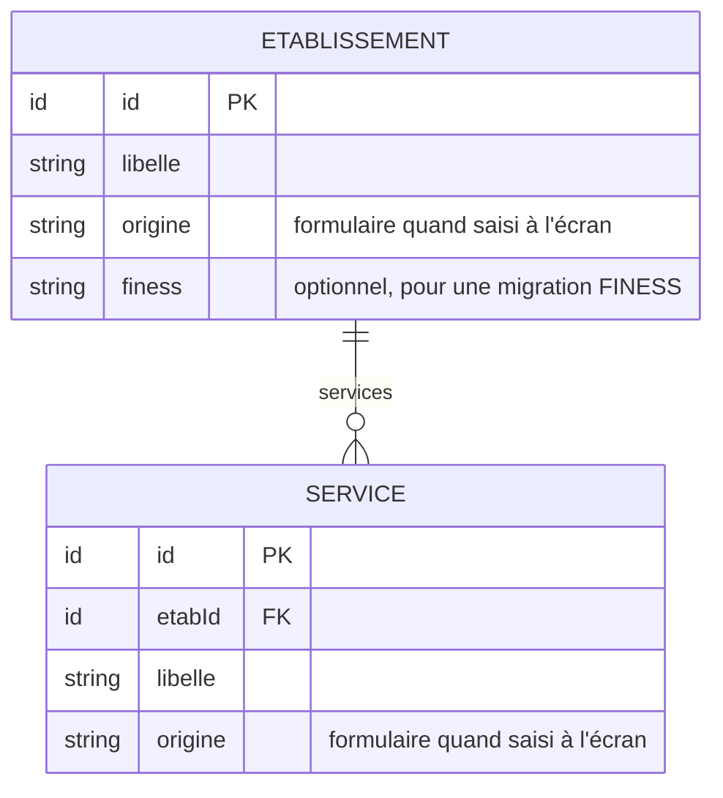

# Le rattachement à un établissement et un service

> Ce que le prescripteur déclare avant de simuler, ce que montre l'écran, et ce
> que porte le référentiel. Les décisions techniques sont dans
> [`../adr/`](../adr/), ADR-0004 à ADR-0009. Ce que l'écran écrit dans Grist est
> dans [`enrichissement-referentiel-rattachement.md`](enrichissement-referentiel-rattachement.md).
> Le vocabulaire est fixé dans [`../CONTEXT.md`](../CONTEXT.md).

## Ce que c'est

Le rattachement est une étape obligatoire, avant toute simulation : le
prescripteur déclare son établissement et son service. Il ne dit pas qui il
est : ni nom, ni prénom, ni liste de prescripteurs.

Le mot « identification » est réservé à une éventuelle authentification
individuelle future.

Trois contraintes :

- le prescripteur arrive par le CMS « Sites Conformes », un site tiers qu'on
  maîtrise peu ;
- le référentiel des établissements et des services est tenu à la main, sans
  lien avec les référentiels de la Sécurité sociale ou de la CNAM. Aucun FINESS
  officiel n'est branché ;
- le rattachement n'entre jamais dans les règles d'éligibilité, qui ne portent
  que le métier de l'éligibilité.

## Ce que montre l'écran

Une seule liste, « Établissement », sans phrase d'aide. Le simulateur s'ouvre
dès que le choix suffit (#197, #367).

```
Établissement ──────────────┬─ établissement du référentiel → Service ─┬─ service de la liste → simulateur
                            │                                          └─ « Autre » → nom du service → bouton
                            │  ──────── (trait de séparation) ────────
                            ├─ « Autre établissement » → nom de l'établissement, nom du service → bouton
                            ├─ « Libéral » → simulateur
                            ├─ « Assurance Maladie » → simulateur
                            └─ « Autre » → simulateur
```

| Cas | Ce qui se passe |
|---|---|
| un service de la liste, ou une structure | le simulateur s'ouvre sans bouton |
| une saisie libre | un bouton valide : on ne sait pas quand une saisie est finie |
| le service « Autre » d'un établissement | le prescripteur saisit son service réel, qui est écrit dans le référentiel et apparaît dans la liste à la visite suivante ; le parcours porte l'id du service créé (#506) |
| « Autre établissement » | le prescripteur saisit l'établissement puis le service ; les deux sont écrits, l'établissement reçoit son service « Autre » (#368), et le parcours porte leurs ids (#506) |
| le référentiel ne répond pas | l'écran le dit et laisse entrer ; le parcours part sans établissement ni service (#506) |

Changer d'écran au choix d'une liste est un changement de contexte (RGAA 7.4,
WCAG 3.2.2), assumé par le produit. Rien ne l'annonce, à la demande du porteur
(#367).

**Les structures.** « Libéral », « Assurance Maladie » et « Autre » s'affichent
sous le trait, toujours dans cet ordre. Ce sont des services d'un établissement
fourre-tout du référentiel, qui ne s'affiche pas. Ses autres services ne
s'affichent pas non plus. Le « Autre » des structures n'est pas une saisie
libre : il ouvre le simulateur.

**« Assurance Maladie »** ouvre la trace de debug sur tous les environnements
(#407, D-280). Les seeds et le choix du modèle restent en local (#373, D-279).

## Ce qui est interdit

Aucun nom de personne, aucun identifiant de patient, aucune donnée de santé.
Les noms saisis, d'un service ou d'un établissement, ne partent jamais à la
[mesure d'audience](mesure-d-audience.md) : un établissement saisi n'a pas d'id
de service, son événement part sans nom.

Le rattachement vit le temps de la session, en mémoire. Rien n'est gardé dans
le navigateur.

## Le référentiel



- Deux tables Grist : `Etablissements` (`Id2`, `Nom`, `Origine`) et
  `Services_Unites` (`Id2`, `Nom`, `Etablissement`, `Origine`). `Id2` est
  l'identifiant métier que l'app expose.
- L'établissement fourre-tout (`Id2 = 11`) porte les structures.
- `Origine` vaut `formulaire` sur une ligne créée depuis l'écran, établissement
  comme service : l'admin la repère, la corrige ou la retire dans Grist.
- Une table des prescripteurs existe encore dans Grist, tenue par l'admin.
  L'app ne la lit ni ne l'écrit depuis le 2026-09-29.
- Le champ `finess` est prévu, en optionnel, pour une migration vers le
  référentiel officiel.
