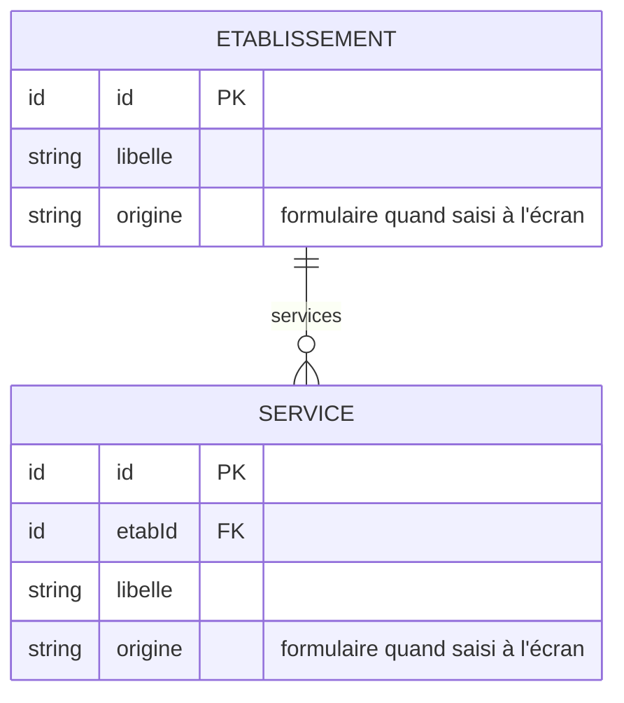

# Le rattachement à un établissement et un service

> Ce que le prescripteur déclare avant de simuler, ce que montre l'écran, ce que
> porte le référentiel et ce que l'écran y écrit. Les décisions techniques sont
> dans [`../adr/`](../adr/), ADR-0006 et ARCH-001. Le vocabulaire est fixé dans
> [`../CONTEXT.md`](../CONTEXT.md).

## Ce que c'est

Le rattachement est une étape obligatoire, avant toute simulation : le
prescripteur déclare son établissement et son service. Il ne dit pas qui il
est : ni nom, ni prénom, ni liste de prescripteurs.

Le mot « identification » est réservé à une éventuelle authentification
individuelle future.

Trois contraintes :

- le prescripteur arrive par le CMS « Sites Conformes », un site tiers qu'on
  maîtrise peu ;
- le référentiel des établissements et des services est tenu à la main, sans
  lien avec les référentiels de la Sécurité sociale ou de la CNAM. Aucun FINESS
  officiel n'est branché ;
- le rattachement n'entre jamais dans les règles d'éligibilité, qui ne portent
  que le métier de l'éligibilité.

## Ce que montre l'écran

Une seule liste, « Établissement », sans phrase d'aide. Le simulateur s'ouvre
dès que le choix suffit.

```
Établissement ──────────────┬─ établissement du référentiel → Service ─┬─ service de la liste → simulateur
                            │                                          └─ « Autre » → nom du service → bouton
                            │  ──────── (trait de séparation) ────────
                            ├─ « Autre établissement » → nom de l'établissement, nom du service → bouton
                            ├─ « Libéral » → simulateur
                            ├─ « Assurance Maladie » → simulateur
                            └─ « Autre » → simulateur
```

| Cas | Ce qui se passe |
|---|---|
| un service de la liste, ou une structure | le simulateur s'ouvre sans bouton |
| une saisie libre | un bouton valide : on ne sait pas quand une saisie est finie |
| le service « Autre » d'un établissement | le prescripteur saisit son service réel, qui est écrit dans le référentiel et apparaît dans la liste à la visite suivante ; le parcours porte l'id du service créé |
| « Autre établissement » | le prescripteur saisit l'établissement puis le service ; les deux sont écrits, l'établissement reçoit son service « Autre », et le parcours porte leurs ids |
| le référentiel ne répond pas | l'écran le dit et laisse entrer ; le parcours part sans établissement ni service |

Changer d'écran au choix d'une liste est un changement de contexte (RGAA 7.4,
WCAG 3.2.2), assumé par le produit. Rien ne l'annonce, à la demande du porteur.

**Les structures.** « Libéral », « Assurance Maladie » et « Autre » s'affichent
sous le trait, toujours dans cet ordre. Ce sont des services d'un établissement
fourre-tout du référentiel, qui ne s'affiche pas. Ses autres services ne
s'affichent pas non plus. Le « Autre » des structures n'est pas une saisie
libre : il ouvre le simulateur.

**« Assurance Maladie »** ouvre la trace de debug sur tous les environnements.
Les seeds et le choix du modèle restent en local.

## Ce qui est interdit

Aucun nom de personne, aucun identifiant de patient, aucune donnée de santé.
Les noms saisis, d'un service ou d'un établissement, ne partent jamais, ni à la
[mesure d'audience](mesure-d-audience.md) ni au journal : seuls partent les ids
que le référentiel leur donne.

Le rattachement vit le temps de la session, en mémoire. Rien n'est gardé dans
le navigateur : ni `localStorage`, ni URL.

Les identifiants du référentiel partent en clair, sans HMAC. Un HMAC protégeait
une personne, le prescripteur. Sans elle, il ne masquerait que des organisations,
et un id Grist se retrouve dans le référentiel sans secret. Il ne réglerait pas
non plus le cas d'un très petit service, qu'un HMAC déterministe désigne
toujours. Le rattachement est déclaratif et non signé : il n'a aucune valeur
probante.

## Le référentiel



- Deux tables Grist : `Etablissements` (`Id2`, `Nom`, `Origine`) et
  `Services_Unites` (`Id2`, `Nom`, `Etablissement`, `Origine`). `Id2` est
  l'identifiant métier que l'app expose.
- L'établissement fourre-tout (`Id2 = 11`) porte les structures.
- `Origine` vaut `formulaire` sur une ligne créée depuis l'écran, établissement
  comme service : l'admin la repère, la corrige ou la retire dans Grist.
- Le navigateur ne peut pas parler à Grist : sa clé est toute-puissante et Grist
  bloque le CORS. Le backend de l'app la détient, et sert le référentiel en
  same-origin. En production, il refuse de démarrer sans la clé ni l'adresse du
  document : son repli, un référentiel factice, n'est bon que pour un poste de
  développement, et le servir en production donnerait un simulateur
  silencieusement faux (`server/configuration.adapter.ts`).

## Ce que l'écran écrit dans le référentiel

Le texte libre d'une saisie enrichit le référentiel, pour que l'admin et les
prescripteurs suivants en bénéficient sans ressaisir. Seules les saisies libres
s'écrivent : un service choisi dans la liste n'apprend rien au référentiel.

- **Visible aussitôt.** La ligne créée reçoit un `Id2` : le plus grand de sa
  table, plus un.
- **Sans doublon.** Un nom déjà là, à la casse et aux espaces près, est
  réutilisé : sous le même établissement pour un service, dans toute la table
  pour un établissement.
- **L'établissement d'abord.** Un établissement saisi est créé ou réutilisé, avec
  son service « Autre » s'il est nouveau, puis son service sous lui.
- **Aucune personne dans Grist.** L'app n'écrit ni ne lit aucune donnée de
  personne.
- **Non bloquant.** Une écriture qui échoue n'empêche jamais d'entrer : le
  prescripteur passe sans les ids de sa saisie, et l'erreur est loguée.
- **Une attente bornée.** L'écran envoie la saisie (`POST /api/rattachement`) et
  attend les ids créés, cinq secondes au plus, pour que le parcours les porte dès
  cette visite. Le bouton dit « Ouverture du simulateur… » pendant ce temps.
- **Quarantaine à la collecte.** Le journal vérifie chaque paire contre le
  référentiel, lu en cache dix minutes (un id inconnu le relit, pour qu'une
  saisie tout juste créée passe). Un établissement inconnu, ou un service hors de
  son établissement, va dans `journal_quarantine` avec sa raison, et ne compte pas
  parmi les événements valides.

La colonne `Origine` doit exister sur `Services_Unites` et sur `Etablissements`.
Le détail des écritures et des réponses de la route est dans
`server/rattachement/referentiel-grist.adapter.ts` et
`rattachement.controller.ts`, que couvrent
`tests/socle/server/enrichissement.test.ts` et `referentiel-grist.test.ts` ; les ids
au parcours et la quarantaine, `tests/socle/rattachement/enregistrement-au-serveur.test.ts`
et `tests/socle/journal/collecte-du-rattachement.test.ts`.
