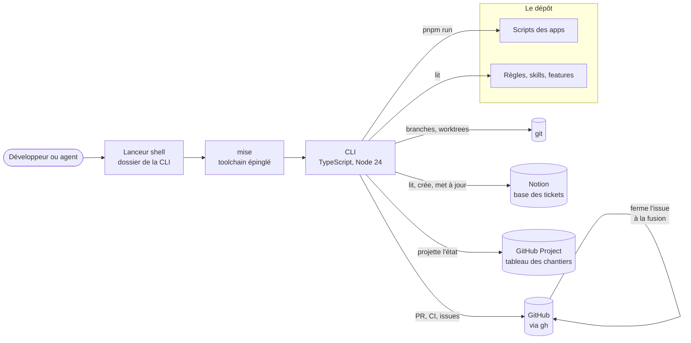

# ADR-0001 - Un lanceur shell adossé à `mise`

> Statut : **décidé** · 2026-10-12 · Anciennement ADR-1 de `cli.md`

**Contexte.** `tsp` doit être le premier geste sur une machine neuve. Or il est
écrit pour Node, que `mise` installe : il ne peut pas s'amorcer lui-même.

**Décision.** Un script shell POSIX, versionné dans le dossier de la CLI
(~~à la racine~~), sert de lanceur. Il
ne demande qu'un shell et `git`. Il exécute la CLI par `mise`, qui fournit le
Node épinglé. `setup` commence donc en shell : installer `mise`, puis le
toolchain. Tout le reste est en TypeScript.

Le lanceur agit sur le clone du répertoire courant. Hors de tout clone, il
retombe sur celui d'où il a été installé.

**Écarté.**

| Option | Pourquoi non |
|---|---|
| Un `bin` de paquet, résolu par pnpm | `tsp` n'existerait qu'après `pnpm install`, donc pas en premier |
| Un binaire compilé | une étape de build et un artefact par plateforme, pour une CLI interne |
| Le Node déjà présent sur la machine | sa version n'est pas garantie, et l'exécution directe de TypeScript en dépend |

**Conséquences.**

- `mise` devient un prérequis dur : sans lui, seul `setup` passe.
- Un agent dans un worktree exécute la CLI de ce worktree, donc la version qu'il
  modifie.
- La CLI n'a aucune dépendance d'exécution : elle doit démarrer avant que les
  dépendances soient installées.

## Ce qui a mené là

Piloter le dépôt demandait de retenir quatre outils (`mise`, `pnpm`, `git`,
`gh`), un tableau Notion et quatre trackers de specs, retirés depuis (ADR-0007).
Les scripts différaient
d'une app à l'autre, et le travail en cours ne se lisait nulle part d'un seul
tenant.

`tsp` répond à deux lecteurs :

- **le développeur**, qui veut moins de choses à retenir ;
- **l'agent**, qui veut des gestes à appeler et des sorties à lire sans deviner.

Le vocabulaire (app, action, feature, recueil, chantier, tâche, ticket) est dans
[`../CONTEXT.md`](../CONTEXT.md). Le mode d'emploi est dans le
[README de la CLI](../../../apps/cli/README.md).

## Architecture

| Composant | Rôle | Statut |
|---|---|---|
| Lanceur shell | choisit le clone, amorce `setup`, passe la main à Node par `mise` | |
| CLI | lit la ligne de commande, lance une commande, rend un code de sortie | |
| Scripts des apps | ce qu'une action exécute réellement | |
| Documentation du dépôt | la source de ce que les commandes de lecture affichent, hors chantiers | modifié |
| ~~Trackers de specs, `docs/tasks`~~ | ~~le cadrage, le découpage et l'état d'un chantier~~ | supprimé (ADR-0007) |
| `gh` | le seul accès à GitHub : PR, état de la CI, issues, sous-issues, blocages | modifié |
| Workflow de fermeture | ferme l'issue d'une PR fusionnée, d'après le numéro de sa branche | ajouté |
| GitHub Project | le kanban des issues, projeté par la CLI à sens unique (ADR-0008) | ajouté |
| API Notion | lecture des tickets par statut, création et mise à jour du ticket d'un chantier | modifié |

## Risques

| Id | Risque | État |
|---|---|---|
| R-5 | Le lanceur suppose `readlink -f`, absent des macOS antérieurs à 12.3 | Assumé |

## Mises à jour

> **Mise à jour 2026-10-12, emplacement du lanceur.** Le lanceur a quitté la
> racine du dépôt pour le dossier de la CLI. L'ADR-0001 tient toujours : seul
> l'endroit change, et le premier geste s'allonge d'un chemin.
