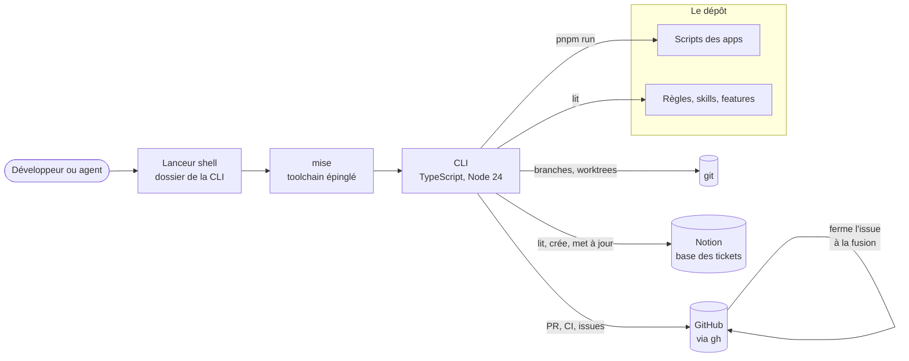

# Architecture : `tsp`, le point d'entrée du dépôt

> Statut : **décidé** · Dernière mise à jour : 2026-10-13

> **Mise à jour 2026-10-13, suivi par issues.** L'ADR-4 est renversé. Les specs
> et les tâches quittent le dépôt : un chantier est une issue GitHub, ses
> tâches sont ses sous-issues. L'ADR-6 dit pourquoi, et ce qui ferme une issue.
> La section 4 perd son absolu : l'état d'un chantier ne se lit plus dans un
> fichier.

> **Mise à jour 2026-10-12, emplacement du lanceur.** Le lanceur a quitté la
> racine du dépôt pour le dossier de la CLI. L'ADR-1 tient toujours : seul
> l'endroit change, et le premier geste s'allonge d'un chemin.

## 1. Contexte & objectifs

Piloter le dépôt demandait de retenir quatre outils (`mise`, `pnpm`, `git`,
`gh`), un tableau Notion et quatre trackers de specs, retirés depuis (ADR-6).
Les scripts différaient
d'une app à l'autre, et le travail en cours ne se lisait nulle part d'un seul
tenant.

`tsp` répond à deux lecteurs :

- **le développeur**, qui veut moins de choses à retenir ;
- **l'agent**, qui veut des gestes à appeler et des sorties à lire sans deviner.

Le vocabulaire (app, action, feature, recueil, chantier, tâche, ticket) est dans
[`../CONTEXT.md`](../CONTEXT.md). Le mode d'emploi est dans le
[README de la CLI](../../../apps/cli/README.md).

## 2. Décisions (ADR)

### ADR-1 - Un lanceur shell adossé à `mise`

**Contexte.** `tsp` doit être le premier geste sur une machine neuve. Or il est
écrit pour Node, que `mise` installe : il ne peut pas s'amorcer lui-même.

**Décision.** Un script shell POSIX, versionné dans le dossier de la CLI
(~~à la racine~~), sert de lanceur. Il
ne demande qu'un shell et `git`. Il exécute la CLI par `mise`, qui fournit le
Node épinglé. `setup` commence donc en shell : installer `mise`, puis le
toolchain. Tout le reste est en TypeScript.

Le lanceur agit sur le clone du répertoire courant. Hors de tout clone, il
retombe sur celui d'où il a été installé.

**Écarté.**

| Option | Pourquoi non |
|---|---|
| Un `bin` de paquet, résolu par pnpm | `tsp` n'existerait qu'après `pnpm install`, donc pas en premier |
| Un binaire compilé | une étape de build et un artefact par plateforme, pour une CLI interne |
| Le Node déjà présent sur la machine | sa version n'est pas garantie, et l'exécution directe de TypeScript en dépend |

**Conséquences.**

- `mise` devient un prérequis dur : sans lui, seul `setup` passe.
- Un agent dans un worktree exécute la CLI de ce worktree, donc la version qu'il
  modifie.
- La CLI n'a aucune dépendance d'exécution : elle doit démarrer avant que les
  dépendances soient installées.

### ADR-2 - Une action est un script du `package.json`

**Contexte.** Les apps ne savent pas faire les mêmes choses. Il faut que `tsp`
sache ce que chacune porte.

**Décision.** `tsp <action> <app>` lance le script du même nom. Une app porte
une action si le script existe. Il n'y a pas de manifeste dédié. Deux
exceptions : `install`, qui appelle `pnpm install`, et `features`, qui lit un
fichier.

**Écarté.** Un manifeste par app, qui aurait déclaré ses actions et ses
features. Il aurait doublé le `package.json`, et les deux auraient divergé.

**Conséquences.**

- Uniformiser une action revient à nommer un script : le simulateur et le
  glossaire ont gagné un script `dev`.
- `tsp` n'ajoute aucune porte. Le `verifier` d'une app reste son script, celui
  que lance la CI.

### ADR-3 - La CI et la production n'appellent pas `tsp`

**Décision.** La CI et le `Procfile` appellent `pnpm` en direct. `tsp` remplace
les tâches `mise`, qui n'étaient qu'un autre point d'entrée pour un humain.

**Conséquences.** Une panne de la CLI ne casse ni un déploiement ni une CI.
« La CI lance la même commande que localement » reste vrai, puisque `tsp`
délègue au même script.

### ADR-4 - L'issue fait foi, Notion la suit (~~la spec fait foi~~)

**Contexte.** L'équipe produit suit le travail dans Notion. Le cadrage
technique, lui, vit dans ~~les specs du dépôt~~ l'issue du chantier (ADR-6).

**Décision.** ~~Une spec a au plus un ticket.~~ Un chantier a au plus un
ticket, et ses tâches n'en ont pas : Notion ne porte que le suivi macro. La
synchronisation est à sens unique, ~~de la spec~~ de l'issue vers Notion.

- Le corps du ticket est écrit à sa création, puis jamais réécrit.
- Un statut ne recule jamais. Les statuts qu'aucun état de chantier ne produit
  se posent à la main.
- Le lien se garde des deux côtés : ~~dans l'en-tête de la spec~~ dans le corps
  de l'issue, et dans le ticket.

**Écarté.** Une synchronisation dans les deux sens. Elle aurait demandé de
trancher les conflits, pour un tableau dont l'équipe produit attend surtout
qu'on ne lui écrase rien.

**Conséquences.** Sans jeton, les commandes de lecture affichent le reste et le
disent. Seule la synchronisation s'arrête.

### ADR-6 - Un chantier est une issue, son état se déduit

**Contexte.** Le cadrage vivait dans `docs/specs`, le découpage dans
`docs/tasks`, l'état dans les deux, en prose. Sur un gros chantier, l'état
suivait la branche : invisible depuis `staging`, et recopié dans chaque
worktree. Aucune PR n'était rattachée à une tâche. On ne voyait ni ce qui était
fait, ni ce qui restait.

**Décision.** GitHub est la source unique du découpage et de l'état.

- Un chantier est une issue. Son corps porte le cadrage.
- Une tâche est une sous-issue, à la taille d'une PR. Une tâche peut avoir ses
  propres tâches.
- Un blocage est un lien natif entre deux issues.
- **L'état ne s'écrit nulle part.** Il se déduit de l'issue, de ses blocages, de
  sa branche et de sa PR.
- Une branche sert l'issue dont elle porte le numéro.
- La fusion d'une PR ferme son issue, par un workflow. GitHub ne le fait que
  pour une PR vers la branche par défaut, et toute PR vise ici `staging`.

Ce qui dure après le chantier quitte l'issue : une décision va dans un document
d'architecture, une connaissance métier dans `domain/`.

**Écarté.**

| Option | Pourquoi non |
|---|---|
| Garder les fichiers, avec un état structuré | l'état resterait sur une branche, et rédigé à la main |
| Des sous-tickets Notion | le tableau de l'équipe produit se remplirait d'items techniques |
| Un GitHub Project | un tableau de plus à administrer, quand l'issue parente montre déjà l'avancement |

**Conséquences.**

- Le cadrage n'est plus relu en PR ni versionné par git. L'historique des
  modifications de l'issue en tient lieu.
- Sans réseau ou sans `gh`, l'avancement ne se lit plus.
- Le dépôt est public : une issue l'est aussi. La confidentialité de
  `data-analyzer` vaut pour elle comme pour un commit.
- Le numéro d'issue se lit à deux endroits, la CLI et le workflow de fermeture.
  Ils doivent le lire de la même façon.

### ADR-5 - Pas de tests sur la CLI

**Décision.** Par choix du porteur, `apps/cli` n'a pas de tests. Son `verifier`
passe le lint, le typecheck et knip.

**Conséquences.**

- Une régression d'une commande se voit à l'usage, pas en CI.
- Les gardes de forme écrites en tests dans le simulateur ne couvrent pas la
  CLI. Seul Biome y garde les limites de taille.
- L'adresse de l'API Notion se remplace par l'environnement : c'est ce qui
  permet d'éprouver la synchronisation à la main, sur un serveur local.

## 3. Architecture cible



| Composant | Rôle | Statut |
|---|---|---|
| Lanceur shell | choisit le clone, amorce `setup`, passe la main à Node par `mise` | |
| CLI | lit la ligne de commande, lance une commande, rend un code de sortie | |
| Scripts des apps | ce qu'une action exécute réellement | |
| Documentation du dépôt | la source de ce que les commandes de lecture affichent, hors chantiers | modifié |
| ~~Trackers de specs, `docs/tasks`~~ | ~~le cadrage, le découpage et l'état d'un chantier~~ | supprimé (ADR-6) |
| `gh` | le seul accès à GitHub : PR, état de la CI, issues, sous-issues, blocages | modifié |
| Workflow de fermeture | ferme l'issue d'une PR fusionnée, d'après le numéro de sa branche | ajouté |
| API Notion | lecture des tickets par statut, création et mise à jour du ticket d'un chantier | modifié |

## 4. Les commandes de lecture ne possèdent rien

Aucune commande de lecture ne tient de donnée à elle. Chacune affiche ~~un
fichier que le dépôt tient déjà~~ ce qu'une source tient déjà : un fichier du
dépôt, ou GitHub pour les chantiers.

| Commande | Ce qu'elle lit |
|---|---|
| `features` | le `features.md` de chaque app |
| `rules` | les recueils de `docs/knowledge/contributing/` |
| `skills` | les skills du dépôt |
| `docs` | les dossiers `adr/` et `domain/` |
| `issue list`, `issue show` | les issues GitHub, les branches et les worktrees de git |
| `wip`, `next` | ~~les trackers, `docs/tasks`,~~ les issues, git, GitHub et Notion |
| `open` | la liste des outils, un fichier local jamais versionné |

Corriger ce que `tsp` affiche, c'est donc corriger la source : le fichier, ou
l'issue. L'état d'une tâche, lui, ne se corrige pas : il change quand sa branche
naît et quand sa PR est fusionnée.

`open` est la seule dont la source n'est pas dans le dépôt. Sa liste nomme
l'infrastructure du projet (hébergement, DNS, administration), et le dépôt est
public : elle suit le même régime que le `.env`, avec un gabarit neutre. Seul
`features.md` a été créé pour la CLI : rien ne décrivait les features d'une app.
Il se tient à la main et rien ne le garde.

## 5. Découpage en incréments

- ✅ Le lanceur et `setup`
- ✅ Les actions par app, à la place des tâches `mise`
- ✅ Les commandes de lecture locales
- ✅ `wip` et `next`, avec GitHub et Notion
- ✅ ~~La tenue des specs et leur ticket Notion~~, retirée (ADR-6)
- ✅ Les branches et les PR
- ✅ Le suivi des chantiers par issues, et leur ticket Notion
- ⬜ La migration de la v10 en issues

## 6. Risques & validations en attente

| Id | Risque | État |
|---|---|---|
| R-1 | La synchronisation Notion n'a été éprouvée que sur un serveur local qui joue l'API. Les noms de propriétés de la base réelle sont ceux relevés le 2026-10-09. | À valider avec un vrai jeton |
| R-2 | L'intégration Notion demande des droits d'écriture, à créer par un administrateur de l'espace | En attente |
| R-3 | `features.md` se périme sans garde | Assumé |
| R-4 | Sans tests, une régression ne se voit qu'à l'usage | Assumé (ADR-5) |
| R-5 | Le lanceur suppose `readlink -f`, absent des macOS antérieurs à 12.3 | Assumé |
| R-6 | Le workflow de fermeture n'a pas encore fermé une issue en conditions réelles | À valider à la première PR tirée d'une issue |
| R-7 | Une PR venue d'un fork n'a pas le droit de fermer une issue : le workflow échoue | Assumé, le dépôt n'a pas de contributeur externe |
| R-8 | `tsp issue list` lit au plus 1 000 issues et 1 000 PR | Assumé |

## Vérification

```bash
apps/cli/bin/tsp setup   # rejouable : finit par le diagnostic
tsp doctor           # ce qui manque, et la commande qui le répare
tsp apps             # chaque app et les actions qu'elle porte
tsp verifier cli     # lint, typecheck, knip
tsp wip              # sans jeton : le reste, et « Notion : jeton absent »
tsp issue list       # les chantiers ouverts et leur avancement
tsp issue show 43    # un chantier en arbre, avec branche, worktree et PR
```
